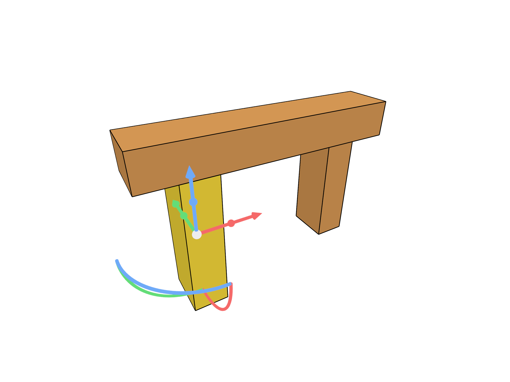
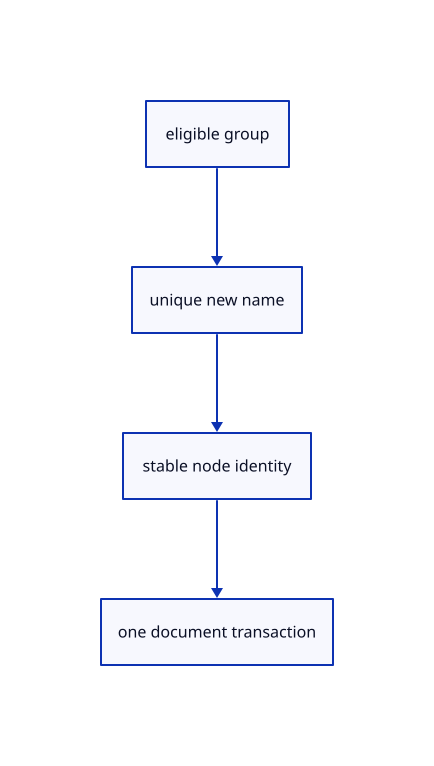

# 8.2.13 · Create and rename uniquely named layers

**Chapter 8 · Hierarchy, layers and direct editing · Section 8.2 · Layers and presentation** · [Contents](contents.md)

**Typing: 19–37 minutes.** [Estimate](typing-load.md).

Create a sibling or sublayer with a fresh stable identity. Trim new names, reject empty/slashed/used names, and preserve the current key through rename and Undo.

## Type

Continue from [Move and copy objects between layer trees](53j-transfers.md). [Save or recover your work](recovery.md).

### 1. `src/layer_edit.rs`

Create checked layer groups and rename labels without replacing their stable identities.

<details>
<summary>Locate the existing block</summary>

```rust
    Ok(())
}
```

</details>

After that block, type:

```rust
--8<-- "journey/code/53k-new-rename-01.rs" skip=14
```

## Run and check

In your project:

```sh
cd workspace/journey
REGEN_PROTO=0 cargo build --lib --locked --target wasm32-unknown-unknown -j1
REGEN_PROTO=0 CARGO_BUILD_JOBS=1 trunk serve --port 8780
```

Open `http://127.0.0.1:8780/`. Keep an existing Trunk server running; saving rebuilds it.


### Recorded visual result

**Source31 native image reviewed.**

The nested frame and selected editable parent remain visible with original source edges.



*Fresh Rust/NVIDIA raw-DPR4 presentation, personally reviewed at 2560 × 1920. The staged52k scene retains editable-parent selection and visible readonly attributes. Creating and renaming tree entries require separate state checks. Fixed-resolution pixel checks and browser controls require separate acceptance.*

This scene continues [8.1.12 · Exercise nested source ownership and exact undo](52k-tree.md). This checkpoint was captured independently; its new source behavior requires separate state checks.

<details>
<summary>Code explanation and diagram</summary>


eligible group → unique new name → stable node identity → one document transaction.



Does renaming the current layer change its identity?

No. Its stable node key remains unchanged, so current-layer selection follows the renamed record and returns through Undo.

Study estimate, including typing and experiments: 0.5–1 hours.

</details>

<details>
<summary>Optional experiment</summary>

Create Layer01 and a sublayer, then rename it. Try an empty name, a slash and an existing name; failures must preserve the redo branch.

</details>

<details>
<summary>Check and save your work</summary>

Restore experimental edits, then run from `session_viewer`:

```sh
npm --prefix ../session_tests run course -- check 8.2.13
npm --prefix ../session_tests run course -- save 8.2.13
```

Source comparison leaves your project untouched. [Save and recovery instructions](recovery.md).

</details>

<details>
<summary>Viewer coverage and verification</summary>

This cumulative subject implements layer editing and independent presentation for the mesh tree and generated geometry lanes already taught. General group placements, display-only streamed documents and later geometry types connect in their own subjects.

The earlier nested-frame acceptance exercise remains; the complete layer control exercise connects at the end of this subject.

[Full validation scope](release.md).

To reproduce the scripted acceptance of the reference checkpoint, run from `session_viewer` with the [course bundle server](release.md#reproduce) running on port 8781:

```sh
npm --prefix ../session_tests run course -- capture 8.2.13
```

This uses the verified reference bundle; it does not check or change your typed project.

</details>
