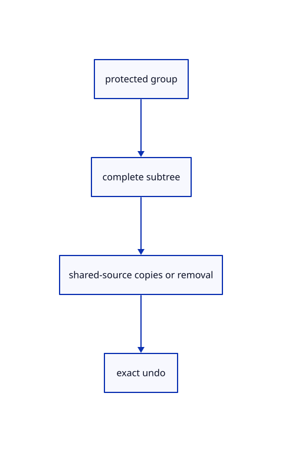

# 8.2.14 · Delete and duplicate complete layer contents

**Chapter 8 · Hierarchy, layers and direct editing · Section 8.2 · Layers and presentation** · [Contents](contents.md)

**Typing: 15–30 minutes.** [Estimate](typing-load.md).

Refuse root and current-layer deletion. Remove a group with every descendant, or duplicate its source-owned subtree and independent view flags as one edit.

## Type

Continue from [Create and rename uniquely named layers](53k-new-rename.md). [Save or recover your work](recovery.md).

### 1. `src/layer_edit.rs`

Delete protected subtrees and duplicate descendants while sharing original source geometry.

<details>
<summary>Locate the existing block</summary>

```rust
    let mut tree=branch(doc,0);let node=&mut find(&mut tree,&node.source.guid).unwrap().node;node.label=label.to_owned();node.source.name=label.to_owned();replace(scene,owner,tree);Ok(())
}
```

</details>

After that block, type:

```rust
--8<-- "journey/code/53l-delete-duplicate-01.rs" skip=191
```

## Run and check

In your project:

```sh
cd workspace/journey
REGEN_PROTO=0 cargo build --lib --locked --target wasm32-unknown-unknown -j1
REGEN_PROTO=0 CARGO_BUILD_JOBS=1 trunk serve --port 8780
```

Open `http://127.0.0.1:8780/`. Keep an existing Trunk server running; saving rebuilds it.


### Recorded visual result

**Previous native render — current verification pending.**

The nested frame and selected editable parent remain visible with original source edges.


*This recorded image predates a source or checker change. Rebuild this checkpoint before using it as current evidence; browser controls require separate acceptance.*

This reference image is shared with [8.1.12 · Exercise nested source ownership and exact undo](52k-tree.md). It does not demonstrate a new feature by itself.

<details>
<summary>Code explanation and diagram</summary>


protected group → complete subtree → shared-source copies or removal → exact undo.



Can deleting a layer leave its read-only attributes behind?

No. The complete layer subtree belongs to one deletion transaction. Undo restores all identities, source sharing and read-only ownership together.

Study estimate, including typing and experiments: 0.5–1 hours.

</details>

<details>
<summary>Optional experiment</summary>

Duplicate Posts, hide and lock the copy, then delete and undo it. The original and copy should keep separate identities and exact placements.

</details>

<details>
<summary>Check and save your work</summary>

Restore experimental edits, then run from `session_viewer`:

```sh
npm --prefix ../session_tests run course -- check 8.2.14
npm --prefix ../session_tests run course -- save 8.2.14
```

Source comparison leaves your project untouched. [Save and recovery instructions](recovery.md).

</details>

<details>
<summary>Viewer coverage and verification</summary>

This cumulative subject implements layer editing and independent presentation for the mesh tree and generated geometry lanes already taught. General group placements, display-only streamed documents and later geometry types connect in their own subjects.

The earlier nested-frame acceptance exercise remains; the complete layer control exercise connects at the end of this subject.

[Full validation scope](release.md).

To reproduce the scripted acceptance of the reference checkpoint, run from `session_viewer` with the [course bundle server](release.md#reproduce) running on port 8781:

```sh
npm --prefix ../session_tests run course -- capture 8.2.14
```

This uses the verified reference bundle; it does not check or change your typed project.

</details>
