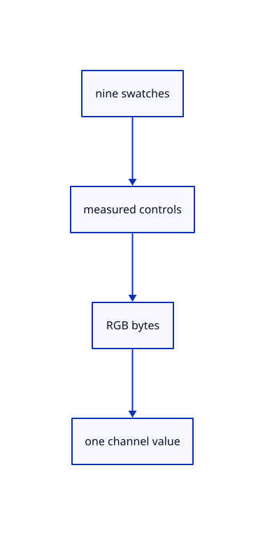

# 8.2.17 · Supply nine colour swatches and RGB sliders

**Chapter 8 · Hierarchy, layers and direct editing · Section 8.2 · Layers and presentation** · [Contents](contents.md)

**Typing: 13–26 minutes.** [Estimate](typing-load.md).

Provide the maintained palette and byte-range RGB sliders as measured egui controls. Each chosen colour belongs to one independent face or edge channel.

## Type

Continue from [Create geometry on the current layer or Created](53n-routing.md). [Save or recover your work](recovery.md).

### 1. `src/layer_palette.rs`

Draw maintained colour swatches and checked RGB sliders without editing source geometry.

Create the file and type:

```rust
--8<-- "journey/code/53o-palette-01.rs"
```

### 2. `src/lib.rs`

Register the new source component.

<details>
<summary>Locate the existing block</summary>

```rust

pub mod layer_edit;
```

</details>

After that block, type:

```rust
--8<-- "journey/code/53o-palette-02.rs" skip=21
```

## Run and check

In your project:

```sh
cd workspace/journey
REGEN_PROTO=0 cargo build --lib --locked --target wasm32-unknown-unknown -j1
REGEN_PROTO=0 CARGO_BUILD_JOBS=1 trunk serve --port 8780
```

Open `http://127.0.0.1:8780/`. Keep an existing Trunk server running; saving rebuilds it.


### Recorded visual result

**Previous native render — current verification pending.**

The nested frame and selected editable parent remain visible with original source edges.


*This recorded image predates a source or checker change. Rebuild this checkpoint before using it as current evidence; browser controls require separate acceptance.*

This reference image is shared with [8.1.12 · Exercise nested source ownership and exact undo](52k-tree.md). It does not demonstrate a new feature by itself.

<details>
<summary>Code explanation and diagram</summary>


nine swatches → measured controls → RGB bytes → one channel value.



Why return an RGB value from the palette helper?

It keeps drawing controls separate from editing scene presentation. The caller resolves the row identity and applies the selected channel.

Study estimate, including typing and experiments: 0.5–1 hours.

</details>

<details>
<summary>Optional experiment</summary>

Compare Red Orange Yellow Green Blue Violet White Gray Black with a custom RGB value. Source colours should remain available through Original.

</details>

<details>
<summary>Check and save your work</summary>

Restore experimental edits, then run from `session_viewer`:

```sh
npm --prefix ../session_tests run course -- check 8.2.17
npm --prefix ../session_tests run course -- save 8.2.17
```

Source comparison leaves your project untouched. [Save and recovery instructions](recovery.md).

</details>

<details>
<summary>Viewer coverage and verification</summary>

This cumulative subject implements layer editing and independent presentation for the mesh tree and generated geometry lanes already taught. General group placements, display-only streamed documents and later geometry types connect in their own subjects.

The earlier nested-frame acceptance exercise remains; the complete layer control exercise connects at the end of this subject.

[Full validation scope](release.md).

To reproduce the scripted acceptance of the reference checkpoint, run from `session_viewer` with the [course bundle server](release.md#reproduce) running on port 8781:

```sh
npm --prefix ../session_tests run course -- capture 8.2.17
```

This uses the verified reference bundle; it does not check or change your typed project.

</details>
