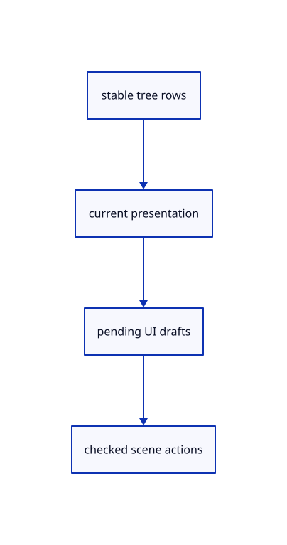

# 8.2.18 · Resolve layer presentation for real tree controls

**Chapter 8 · Hierarchy, layers and direct editing · Section 8.2 · Layers and presentation** · [Contents](contents.md)

**Typing: 19–37 minutes.** [Estimate](typing-load.md).

Refresh tree rows with their current visibility, lock state, colour channels and eligible group actions. Keep rename and confirmation drafts outside document history.

## Type

Continue from [Supply nine colour swatches and RGB sliders](53o-palette.md). [Save or recover your work](recovery.md).

### 1. `src/tree_panel.rs`

Keep row presentation and pending layer drafts separate from source and history ownership.

<details>
<summary>Locate the existing block</summary>

```rust
use crate::{hierarchy::Row,scene::ObjectId};
#[cfg(any(test,target_arch="wasm32"))]
use crate::command_dock::{Control,record};
use std::collections::HashSet;

#[derive(Default)]
pub struct TreePanel {pub open:bool,pub rows:Vec<Row>,pub selected:Vec<ObjectId>,expanded:HashSet<String>,pub rect:Option<egui::Rect>,pub action:Option<(Vec<ObjectId>,bool)>,page:usize}
impl TreePanel {
    pub fn refresh(&mut self,scene:&crate::scene::Scene,selected:Vec<ObjectId>) {self.rows=crate::hierarchy::rows(scene);self.selected=selected;}
    pub fn all(&mut self) {self.open=true;self.expanded.extend(self.rows.iter().enumerate().filter(|(index,r)|r.end>*index+1).map(|(_,r)|r.key.clone()));self.page=0;}
    pub fn visible(&self)->Vec<usize> {
        let mut out=Vec::new();let mut index=0;
        while index<self.rows.len() {out.push(index);let row=&self.rows[index];index=if self.expanded.contains(&row.key) {index+1} else {row.end.max(index+1)};}
        out
    }
}

#[cfg(any(test,target_arch="wasm32"))]
pub fn draw(root:&mut egui::Ui,model:&mut TreePanel,controls:&mut Option<Vec<Control>>) {
    model.rect=None;if !model.open {return;}
    let visible=model.visible();let pages=visible.len().div_ceil(128).max(1);model.page=model.page.min(pages-1);
    let response=egui::Area::new("session-tree".into()).anchor(egui::Align2::RIGHT_TOP,egui::vec2(-8.,8.)).order(egui::Order::Foreground).show(root.ctx(),|ui| {
        egui::Frame::group(ui.style()).fill(egui::Color32::from_rgb(248,248,248)).show(ui,|ui| {
            ui.set_width(240.);ui.horizontal(|ui| {ui.strong("Layers");let close=ui.button("×");record(controls,"tree/close","Close Layers",&close);if close.clicked() {model.open=false;}});
            if pages>1 {ui.horizontal(|ui| {if ui.button("Previous").clicked() {model.page=model.page.saturating_sub(1);}ui.label(format!("{} / {pages}",model.page+1));if ui.button("Next").clicked() {model.page=(model.page+1).min(pages-1);}});}
            let height=(root.max_rect().height()-100.).max(60.);
            egui::ScrollArea::vertical().max_height(height).show(ui,|ui| {
                for &index in visible.iter().skip(model.page*128).take(128) {
                    let row=&model.rows[index];ui.horizontal(|ui| {
                        ui.add_space(row.depth.min(12) as f32*12.);
                        if row.end>index+1 {let arrow=ui.small_button(if model.expanded.contains(&row.key) {"▾"} else {"▸"});record(controls,&format!("tree/open/{}",row.key),"Expand or collapse",&arrow);if arrow.clicked() {if !model.expanded.insert(row.key.clone()) {model.expanded.remove(&row.key);}}} else {ui.add_space(18.);}
                        let selected=row.ids.iter().any(|id|model.selected.contains(id));
                        let label=if row.label.is_empty() {row.ids.first().map_or("Group".into(),|id|format!("Object {}",id.value()))} else {row.label.clone()};
                        let button=ui.add_enabled(!row.readonly && !row.ids.is_empty(),egui::Button::new(format!("{label} ({})",row.ids.len())).selected(selected)).on_disabled_hover_text("Source attribute: read only; edit its parent");
                        record(controls,&format!("tree/select/{}",row.key),&label,&button);
                        if button.clicked() {model.action=Some((row.ids.clone(),ui.input(|input|input.modifiers.shift)));}
                    });
                }
            });
        });
    });model.rect=model.open.then_some(response.response.rect);
}
```

</details>

Edit the existing block to match this code; keep unchanged lines:

```rust
use crate::{hierarchy::Row,scene::ObjectId};
#[cfg(any(test,target_arch="wasm32"))]
use crate::command_dock::{Control,record};
use std::collections::HashSet;

#[derive(Default)]
pub struct TreePanel {pub edit:Option<(String,crate::layer_edit::Edit)>,pub rename:Option<(String,String)>,pub rename_error:String,rename_focus:bool,pub confirm:Option<(String,usize)>,pub property:Option<(String,crate::layer_properties::Property)>,pub menu_rects:Vec<egui::Rect>,states:std::collections::HashMap<String,RowState>,pub open:bool,pub rows:Vec<Row>,pub selected:Vec<ObjectId>,expanded:HashSet<String>,pub rect:Option<egui::Rect>,pub action:Option<(Vec<ObjectId>,bool)>,page:usize}
impl TreePanel {
    pub fn refresh(&mut self,scene:&crate::scene::Scene,selected:Vec<ObjectId>) {
        self.rows=crate::hierarchy::rows(scene);self.selected=selected;self.states=self.rows.iter().map(|row|(row.key.clone(),RowState {hidden:scene.view.lamps.contains(&row.key)||!row.ids.is_empty()&&row.ids.iter().all(|id|scene.view.hidden.contains(id)),locked:!row.ids.is_empty()&&row.ids.iter().all(|id|scene.view.locked.contains(id)),selectable:row.ids.iter().any(|id|scene.pick_id(id.value()).is_some()),current:crate::layer_edit::current_key(scene).as_ref()==Some(&row.key),has_faces:row.ids.iter().any(|id|scene.objects().iter().any(|mesh|mesh.id==*id)),colours:[row.ids.iter().find_map(|id|scene.view.faces.get(id).copied()),row.ids.iter().find_map(|id|scene.view.edges.get(id).copied())],group:crate::layer_edit::locate(scene,&row.key).is_ok(),root:row.depth==0,holds_current:crate::layer_edit::holds_current(scene,&row.key)})).collect();
    }
    pub fn rename_result(&mut self,error:Option<&str>) {if let Some(error)=error {self.rename_error=error.into();self.rename_focus=true;} else {self.rename=None;self.rename_error.clear();}}
    pub fn all(&mut self) {self.open=true;self.expanded.extend(self.rows.iter().enumerate().filter(|(index,r)|r.end>*index+1).map(|(_,r)|r.key.clone()));self.page=0;}
    pub fn visible(&self)->Vec<usize> {
        let mut out=Vec::new();let mut index=0;
        while index<self.rows.len() {out.push(index);let row=&self.rows[index];index=if self.expanded.contains(&row.key) {index+1} else {row.end.max(index+1)};}
        out
    }
}

#[cfg(any(test,target_arch="wasm32"))]
pub fn draw(root:&mut egui::Ui,model:&mut TreePanel,controls:&mut Option<Vec<Control>>) {
    model.rect=None;if !model.open {return;}
    let visible=model.visible();let pages=visible.len().div_ceil(128).max(1);model.page=model.page.min(pages-1);
    let response=egui::Area::new("session-tree".into()).anchor(egui::Align2::RIGHT_TOP,egui::vec2(-8.,8.)).order(egui::Order::Foreground).show(root.ctx(),|ui| {
        egui::Frame::group(ui.style()).fill(egui::Color32::from_rgb(248,248,248)).show(ui,|ui| {
            ui.set_width(240.);ui.horizontal(|ui| {ui.strong("Layers");let close=ui.button("×");record(controls,"tree/close","Close Layers",&close);if close.clicked() {model.open=false;}});
            if pages>1 {ui.horizontal(|ui| {if ui.button("Previous").clicked() {model.page=model.page.saturating_sub(1);}ui.label(format!("{} / {pages}",model.page+1));if ui.button("Next").clicked() {model.page=(model.page+1).min(pages-1);}});}
            let height=(root.max_rect().height()-100.).max(60.);
            egui::ScrollArea::vertical().max_height(height).show(ui,|ui| {
                for &index in visible.iter().skip(model.page*128).take(128) {
                    let row=&model.rows[index];ui.horizontal(|ui| {
                        ui.add_space(row.depth.min(12) as f32*12.);
                        if row.end>index+1 {let arrow=ui.small_button(if model.expanded.contains(&row.key) {"▾"} else {"▸"});record(controls,&format!("tree/open/{}",row.key),"Expand or collapse",&arrow);if arrow.clicked() {if !model.expanded.insert(row.key.clone()) {model.expanded.remove(&row.key);}}} else {ui.add_space(18.);}
                        let selected=row.ids.iter().any(|id|model.selected.contains(id));
                        let label=if row.label.is_empty() {row.ids.first().map_or("Group".into(),|id|format!("Object {}",id.value()))} else {row.label.clone()};
                        let button=ui.add_enabled(!row.readonly && !row.ids.is_empty(),egui::Button::new(format!("{label} ({})",row.ids.len())).selected(selected)).on_disabled_hover_text("Source attribute: read only; edit its parent");
                        record(controls,&format!("tree/select/{}",row.key),&label,&button);
                        if button.clicked() {model.action=Some((row.ids.clone(),ui.input(|input|input.modifiers.shift)));}
                    });
                }
            });
        });
    });model.rect=model.open.then_some(response.response.rect);
}
#[derive(Clone,Copy,Default)]
struct RowState {hidden:bool,locked:bool,selectable:bool,current:bool,has_faces:bool,colours:[Option<[u8;3]>;2],group:bool,root:bool,holds_current:bool}
```

<details>
<summary>Optional patch references</summary>

Use these original edit fragments when comparing a saved checkpoint. Apply the complete blocks above.

```text
--8<-- "journey/code/53p-panel-state-01.rs"
```

```text
--8<-- "journey/code/53p-panel-state-02.rs"
```

</details>

## Run and check

In your project:

```sh
cd workspace/journey
REGEN_PROTO=0 cargo build --lib --locked --target wasm32-unknown-unknown -j1
REGEN_PROTO=0 CARGO_BUILD_JOBS=1 trunk serve --port 8780
```

Open `http://127.0.0.1:8780/`. Keep an existing Trunk server running; saving rebuilds it.


### Recorded visual result

**Previous native render — current verification pending.**

The nested frame and selected editable parent remain visible with original source edges.


*This recorded image predates a source or checker change. Rebuild this checkpoint before using it as current evidence; browser controls require separate acceptance.*

This reference image is shared with [8.1.12 · Exercise nested source ownership and exact undo](52k-tree.md). It does not demonstrate a new feature by itself.

<details>
<summary>Code explanation and diagram</summary>


stable tree rows → current presentation → pending UI drafts → checked scene actions.



Does a layer-name draft change saved geometry?

No. Draft text and error messages belong to the panel. The document changes only after a checked rename action succeeds.

Study estimate, including typing and experiments: 0.5–1 hours.

</details>

<details>
<summary>Optional experiment</summary>

Compare a hidden row, locked row and empty layer. Empty groups still need a context menu even though they contain no selectable geometry.

</details>

<details>
<summary>Check and save your work</summary>

Restore experimental edits, then run from `session_viewer`:

```sh
npm --prefix ../session_tests run course -- check 8.2.18
npm --prefix ../session_tests run course -- save 8.2.18
```

Source comparison leaves your project untouched. [Save and recovery instructions](recovery.md).

</details>

<details>
<summary>Viewer coverage and verification</summary>


The earlier nested-frame acceptance exercise remains; the complete layer control exercise connects at the end of this subject.

[Full validation scope](release.md).

To reproduce the scripted acceptance of the reference checkpoint, run from `session_viewer` with the [course bundle server](release.md#reproduce) running on port 8781:

```sh
npm --prefix ../session_tests run course -- capture 8.2.18
```

This uses the verified reference bundle; it does not check or change your typed project.

</details>
