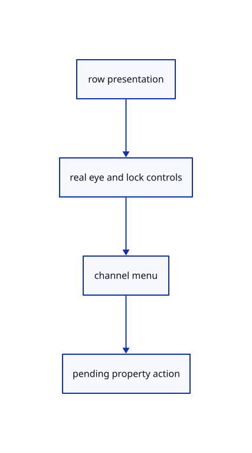

# 8.2.19 · Draw eye lock and independent colour menus

**Chapter 8 · Hierarchy, layers and direct editing · Section 8.2 · Layers and presentation** · [Contents](contents.md)

**Typing: 22–43 minutes.** [Estimate](typing-load.md).

Use actual measured eye, lock and colour controls. The current layer cannot be hidden; Faces and Edges expose separate Original, swatch and RGB choices.

## Type

Continue from [Resolve layer presentation for real tree controls](53p-panel-state.md). [Save or recover your work](recovery.md).

### 1. `src/tree_panel.rs`

Draw actual layer property controls and record colour-popup rectangles for input ownership.

<details>
<summary>Locate the existing block</summary>

```rust
struct RowState {hidden:bool,locked:bool,selectable:bool,current:bool,has_faces:bool,colours:[Option<[u8;3]>;2],group:bool,root:bool,holds_current:bool}
```

</details>

After that block, type:

```rust
--8<-- "journey/code/53q-properties-ui-01.rs" skip=154
```

## Run and check

In your project:

```sh
cd workspace/journey
REGEN_PROTO=0 cargo build --lib --locked --target wasm32-unknown-unknown -j1
REGEN_PROTO=0 CARGO_BUILD_JOBS=1 trunk serve --port 8780
```

Open `http://127.0.0.1:8780/`. Keep an existing Trunk server running; saving rebuilds it.


### Recorded visual result

**Previous native render — current verification pending.**

The nested frame and selected editable parent remain visible with original source edges.


*This recorded image predates a source or checker change. Rebuild this checkpoint before using it as current evidence; browser controls require separate acceptance.*

This reference image is shared with [8.1.12 · Exercise nested source ownership and exact undo](52k-tree.md). It does not demonstrate a new feature by itself.

<details>
<summary>Code explanation and diagram</summary>


row presentation → real eye and lock controls → channel menu → pending property action.



Should a colour popup outside the panel allow canvas picking underneath?

No. Its measured rectangle owns pointer and wheel input until the popup closes. The canvas resumes ownership outside panel controls.

Study estimate, including typing and experiments: 0.5–1 hours.

</details>

<details>
<summary>Optional experiment</summary>

Open the Edges menu, choose green, then restore Faces Original. Inspect the unchanged edge channel and original source colours.

</details>

<details>
<summary>Check and save your work</summary>

Restore experimental edits, then run from `session_viewer`:

```sh
npm --prefix ../session_tests run course -- check 8.2.19
npm --prefix ../session_tests run course -- save 8.2.19
```

Source comparison leaves your project untouched. [Save and recovery instructions](recovery.md).

</details>

<details>
<summary>Viewer coverage and verification</summary>

This cumulative subject implements layer editing and independent presentation for the mesh tree and generated geometry lanes already taught. General group placements, display-only streamed documents and later geometry types connect in their own subjects.

The earlier nested-frame acceptance exercise remains; the complete layer control exercise connects at the end of this subject.

[Full validation scope](release.md).

To reproduce the scripted acceptance of the reference checkpoint, run from `session_viewer` with the [course bundle server](release.md#reproduce) running on port 8781:

```sh
npm --prefix ../session_tests run course -- capture 8.2.19
```

This uses the verified reference bundle; it does not check or change your typed project.

</details>
