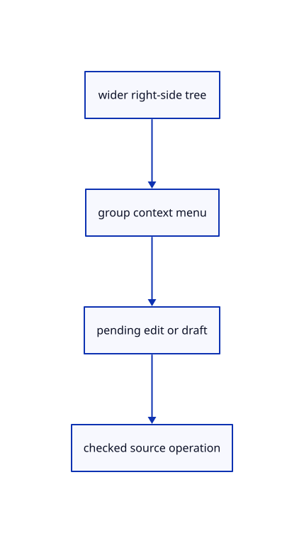

# 8.2.21 · Connect group menus to the wider tree panel

**Chapter 8 · Hierarchy, layers and direct editing · Section 8.2 · Layers and presentation** · [Contents](contents.md)

**Typing: 28–55 minutes.** [Estimate](typing-load.md).

Make empty groups respond to context menus. Expose current, new, sublayer, rename, duplicate, move, copy and protected deletion through real tree controls.

## Type

Continue from [Own rename text and populated deletion confirmation](53r-name.md). [Save or recover your work](recovery.md).

### 1. `src/tree_panel.rs`

Connect measured group menus and property controls while preserving read-only source selection guards.

Edit these blocks from bottom to top. Keep the surrounding lines unchanged.

<details>
<summary>Locate this block</summary>

```rust

#[cfg(any(test,target_arch="wasm32"))]
pub fn draw(root:&mut egui::Ui,model:&mut TreePanel,controls:&mut Option<Vec<Control>>) {
    model.rect=None;if !model.open {return;}
    let visible=model.visible();let pages=visible.len().div_ceil(128).max(1);model.page=model.page.min(pages-1);
    let response=egui::Area::new("session-tree".into()).anchor(egui::Align2::RIGHT_TOP,egui::vec2(-8.,8.)).order(egui::Order::Foreground).show(root.ctx(),|ui| {
        egui::Frame::group(ui.style()).fill(egui::Color32::from_rgb(248,248,248)).show(ui,|ui| {
            ui.set_width(240.);ui.horizontal(|ui| {ui.strong("Layers");let close=ui.button("×");record(controls,"tree/close","Close Layers",&close);if close.clicked() {model.open=false;}});
            if pages>1 {ui.horizontal(|ui| {if ui.button("Previous").clicked() {model.page=model.page.saturating_sub(1);}ui.label(format!("{} / {pages}",model.page+1));if ui.button("Next").clicked() {model.page=(model.page+1).min(pages-1);}});}
            let height=(root.max_rect().height()-100.).max(60.);
            egui::ScrollArea::vertical().max_height(height).show(ui,|ui| {
                for &index in visible.iter().skip(model.page*128).take(128) {
                    let row=&model.rows[index];ui.horizontal(|ui| {
                        ui.add_space(row.depth.min(12) as f32*12.);
                        if row.end>index+1 {let arrow=ui.small_button(if model.expanded.contains(&row.key) {"▾"} else {"▸"});record(controls,&format!("tree/open/{}",row.key),"Expand or collapse",&arrow);if arrow.clicked() {if !model.expanded.insert(row.key.clone()) {model.expanded.remove(&row.key);}}} else {ui.add_space(18.);}
                        let selected=row.ids.iter().any(|id|model.selected.contains(id));
                        let label=if row.label.is_empty() {row.ids.first().map_or("Group".into(),|id|format!("Object {}",id.value()))} else {row.label.clone()};
                        let button=ui.add_enabled(!row.readonly && !row.ids.is_empty(),egui::Button::new(format!("{label} ({})",row.ids.len())).selected(selected)).on_disabled_hover_text("Source attribute: read only; edit its parent");
                        record(controls,&format!("tree/select/{}",row.key),&label,&button);
                        if button.clicked() {model.action=Some((row.ids.clone(),ui.input(|input|input.modifiers.shift)));}
                    });
                }
            });
        });
    });model.rect=model.open.then_some(response.response.rect);
}
#[derive(Clone,Copy,Default)]
struct RowState {hidden:bool,locked:bool,selectable:bool,current:bool,has_faces:bool,colours:[Option<[u8;3]>;2],group:bool,root:bool,holds_current:bool}
```

</details>

Replace it with:

```rust

#[cfg(any(test,target_arch="wasm32"))]
pub fn draw(root:&mut egui::Ui,model:&mut TreePanel,controls:&mut Option<Vec<Control>>) {
    model.rect=None;model.menu_rects.clear();if !model.open {return;}
    let visible=model.visible();let pages=visible.len().div_ceil(128).max(1);model.page=model.page.min(pages-1);
    let response=egui::Area::new("session-tree".into()).anchor(egui::Align2::RIGHT_TOP,egui::vec2(-8.,8.)).order(egui::Order::Foreground).show(root.ctx(),|ui| {
        egui::Frame::group(ui.style()).fill(egui::Color32::from_rgb(248,248,248)).show(ui,|ui| {
            ui.set_width((root.available_width()/3.).clamp(240.,413.33334));ui.set_height((root.max_rect().height()-32.).max(60.));ui.horizontal(|ui| {ui.strong("Layers");let close=ui.button("×");record(controls,"tree/close","Close Layers",&close);if close.clicked() {model.open=false;}});
            dialogs(ui,model,controls);
            if pages>1 {ui.horizontal(|ui| {if ui.button("Previous").clicked() {model.page=model.page.saturating_sub(1);}ui.label(format!("{} / {pages}",model.page+1));if ui.button("Next").clicked() {model.page=(model.page+1).min(pages-1);}});}
            let height=(root.max_rect().height()-100.).max(60.);
            egui::ScrollArea::vertical().max_height(height).show(ui,|ui| {
                for &index in visible.iter().skip(model.page*128).take(128) {
                    let row=model.rows[index].clone();let state=model.states.get(&row.key).copied().unwrap_or_default();ui.push_id(&row.key,|ui|ui.horizontal(|ui| {
                        ui.add_space(row.depth.min(12) as f32*12.);
                        if row.end>index+1 {let arrow=ui.small_button(if model.expanded.contains(&row.key) {"▾"} else {"▸"});record(controls,&format!("tree/open/{}",row.key),"Expand or collapse",&arrow);if arrow.clicked() {if !model.expanded.insert(row.key.clone()) {model.expanded.remove(&row.key);}}} else {ui.add_space(18.);}
                        let selected=row.ids.iter().any(|id|model.selected.contains(id));
                        let label=if row.label.is_empty() {row.ids.first().map_or("Group".into(),|id|format!("Object {}",id.value()))} else {row.label.clone()};
                        let label_width=(ui.available_width()-90.).max(24.);
                        let button=ui.add_enabled_ui(state.group || !row.readonly && state.selectable,|ui|ui.add_sized([label_width,20.],egui::Button::new(format!("{label} ({})",row.ids.len())).selected(selected).truncate())).inner.on_hover_text(&label).on_disabled_hover_text("Source attribute: read only; edit its parent");
                        record(controls,&format!("tree/select/{}",row.key),&label,&button);
                        if button.clicked() && state.selectable {model.action=Some((row.ids.clone(),ui.input(|input|input.modifiers.shift)));}
                        if state.group {if let Some(menu)=egui::Popup::context_menu(&button).show(|ui| {
                            use crate::layer_edit::Edit;
                            for (name,edit,enabled) in [("Set current",Some(Edit::Current),true),("New layer",Some(Edit::New {sublayer:false}),true),("New sublayer",Some(Edit::New {sublayer:true}),true),("Duplicate layer",Some(Edit::Duplicate),!state.root),("Change object layer",Some(Edit::Move(model.selected.clone())),!model.selected.is_empty()),("Copy object layer",Some(Edit::Copy(model.selected.clone())),!model.selected.is_empty()),("Rename",None,!state.root),("Delete",Some(Edit::Delete),!state.root&&!state.holds_current)] {
                                let button=ui.add_enabled(enabled,egui::Button::new(name));record(controls,&format!("layer/menu/{}/{name}",row.key),name,&button);
                                if button.clicked() {
                                    if name=="Rename" {model.rename=Some((row.key.clone(),row.label.clone()));model.rename_error.clear();model.rename_focus=true;}
                                    else if name=="Delete"&&!row.ids.is_empty() {model.confirm=Some((row.key.clone(),row.ids.len()));}
                                    else {model.edit=Some((row.key.clone(),edit.unwrap()));}
                                    ui.close();
                                }
                            }
                        }) {model.menu_rects.push(menu.response.rect);}}
                        properties(ui,&row.key,state,&mut model.property,&mut model.menu_rects,controls);
                    }));
                }
            });
        });
    });model.rect=model.open.then_some(response.response.rect);
}

#[derive(Clone,Copy,Default)]
struct RowState {hidden:bool,locked:bool,selectable:bool,current:bool,has_faces:bool,colours:[Option<[u8;3]>;2],group:bool,root:bool,holds_current:bool}
```

<details>
<summary>Complete updated block reference</summary>

```rust
use crate::{hierarchy::Row,scene::ObjectId};
#[cfg(any(test,target_arch="wasm32"))]
use crate::command_dock::{Control,record};
use std::collections::HashSet;

#[derive(Default)]
pub struct TreePanel {pub edit:Option<(String,crate::layer_edit::Edit)>,pub rename:Option<(String,String)>,pub rename_error:String,rename_focus:bool,pub confirm:Option<(String,usize)>,pub property:Option<(String,crate::layer_properties::Property)>,pub menu_rects:Vec<egui::Rect>,states:std::collections::HashMap<String,RowState>,pub open:bool,pub rows:Vec<Row>,pub selected:Vec<ObjectId>,expanded:HashSet<String>,pub rect:Option<egui::Rect>,pub action:Option<(Vec<ObjectId>,bool)>,page:usize}
impl TreePanel {
    pub fn refresh(&mut self,scene:&crate::scene::Scene,selected:Vec<ObjectId>) {
        self.rows=crate::hierarchy::rows(scene);self.selected=selected;self.states=self.rows.iter().map(|row|(row.key.clone(),RowState {hidden:scene.view.lamps.contains(&row.key)||!row.ids.is_empty()&&row.ids.iter().all(|id|scene.view.hidden.contains(id)),locked:!row.ids.is_empty()&&row.ids.iter().all(|id|scene.view.locked.contains(id)),selectable:row.ids.iter().any(|id|scene.pick_id(id.value()).is_some()),current:crate::layer_edit::current_key(scene).as_ref()==Some(&row.key),has_faces:row.ids.iter().any(|id|scene.objects().iter().any(|mesh|mesh.id==*id)),colours:[row.ids.iter().find_map(|id|scene.view.faces.get(id).copied()),row.ids.iter().find_map(|id|scene.view.edges.get(id).copied())],group:crate::layer_edit::locate(scene,&row.key).is_ok(),root:row.depth==0,holds_current:crate::layer_edit::holds_current(scene,&row.key)})).collect();
    }
    pub fn rename_result(&mut self,error:Option<&str>) {if let Some(error)=error {self.rename_error=error.into();self.rename_focus=true;} else {self.rename=None;self.rename_error.clear();}}
    pub fn all(&mut self) {self.open=true;self.expanded.extend(self.rows.iter().enumerate().filter(|(index,r)|r.end>*index+1).map(|(_,r)|r.key.clone()));self.page=0;}
    pub fn visible(&self)->Vec<usize> {
        let mut out=Vec::new();let mut index=0;
        while index<self.rows.len() {out.push(index);let row=&self.rows[index];index=if self.expanded.contains(&row.key) {index+1} else {row.end.max(index+1)};}
        out
    }
}

#[cfg(any(test,target_arch="wasm32"))]
pub fn draw(root:&mut egui::Ui,model:&mut TreePanel,controls:&mut Option<Vec<Control>>) {
    model.rect=None;model.menu_rects.clear();if !model.open {return;}
    let visible=model.visible();let pages=visible.len().div_ceil(128).max(1);model.page=model.page.min(pages-1);
    let response=egui::Area::new("session-tree".into()).anchor(egui::Align2::RIGHT_TOP,egui::vec2(-8.,8.)).order(egui::Order::Foreground).show(root.ctx(),|ui| {
        egui::Frame::group(ui.style()).fill(egui::Color32::from_rgb(248,248,248)).show(ui,|ui| {
            ui.set_width((root.available_width()/3.).clamp(240.,413.33334));ui.set_height((root.max_rect().height()-32.).max(60.));ui.horizontal(|ui| {ui.strong("Layers");let close=ui.button("×");record(controls,"tree/close","Close Layers",&close);if close.clicked() {model.open=false;}});
            dialogs(ui,model,controls);
            if pages>1 {ui.horizontal(|ui| {if ui.button("Previous").clicked() {model.page=model.page.saturating_sub(1);}ui.label(format!("{} / {pages}",model.page+1));if ui.button("Next").clicked() {model.page=(model.page+1).min(pages-1);}});}
            let height=(root.max_rect().height()-100.).max(60.);
            egui::ScrollArea::vertical().max_height(height).show(ui,|ui| {
                for &index in visible.iter().skip(model.page*128).take(128) {
                    let row=model.rows[index].clone();let state=model.states.get(&row.key).copied().unwrap_or_default();ui.push_id(&row.key,|ui|ui.horizontal(|ui| {
                        ui.add_space(row.depth.min(12) as f32*12.);
                        if row.end>index+1 {let arrow=ui.small_button(if model.expanded.contains(&row.key) {"▾"} else {"▸"});record(controls,&format!("tree/open/{}",row.key),"Expand or collapse",&arrow);if arrow.clicked() {if !model.expanded.insert(row.key.clone()) {model.expanded.remove(&row.key);}}} else {ui.add_space(18.);}
                        let selected=row.ids.iter().any(|id|model.selected.contains(id));
                        let label=if row.label.is_empty() {row.ids.first().map_or("Group".into(),|id|format!("Object {}",id.value()))} else {row.label.clone()};
                        let label_width=(ui.available_width()-90.).max(24.);
                        let button=ui.add_enabled_ui(state.group || !row.readonly && state.selectable,|ui|ui.add_sized([label_width,20.],egui::Button::new(format!("{label} ({})",row.ids.len())).selected(selected).truncate())).inner.on_hover_text(&label).on_disabled_hover_text("Source attribute: read only; edit its parent");
                        record(controls,&format!("tree/select/{}",row.key),&label,&button);
                        if button.clicked() && state.selectable {model.action=Some((row.ids.clone(),ui.input(|input|input.modifiers.shift)));}
                        if state.group {if let Some(menu)=egui::Popup::context_menu(&button).show(|ui| {
                            use crate::layer_edit::Edit;
                            for (name,edit,enabled) in [("Set current",Some(Edit::Current),true),("New layer",Some(Edit::New {sublayer:false}),true),("New sublayer",Some(Edit::New {sublayer:true}),true),("Duplicate layer",Some(Edit::Duplicate),!state.root),("Change object layer",Some(Edit::Move(model.selected.clone())),!model.selected.is_empty()),("Copy object layer",Some(Edit::Copy(model.selected.clone())),!model.selected.is_empty()),("Rename",None,!state.root),("Delete",Some(Edit::Delete),!state.root&&!state.holds_current)] {
                                let button=ui.add_enabled(enabled,egui::Button::new(name));record(controls,&format!("layer/menu/{}/{name}",row.key),name,&button);
                                if button.clicked() {
                                    if name=="Rename" {model.rename=Some((row.key.clone(),row.label.clone()));model.rename_error.clear();model.rename_focus=true;}
                                    else if name=="Delete"&&!row.ids.is_empty() {model.confirm=Some((row.key.clone(),row.ids.len()));}
                                    else {model.edit=Some((row.key.clone(),edit.unwrap()));}
                                    ui.close();
                                }
                            }
                        }) {model.menu_rects.push(menu.response.rect);}}
                        properties(ui,&row.key,state,&mut model.property,&mut model.menu_rects,controls);
                    }));
                }
            });
        });
    });model.rect=model.open.then_some(response.response.rect);
}

#[derive(Clone,Copy,Default)]
struct RowState {hidden:bool,locked:bool,selectable:bool,current:bool,has_faces:bool,colours:[Option<[u8;3]>;2],group:bool,root:bool,holds_current:bool}

#[cfg(any(test,target_arch="wasm32"))]
fn properties(ui:&mut egui::Ui,key:&str,state:RowState,action:&mut Option<(String,crate::layer_properties::Property)>,menus:&mut Vec<egui::Rect>,controls:&mut Option<Vec<Control>>) {
    use crate::layer_properties::Property;
    for (name,label,property,enabled) in [("hide",if state.current {"✓"} else if state.hidden {"○"} else {"●"},Property::Hidden(!state.hidden),!state.current),("lock",if state.locked {"🔒"} else {"🔓"},Property::Locked(!state.locked),true)] {
        let button=ui.add_enabled(enabled,egui::Button::new(label)).on_hover_text(if name=="hide" {"Switch this row’s lamp; preserve the children’s own lamps"} else {"Lock or unlock selection of this row and children"});record(controls,&format!("layer/{name}/{key}"),name,&button);
        if button.clicked() {*action=Some((key.to_owned(),property));}
    }
    let button=ui.button("■").on_hover_text("Object colours; Faces and Edges are independent");record(controls,&format!("layer/colour/{key}"),"Colour",&button);
    if let Some(menu)=egui::Popup::menu(&button).close_behavior(egui::PopupCloseBehavior::CloseOnClickOutside).show(|ui| {
        let channel_id=egui::Id::new(("layer-colour-channel",key));
        let mut edge=ui.ctx().data_mut(|data|data.get_temp::<bool>(channel_id).unwrap_or(false))&&state.has_faces;
        if state.has_faces {ui.horizontal(|ui| {for (name,value) in [("Faces",false),("Edges",true)] {let button=ui.selectable_label(edge==value,name);record(controls,&format!("layer/channel/{key}/{name}"),name,&button);if button.clicked() {edge=value;}}});} else {ui.label("Object and child colours");}
        ui.ctx().data_mut(|data|data.insert_temp(channel_id,edge));
        let original=ui.button("Original");record(controls,&format!("layer/original/{key}/{edge}"),"Original",&original);if original.clicked() {*action=Some((key.to_owned(),Property::Colour {edge,rgb:None}));ui.close();}
        if let Some(rgb)=crate::layer_palette::draw(ui,key,edge,state.colours[usize::from(edge)],controls) {*action=Some((key.to_owned(),Property::Colour {edge,rgb:Some(rgb)}));}
    }) {menus.push(menu.response.rect);}
}

#[cfg(any(test,target_arch="wasm32"))]
fn dialogs(ui:&mut egui::Ui,model:&mut TreePanel,controls:&mut Option<Vec<Control>>) {
    if let Some((key,text))=model.rename.as_mut() {
        let id=egui::Id::new("layer-name-input");
        if std::mem::take(&mut model.rename_focus) {ui.memory_mut(|memory|memory.request_focus(id));}
        let cancel=ui.input_mut(|input|input.consume_key(egui::Modifiers::NONE,egui::Key::Escape));
        let mut submit=ui.input_mut(|input|input.consume_key(egui::Modifiers::NONE,egui::Key::Enter));
        ui.horizontal(|ui| {let field=ui.add(egui::TextEdit::singleline(text).id(id).char_limit(128).desired_width(130.));record(controls,"layer/name","Layer name",&field);let apply=ui.button("Rename");record(controls,"layer/name/apply","Rename",&apply);submit|=apply.clicked();});
        if !model.rename_error.is_empty() {ui.colored_label(egui::Color32::from_rgb(170,30,30),&model.rename_error);}
        if submit {model.edit=Some((key.clone(),crate::layer_edit::Edit::Rename(text.clone())));}
        if cancel {model.rename=None;model.rename_error.clear();ui.memory_mut(|memory|memory.surrender_focus(id));}
    }
    if let Some((key,count))=model.confirm.clone() {
        ui.label(format!("Delete this layer and {count} objects?"));
        ui.horizontal(|ui| {for (name,yes) in [("Delete",true),("Cancel",false)] {let button=ui.button(name);record(controls,&format!("layer/delete/{name}"),name,&button);if button.clicked() {if yes {model.edit=Some((key.clone(),crate::layer_edit::Edit::Delete));}model.confirm=None;}}});
    }
}
```

</details>

<details>
<summary>Optional patch references</summary>

Use these original edit fragments when comparing a saved checkpoint. Apply the complete blocks above.

```text
--8<-- "journey/code/53s-tree-controls-01.rs"
```

```text
--8<-- "journey/code/53s-tree-controls-02.rs"
```

</details>

## Run and check

In your project:

```sh
cd workspace/journey
REGEN_PROTO=0 cargo build --lib --locked --target wasm32-unknown-unknown -j1
REGEN_PROTO=0 CARGO_BUILD_JOBS=1 trunk serve --port 8780
```

Open `http://127.0.0.1:8780/`. Keep an existing Trunk server running; saving rebuilds it.


### Recorded visual result

**Previous native render — current verification pending.**

The nested frame and selected editable parent remain visible with original source edges.


*This recorded image predates a source or checker change. Rebuild this checkpoint before using it as current evidence; browser controls require separate acceptance.*

This reference image is shared with [8.1.12 · Exercise nested source ownership and exact undo](52k-tree.md). It does not demonstrate a new feature by itself.

<details>
<summary>Code explanation and diagram</summary>


wider right-side tree → group context menu → pending edit or draft → checked source operation.



Why keep an empty group’s label enabled?

Its geometry selection is empty, but its context menu still creates sublayers, sets current, renames or deletes the group.

Study estimate, including typing and experiments: 0.5–1 hours.

</details>

<details>
<summary>Optional experiment</summary>

Right-click an empty Layer01. Create a sublayer, set it current, then copy a selected object onto it and undo once.

</details>

<details>
<summary>Check and save your work</summary>

Restore experimental edits, then run from `session_viewer`:

```sh
npm --prefix ../session_tests run course -- check 8.2.21
npm --prefix ../session_tests run course -- save 8.2.21
```

Source comparison leaves your project untouched. [Save and recovery instructions](recovery.md).

</details>

<details>
<summary>Viewer coverage and verification</summary>

This cumulative subject implements layer editing and independent presentation for the mesh tree and generated geometry lanes already taught. General group placements, display-only streamed documents and later geometry types connect in their own subjects.

The earlier nested-frame acceptance exercise remains; the complete layer control exercise connects at the end of this subject.

[Full validation scope](release.md).

To reproduce the scripted acceptance of the reference checkpoint, run from `session_viewer` with the [course bundle server](release.md#reproduce) running on port 8781:

```sh
npm --prefix ../session_tests run course -- capture 8.2.21
```

This uses the verified reference bundle; it does not check or change your typed project.

</details>
