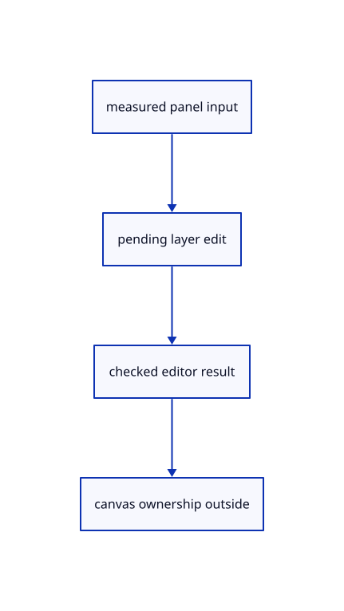

# 8.2.22 · Route layer controls before handles and canvas input

**Chapter 8 · Hierarchy, layers and direct editing · Section 8.2 · Layers and presentation** · [Contents](contents.md)

**Typing: 21–41 minutes.** [Estimate](typing-load.md).

Apply pending layer actions before handle gestures and asynchronous picks. Preserve existing text-field focus, include popup rectangles and retain rename errors until corrected.

## Type

Continue from [Connect group menus to the wider tree panel](53s-tree-controls.md). [Save or recover your work](recovery.md).

### 1. `src/panel.rs`

Preserve active text-field focus and let popup rectangles own pointer and wheel input.

Edit these blocks from bottom to top. Keep the surrounding lines unchanged.

<details>
<summary>Locate this block</summary>

```rust
            unit: match event.delta_mode() { 1 => egui::MouseWheelUnit::Line, 2 => egui::MouseWheelUnit::Page, _ => egui::MouseWheelUnit::Point },
            phase: egui::TouchPhase::Move, delta: egui::vec2(-event.delta_x() as f32, -event.delta_y() as f32), modifiers: Default::default(),
        });
        let over = self.tree.rect.is_some_and(|r|r.contains(pos)) || self.number.number_rect.is_some_and(|r|r.contains(pos)) || pos.y >= self.top || (self.model.completion_rect.is_some_and(|r| r.contains(pos)) || self.model.options_rect.is_some_and(|r| r.contains(pos)));
        if over { event.prevent_default(); }
        over
    }
```

</details>

Replace it with:

```rust
            unit: match event.delta_mode() { 1 => egui::MouseWheelUnit::Line, 2 => egui::MouseWheelUnit::Page, _ => egui::MouseWheelUnit::Point },
            phase: egui::TouchPhase::Move, delta: egui::vec2(-event.delta_x() as f32, -event.delta_y() as f32), modifiers: Default::default(),
        });
        let over = (self.tree.rect.is_some_and(|r|r.contains(pos)) || self.tree.menu_rects.iter().any(|r|r.contains(pos))) || self.number.number_rect.is_some_and(|r|r.contains(pos)) || pos.y >= self.top || (self.model.completion_rect.is_some_and(|r| r.contains(pos)) || self.model.options_rect.is_some_and(|r| r.contains(pos)));
        if over { event.prevent_default(); }
        over
    }
```

<details>
<summary>Locate this block</summary>

```rust
    pub fn pointer(&mut self, event: &web_sys::PointerEvent, canvas: &web_sys::HtmlCanvasElement) -> bool {
        let rect = canvas.get_bounding_client_rect();
        let pos = egui::pos2((event.client_x() as f64 - rect.left()) as f32, (event.client_y() as f64 - rect.top()) as f32);
        let over = self.tree.rect.is_some_and(|r|r.contains(pos)) || self.number.number_rect.is_some_and(|r|r.contains(pos)) || pos.y >= self.top || (self.model.completion_rect.is_some_and(|r| r.contains(pos)) || self.model.options_rect.is_some_and(|r| r.contains(pos)));
        let owned = over || self.pointer_owned;
        if event.type_() == "pointerdown" {
            self.pointer_owned = over;
```

</details>

Replace it with:

```rust
    pub fn pointer(&mut self, event: &web_sys::PointerEvent, canvas: &web_sys::HtmlCanvasElement) -> bool {
        let rect = canvas.get_bounding_client_rect();
        let pos = egui::pos2((event.client_x() as f64 - rect.left()) as f32, (event.client_y() as f64 - rect.top()) as f32);
        let over = (self.tree.rect.is_some_and(|r|r.contains(pos)) || self.tree.menu_rects.iter().any(|r|r.contains(pos))) || self.number.number_rect.is_some_and(|r|r.contains(pos)) || pos.y >= self.top || (self.model.completion_rect.is_some_and(|r| r.contains(pos)) || self.model.options_rect.is_some_and(|r| r.contains(pos)));
        let owned = over || self.pointer_owned;
        if event.type_() == "pointerdown" {
            self.pointer_owned = over;
```

<details>
<summary>Locate this block</summary>

```rust
        };
        let text = event.type_() == "keydown" && event.key().chars().count() == 1
            && !modifiers.command && !modifiers.alt;
        if text {
            let number=self.number.number_prompt.is_some();
            if !self.context.egui_wants_keyboard_input() && !number { self.model.focus_command=true; }
            self.context.memory_mut(|memory|memory.request_focus(egui::Id::new(if number {"number-input"} else {"command-input"})));
```

</details>

Replace it with:

```rust
        };
        let text = event.type_() == "keydown" && event.key().chars().count() == 1
            && !modifiers.command && !modifiers.alt;
        if text && (!self.context.egui_wants_keyboard_input() || self.number.number_prompt.is_some()) {
            let number=self.number.number_prompt.is_some();
            if !self.context.egui_wants_keyboard_input() && !number { self.model.focus_command=true; }
            self.context.memory_mut(|memory|memory.request_focus(egui::Id::new(if number {"number-input"} else {"command-input"})));
```

<details>
<summary>Complete updated block reference</summary>

```rust
use crate::command_dock::{self, CommandLine, Commands as _, theme};
use crate::renderer::Renderer;

struct Commands(Vec<&'static str>);

impl command_dock::Commands for Commands {
    fn canonical(&self, line: &str) -> String {
        crate::commands::canonical(line)
    }
    fn choosing_option(&self, _: &str) -> bool {
        false
    }
    fn accept(&self, line: &str) -> (String, bool) {
        (self.canonical(line), true)
    }
    fn completions(&self, line: &str) -> Vec<&'static str> {
        crate::command_vocabulary::ranked(self.0.as_ref(), line)
    }
    fn browse(&self, line: &str) -> Vec<&'static str> {
        self.completions(line)
    }
}

pub struct Panel {
    pub tree:crate::tree_panel::TreePanel,
    number:crate::number_box::NumberBox,
    commands: Commands,
    pub consumed: bool,
    pointer_owned: bool,
    top: f32,
    controls: Option<Vec<command_dock::Control>>,
    context: egui::Context,
    painter: egui_wgpu::Renderer,
    model: CommandLine,
    events: Vec<egui::Event>,
    output: Option<egui::FullOutput>,
    screen: egui_wgpu::ScreenDescriptor,
}

impl Panel {
    pub fn new(renderer: &Renderer, format: wgpu::TextureFormat, commands: Vec<&'static str>) -> Self {
        let context = egui::Context::default();
        context.set_fonts(theme::fonts([
            include_bytes!("../assets/text/NotoSans-Regular.subset.ttf"),
            include_bytes!("../assets/text/NotoSansSymbols2-Regular.subset.ttf"),
            include_bytes!("../assets/text/NotoSansSymbols-Regular.subset.ttf"),
        ]));
        context.set_theme(egui::Theme::Light);
        context.set_visuals(theme::visuals());
        // One layout pass prevents a future text event from being replayed.
        context.options_mut(|options| options.max_passes = 1.try_into().unwrap());
        let painter = egui_wgpu::Renderer::new(&renderer.device, format, Default::default());
        Self { tree:Default::default(), number:Default::default(), commands: Commands(commands), consumed: false, pointer_owned: false, top: f32::INFINITY, controls: None, context, painter, events: Vec::new(), output: None,
            screen: egui_wgpu::ScreenDescriptor { size_in_pixels: [640, 480], pixels_per_point: 1.0 }, model: CommandLine {
            focus_command: true,
            ..Default::default()
        } }
    }

    pub fn number(&mut self,prompt:Option<crate::number_box::NumberPrompt>) {
        if prompt.is_some() {self.model.focus_command=false;}
        else if self.number.number_prompt.is_some() {self.context.memory_mut(|m|m.surrender_focus(egui::Id::new("number-input")));}
        self.number.set(prompt);
    }

    pub fn tool(&mut self, prompt: String, options: Vec<(String, String)>) {
        self.model.drawing_prompt = prompt; self.model.options = options;
        if self.model.options.is_empty() { self.model.options_rect = None; }
        if !self.model.options.is_empty() { self.model.completion_visible = false; self.model.inline_suffix = false; }
    }

    pub fn cancel_input(&mut self) {
        self.model.command.clear(); self.model.completion_visible = false; self.model.inline_suffix = false;
        self.model.command_open = false; self.model.focus_command = false;
        self.context.memory_mut(|memory| memory.surrender_focus(egui::Id::new("command-input")));
    }

    pub fn command(&self) -> &str { &self.model.command }

    pub fn history(&self) -> &std::collections::VecDeque<String> { &self.model.history }

    pub fn shortcut(&self, event: &web_sys::KeyboardEvent) -> Option<crate::shortcuts::Shortcut> {
        if self.number.number_prompt.is_some() || event.type_() != "keydown" || event.repeat() { return None; }
        crate::shortcuts::key(&event.key(), event.ctrl_key() || event.meta_key(), event.shift_key(),
            event.alt_key(), event.is_composing(), self.context.egui_wants_keyboard_input(), self.model.command.is_empty())
    }

    pub fn key(&mut self, event: &web_sys::KeyboardEvent) -> bool {

        if event.is_composing() { return false; }
        let modifiers = egui::Modifiers {
            alt: event.alt_key(), ctrl: event.ctrl_key(), shift: event.shift_key(),
            mac_cmd: event.meta_key(), command: event.ctrl_key() || event.meta_key(),
        };
        let text = event.type_() == "keydown" && event.key().chars().count() == 1
            && !modifiers.command && !modifiers.alt;
        if text && (!self.context.egui_wants_keyboard_input() || self.number.number_prompt.is_some()) {
            let number=self.number.number_prompt.is_some();
            if !self.context.egui_wants_keyboard_input() && !number { self.model.focus_command=true; }
            self.context.memory_mut(|memory|memory.request_focus(egui::Id::new(if number {"number-input"} else {"command-input"})));
            if !number {self.model.command_open=true;}
        }
        if !self.context.egui_wants_keyboard_input() { return false; }
        if let Some(key) = egui::Key::from_name(&event.key()) {
            self.events.push(egui::Event::Key {
                key, physical_key: None, pressed: event.type_() == "keydown",
                repeat: event.repeat(), modifiers,
            });
        }
        if text { self.events.push(egui::Event::Text(event.key())); }
        event.prevent_default();
        true
    }

    pub fn pointer(&mut self, event: &web_sys::PointerEvent, canvas: &web_sys::HtmlCanvasElement) -> bool {
        let rect = canvas.get_bounding_client_rect();
        let pos = egui::pos2((event.client_x() as f64 - rect.left()) as f32, (event.client_y() as f64 - rect.top()) as f32);
        let over = (self.tree.rect.is_some_and(|r|r.contains(pos)) || self.tree.menu_rects.iter().any(|r|r.contains(pos))) || self.number.number_rect.is_some_and(|r|r.contains(pos)) || pos.y >= self.top || (self.model.completion_rect.is_some_and(|r| r.contains(pos)) || self.model.options_rect.is_some_and(|r| r.contains(pos)));
        let owned = over || self.pointer_owned;
        if event.type_() == "pointerdown" {
            self.pointer_owned = over;
            if !over {
                self.model.command_open = false;
                self.model.focus_command = false;
                self.context.memory_mut(|memory| memory.surrender_focus(egui::Id::new("command-input")));
            }
        }
        self.events.push(egui::Event::PointerMoved(pos));
        if matches!(event.type_().as_str(), "pointercancel" | "lostpointercapture") {
            for button in [egui::PointerButton::Primary, egui::PointerButton::Middle, egui::PointerButton::Secondary] {
                self.events.push(egui::Event::PointerButton { pos, button, pressed: false, modifiers: Default::default() });
            }
            self.events.push(egui::Event::PointerGone);
        } else if matches!(event.type_().as_str(), "pointerdown" | "pointerup") {
            let button = match event.button() { 0 => egui::PointerButton::Primary, 1 => egui::PointerButton::Middle, _ => egui::PointerButton::Secondary };
            self.events.push(egui::Event::PointerButton { pos, button, pressed: event.type_() == "pointerdown", modifiers: Default::default() });
        }
        if matches!(event.type_().as_str(), "pointerup" | "pointercancel" | "lostpointercapture") { self.pointer_owned = false; }
        if owned { event.prevent_default(); }
        owned
    }

    pub fn wheel(&mut self, event: &web_sys::WheelEvent, canvas: &web_sys::HtmlCanvasElement) -> bool {
        let rect = canvas.get_bounding_client_rect();
        let pos = egui::pos2((event.client_x() as f64 - rect.left()) as f32, (event.client_y() as f64 - rect.top()) as f32);
        self.events.push(egui::Event::PointerMoved(pos));
        self.events.push(egui::Event::MouseWheel {
            unit: match event.delta_mode() { 1 => egui::MouseWheelUnit::Line, 2 => egui::MouseWheelUnit::Page, _ => egui::MouseWheelUnit::Point },
            phase: egui::TouchPhase::Move, delta: egui::vec2(-event.delta_x() as f32, -event.delta_y() as f32), modifiers: Default::default(),
        });
        let over = (self.tree.rect.is_some_and(|r|r.contains(pos)) || self.tree.menu_rects.iter().any(|r|r.contains(pos))) || self.number.number_rect.is_some_and(|r|r.contains(pos)) || pos.y >= self.top || (self.model.completion_rect.is_some_and(|r| r.contains(pos)) || self.model.options_rect.is_some_and(|r| r.contains(pos)));
        if over { event.prevent_default(); }
        over
    }

    pub fn inspect(&self) -> String {
        serde_json::json!({"tree_rect":self.tree.rect.map(|r|[r.min.x,r.min.y,r.max.x,r.max.y]),"tree_open":self.tree.open,"number":self.number.number,"number_error":self.number.number_error,"number_rect":self.number.number_rect.map(|r|[r.min.x,r.min.y,r.max.x,r.max.y]),"controls": self.controls, "command": self.model.command, "history": self.model.history, "status": self.model.status,
            "pointer_owned": self.pointer_owned,
            "top": self.top, "focused": self.context.egui_wants_keyboard_input(),
            "completion_rect": self.model.completion_rect.map(|r| [r.min.x, r.min.y, r.max.x, r.max.y]),
            "options": self.model.options, "options_rect": self.model.options_rect.map(|r| [r.min.x, r.min.y, r.max.x, r.max.y])}).to_string()
    }

    pub fn answer(&mut self, line: &str, message: &str) {
        self.model.remember(format!("> {line}\n{message}"));
        self.model.status = message.into();
    }

    pub fn result(&mut self, message: &str) {
        self.model.status = message.into();
        if self.number.number_prompt.is_some() {self.number.number_error=message.into();}
        if let Some(last) = self.model.history.back_mut()
            && let Some(at) = last.find('\n')
        {
            last.truncate(at + 1);
            last.push_str(message);
        }
    }

    pub fn update(
        &mut self,
        event: Option<&web_sys::Event>,
        canvas: &web_sys::HtmlCanvasElement,
    ) -> Result<Option<String>, wasm_bindgen::JsValue> {
        use wasm_bindgen::JsCast;
        let rect = canvas.get_bounding_client_rect();
        self.screen.size_in_pixels = [canvas.width(), canvas.height()];
        self.screen.pixels_per_point = canvas.width() as f32 / rect.width() as f32;
        self.consumed = false;
        if let Some(event) = event {
            if let Some(key) = event.dyn_ref::<web_sys::KeyboardEvent>() { self.consumed = self.key(key); }
            if let Some(pointer) = event.dyn_ref::<web_sys::PointerEvent>() {
                self.consumed = self.pointer(pointer, canvas);
                if event.type_() == "pointerdown" {
                    let options = web_sys::FocusOptions::new(); options.set_prevent_scroll(true);
                    canvas.focus_with_options(&options)?;
                    event.prevent_default();
                }
            }
            if let Some(wheel) = event.dyn_ref::<web_sys::WheelEvent>() { self.consumed = self.wheel(wheel, canvas); }
        }
        let number_open=self.number.number_prompt.is_some();
        let line = self.prepare();
        canvas.set_attribute("data-command-ui", &self.inspect())?;
        let Some(line) = line else { return Ok(None); };
        if number_open {return Ok(Some(line));}
        if !self.model.options.is_empty() { self.answer(&line, "Tool input submitted."); return Ok(Some(line)); }
        if line == "Escape" { return Ok(None); }
        if line.eq_ignore_ascii_case("Help") {
            self.answer(&line, &self.commands.0.join(" · "));
            return Ok(None);
        }
        self.answer(&line, "Command submitted.");
        Ok(Some(line))
    }

    fn prepare(&mut self) -> Option<String> {
        let size = self.screen.size_in_pixels;
        let mut input = egui::RawInput {
            focused: true,
            events: std::mem::take(&mut self.events),
            screen_rect: Some(egui::Rect::from_min_size(
                egui::Pos2::ZERO, egui::vec2(size[0] as f32, size[1] as f32) / self.screen.pixels_per_point,
            )),
            ..Default::default()
        };
        input.viewports.get_mut(&egui::ViewportId::ROOT).unwrap().native_pixels_per_point = Some(self.screen.pixels_per_point);
        self.controls = Some(Vec::new());
        let mut line = None;
        let output = self.context.run_ui(input, |root| {
            crate::tree_panel::draw(root,&mut self.tree,&mut self.controls);
            crate::number_box::draw(root,&mut self.number,&mut self.controls);
            command_dock::draw(root, &mut self.model, &mut self.controls, &mut line, &self.commands, true);
        });
        if let Some(number)=self.number.take() {line=Some(number);}
        if let Some(control) = self.controls.as_ref().and_then(|items| items.iter().find(|item| item.key == "command/resize")) {
            self.top = control.rect[1];
        }
        if let Some(previous) = self.output.as_mut() { previous.append(output); }
        else { self.output = Some(output); }
        line
    }

    pub fn draw(&mut self, renderer: &Renderer, target: &wgpu::TextureView) {
        let Some(output) = self.output.take() else { return; };
        // The font atlas is a texture: upload its changed pixels before drawing the letters.
        for (id, delta) in &output.textures_delta.set {
            self.painter.update_texture(&renderer.device, &renderer.queue, *id, delta);
        }
        let jobs = self.context.tessellate(output.shapes, output.pixels_per_point);
        let mut encoder = renderer.device.create_command_encoder(&Default::default());
        let mut buffers = self.painter.update_buffers(
            &renderer.device, &renderer.queue, &mut encoder, &jobs, &self.screen,
        );
        let pass = encoder.begin_render_pass(&wgpu::RenderPassDescriptor {
            label: Some("command panel"),
            color_attachments: &[Some(wgpu::RenderPassColorAttachment {
                view: target, resolve_target: None, depth_slice: None,
                ops: wgpu::Operations { load: wgpu::LoadOp::Load, store: wgpu::StoreOp::Store },
            })],
            ..Default::default()
        });
        self.painter.render(&mut pass.forget_lifetime(), &jobs, &self.screen);
        buffers.push(encoder.finish());
        renderer.queue.submit(buffers);
        for id in output.textures_delta.free { self.painter.free_texture(&id); }
    }
}
```

</details>

<details>
<summary>Optional patch references</summary>

Use these original edit fragments when comparing a saved checkpoint. Apply the complete blocks above.

```text
--8<-- "journey/code/53t-input-01.rs"
```

```text
--8<-- "journey/code/53t-input-02.rs"
```

```text
--8<-- "journey/code/53t-input-03.rs"
```

</details>

### 2. `src/browser.rs`

Route pending layer edits and properties first, retain errors and expose current presentation diagnostics.

Edit these blocks from bottom to top. Keep the surrounding lines unchanged.

<details>
<summary>Locate this block</summary>

```rust
        .get_element_by_id("canvas")
        .ok_or("Missing canvas")?;
    let placements: Vec<_> = editor.scene.objects().iter().map(|row| (format!("{:?}", row.id), row.model.m)).collect();
    canvas.set_attribute("data-tree",&serde_json::json!(crate::hierarchy::rows(&editor.scene).iter().map(|r|serde_json::json!({"key":r.key,"label":r.label,"depth":r.depth,"end":r.end,"readonly":r.readonly,"ids":r.ids.iter().map(|id|id.value()).collect::<Vec<_>>()})).collect::<Vec<_>>()).to_string())?;
    canvas.set_attribute("data-gizmo",&serde_json::json!({"origin":editor.gizmo_origin(),"active":editor.gizmo_active(),"pointer":editor.gizmo_edit.as_ref().and_then(|e|e.pointer),"typing":editor.gizmo_edit.as_ref().and_then(|e|e.gizmo.typing).map(|h|h.title()),"matrix":editor.gizmo_edit.as_ref().map(|e|e.preview.matrix()),"gpu":renderer.gizmo_usage()}).to_string())?;
    canvas.set_attribute("data-row-placements", &serde_json::to_string(&placements).map_err(|error| JsValue::from_str(&error.to_string()))?)?;
```

</details>

Replace it with:

```rust
        .get_element_by_id("canvas")
        .ok_or("Missing canvas")?;
    let placements: Vec<_> = editor.scene.objects().iter().map(|row| (format!("{:?}", row.id), row.model.m)).collect();
    let view_ids=editor.scene.objects().iter().map(|row|row.id).chain(editor.scene.lines().iter().map(|row|row.id)).chain(editor.scene.paths().iter().map(|row|row.id)).chain(editor.scene.points().iter().map(|row|row.id));
    let view_rows=view_ids.map(|id|serde_json::json!({"id":id.value(),"visible":editor.scene.visible(id),"locked":editor.scene.view.locked.contains(&id),"faces":editor.scene.view.faces.get(&id),"edges":editor.scene.view.edges.get(&id)})).collect::<Vec<_>>();
    canvas.set_attribute("data-view-flags",&serde_json::json!({"current":crate::layer_edit::current_key(&editor.scene),"rows":view_rows}).to_string())?;
    canvas.set_attribute("data-tree",&serde_json::json!(crate::hierarchy::rows(&editor.scene).iter().map(|r|serde_json::json!({"key":r.key,"label":r.label,"depth":r.depth,"end":r.end,"readonly":r.readonly,"ids":r.ids.iter().map(|id|id.value()).collect::<Vec<_>>()})).collect::<Vec<_>>()).to_string())?;
    canvas.set_attribute("data-gizmo",&serde_json::json!({"origin":editor.gizmo_origin(),"active":editor.gizmo_active(),"pointer":editor.gizmo_edit.as_ref().and_then(|e|e.pointer),"typing":editor.gizmo_edit.as_ref().and_then(|e|e.gizmo.typing).map(|h|h.title()),"matrix":editor.gizmo_edit.as_ref().map(|e|e.preview.matrix()),"gpu":renderer.gizmo_usage()}).to_string())?;
    canvas.set_attribute("data-row-placements", &serde_json::to_string(&placements).map_err(|error| JsValue::from_str(&error.to_string()))?)?;
```

<details>
<summary>Locate this block</summary>

```rust
                if waiting { panel.result("Reloading editable sources…"); Ok(None) }
                else { editor.apply(action).map(Some).map_err(str::to_owned) }
            });
            if tool_action && change.is_ok() { panel.result(&editor.tool_status); }
            match change {
                Ok(Some(Change::Scene)) => {
```

</details>

Replace it with:

```rust
                if waiting { panel.result("Reloading editable sources…"); Ok(None) }
                else { editor.apply(action).map(Some).map_err(str::to_owned) }
            });
            if rename_action {panel.tree.rename_result(change.as_ref().err().map(String::as_str));}
            if tool_action && change.is_ok() { panel.result(&editor.tool_status); }
            match change {
                Ok(Some(Change::Scene)) => {
```

<details>
<summary>Locate this block</summary>

```rust
        } };
        if let Some(action) = action {
            highlight_changed |= matches!(&action, Action::SelectAll);
            let tool_action = matches!(&action, Action::BeginTool(_) | Action::ToolPoint(_) | Action::CancelTool | Action::Snap(_) | Action::GizmoRelease {..} | Action::GizmoCancel | Action::GizmoNumber(_) | Action::ToolScreen { commit:true,.. });
            if matches!(&action, Action::CancelTool) { panel.cancel_input(); }
            if matches!(&action, Action::Close | Action::UnloadSources | Action::Undo | Action::Redo
```

</details>

Replace it with:

```rust
        } };
        if let Some(action) = action {
            highlight_changed |= matches!(&action, Action::SelectAll);
            let rename_action=matches!(&action,Action::LayerEdit {edit:crate::layer_edit::Edit::Rename(_),..});
            let tool_action = matches!(&action, Action::BeginTool(_) | Action::ToolPoint(_) | Action::CancelTool | Action::Snap(_) | Action::GizmoRelease {..} | Action::GizmoCancel | Action::GizmoNumber(_) | Action::ToolScreen { commit:true,.. });
            if matches!(&action, Action::CancelTool) { panel.cancel_input(); }
            if matches!(&action, Action::Close | Action::UnloadSources | Action::Undo | Action::Redo
```

<details>
<summary>Locate this block</summary>

```rust
            None
        };
        let handle_action=gizmo_action(&event,&pointer_canvas,&editor,panel.consumed);
        let action = if let Some((ids,additive))=panel.tree.action.take() {
            renderer.cancel_pick();gesture.cancel();Some(Action::TreePick {ids,additive})
        } else if let Some(handle_action)=handle_action {
            renderer.cancel_pick();gesture.cancel();Some(handle_action)
```

</details>

Replace it with:

```rust
            None
        };
        let handle_action=gizmo_action(&event,&pointer_canvas,&editor,panel.consumed);
        let action = if let Some((key,edit))=panel.tree.edit.take() {
            renderer.cancel_pick();gesture.cancel();Some(Action::LayerEdit {key,edit})
        } else if let Some((key,property))=panel.tree.property.take() {
            renderer.cancel_pick();gesture.cancel();Some(Action::LayerProperty {key,property})
        } else if let Some((ids,additive))=panel.tree.action.take() {
            renderer.cancel_pick();gesture.cancel();Some(Action::TreePick {ids,additive})
        } else if let Some(handle_action)=handle_action {
            renderer.cancel_pick();gesture.cancel();Some(handle_action)
```

<details>
<summary>Complete updated block reference</summary>

```rust
use crate::background::Background;
use crate::editor::{Action, Change, Editor};
use crate::gesture::Gesture;
use crate::renderer::Renderer;
use crate::viewport::Viewport;
use wasm_bindgen::{JsCast, JsValue, closure::Closure};

pub fn report(message: &str) {
    if let Some(document) = web_sys::window().and_then(|window| window.document()) {
        if let Some(status) = document.get_element_by_id("status") {
            status.set_text_content(Some(message));
            if message.starts_with("Cannot draw:") { let _ = status.remove_attribute("hidden"); }
        }
    }
}

fn failed(fault: crate::gpu_fault::Fault, message: String) {
    if !fault.remember(message.clone()) { return; }
    wasm_bindgen_futures::spawn_local(async move {
        if crate::browser_runtime::stop_if(&fault) {
            crate::browser_report::fatal(&message);
            if crate::browser_recovery::request(&message) { return; }
            report(&format!("Cannot draw: {message}"));
        }
    });
}

fn save_result(bytes: &[u8]) -> Result<String, String> {
    crate::file_output::download(bytes)
        .map(|()| format!("Saved editable document ({} bytes)", bytes.len()))
        .map_err(|error| format!("Save failed: {error:?}"))
}

pub async fn run() -> Result<(), JsValue> { run_with(crate::drawing_document::new()).await }

pub async fn run_with(shared: crate::drawing_document::Shared) -> Result<(), JsValue> {
    let window = web_sys::window().ok_or("No browser window")?;
    let document = window.document().ok_or("No document")?;
    let canvas: web_sys::HtmlCanvasElement = document
        .get_element_by_id("canvas")
        .ok_or("Missing canvas")?
        .dyn_into()?;
    let recovery = crate::browser_recovery::adopt()?;
    crate::browser_report::start()?;
    let startup = crate::browser_startup::Guard::new()?;
    let instance = wgpu::Instance::new(wgpu::InstanceDescriptor {
        backends: wgpu::Backends::BROWSER_WEBGPU,
        flags: Default::default(),
        memory_budget_thresholds: Default::default(),
        backend_options: Default::default(),
        display: None,
    });
    let surface = instance
        .create_surface(wgpu::SurfaceTarget::Canvas(canvas.clone()))
        .map_err(|error| JsValue::from_str(&error.to_string()))?;
    let adapter_started = crate::browser_phase::now();
    let probe = crate::browser_adapter::Probe::new().ok();
    let adapter = instance
        .request_adapter(&wgpu::RequestAdapterOptions {
            compatible_surface: Some(&surface),
            ..Default::default()
        })
        .await;
    if !startup.permits() { return Ok(()); }
    crate::browser_phase::finish("adapter request", adapter_started, 0, "GPU");
    let adapter = adapter.map_err(|error| JsValue::from_str(&error.to_string()))?;
    if let Some(info) = probe.as_ref().and_then(|probe| probe.info()) { let _ = crate::browser_report::adapter(info); }
    else { let _ = crate::browser_report::observe("diagnostic", "Adapter identity unavailable"); }
    drop(probe);
    let device_started = crate::browser_phase::now();
    let device = adapter
        .request_device(&wgpu::DeviceDescriptor::default())
        .await;
    if !startup.permits() {
        if let Ok((device, _)) = device { device.destroy(); }
        return Ok(());
    }
    crate::browser_phase::finish("device request", device_started, 0, "GPU");
    let (device, queue) = device.map_err(|error| JsValue::from_str(&error.to_string()))?;
    let fault = crate::gpu_fault::Fault::default();
    let errors = fault.clone();
    device.on_uncaptured_error(std::sync::Arc::new(move |error| failed(errors.clone(), format!("WebGPU error: {error}"))));
    let lost = fault.clone();
    device.set_device_lost_callback(move |reason, message| failed(lost.clone(), format!("WebGPU device lost ({reason:?}): {message}")));
    let limit = device.limits().max_texture_dimension_2d;
    let width = (window.inner_width()?.as_f64().ok_or("No window width")? as u32).clamp(1, limit);
    let height = (window.inner_height()?.as_f64().ok_or("No window height")? as u32).clamp(1, limit);
    canvas.set_width(width);
    canvas.set_height(height);
    let mut config = surface
        .get_default_config(&adapter, width, height)
        .ok_or("No compatible surface format")?;
    config.view_formats = vec![config.format.add_srgb_suffix()];
    surface.configure(&device, &config);
    let mut editor = shared.borrow_mut();
    let pipeline_started = crate::browser_phase::now();
    let mut renderer = Renderer::new(
        device,
        queue,
        config.format.add_srgb_suffix(),
        &editor.scene,
    );
    crate::browser_phase::finish("renderer setup", pipeline_started, 0, "GPU");
    renderer.resize(Viewport { width, height });
    inspect(&editor, &renderer)?;
    let mut panel = crate::panel::Panel::new(
        &renderer,
        config.format.add_srgb_suffix(),
        crate::commands::names(),
    );
    if let Some(message) = crate::browser_report::previous_notice() { panel.result(message); }
    if let Some(message) = &recovery { panel.result(message); }
    panel.update(None, &canvas)?;
    if resize(
        &window,
        &canvas,
        &surface,
        &mut config,
        &mut renderer,
        &mut editor,
    ) {
        panel.update(None, &canvas)?;
        let frame_started = crate::browser_phase::now();
        present(
            &surface,
            &renderer,
            &editor.background,
            &editor.camera.uniform(),
            editor.normal_view,
            &mut panel,
        )?;
        let completing = fault.clone();
        // Queue completion runs after submitted GPU work; checking the current device prevents a late result from reviving an exited runtime.
        renderer.queue.on_submitted_work_done(move || {
            if crate::browser_runtime::owns(&completing) && completing.message().is_none() {
                crate::browser_phase::finish("first frame complete", frame_started, 0, "GPU");
                let _ = crate::browser_report::observe("milestone", "geometry on screen");
            }
        });
    }
    let input_canvas = canvas.clone();
    let browser_window = window.clone();
    let pointer_canvas = canvas.clone();
    let mut gesture = Gesture::default();
    let pick_additive = std::rc::Rc::new(std::cell::Cell::new(false));
    let request = std::rc::Rc::new(std::cell::RefCell::new(crate::read_gate::ReadGate::default()));
    let read_mode = std::cell::Cell::new(crate::file_input::Mode::Append);
    let delivery: crate::file_input::Delivery = std::rc::Rc::new(std::cell::RefCell::new(None));
    let reload: crate::browser_reload::Shared = std::rc::Rc::new(std::cell::RefCell::new(Default::default()));
    let reload_delivery: crate::browser_reload::Delivery = std::rc::Rc::new(std::cell::RefCell::new(None));
    let owned_request = std::rc::Rc::clone(&request);
    let owned_reload = std::rc::Rc::clone(&reload);
    let active_fault = fault.clone();
    drop(editor);
    let owned_editor = std::rc::Rc::clone(&shared);
    let update = Closure::<dyn FnMut(web_sys::Event)>::new(move |event: web_sys::Event| {
        if active_fault.message().is_some() { return; }
        let mut editor = shared.borrow_mut();
        if matches!(event.type_().as_str(), "blur" | "pagehide" | "viewer-reload") { renderer.cancel_pick(); }
        if event.type_() == "pagehide" {
            gesture.cancel(); let _=editor.apply(Action::GizmoCancel);
            crate::browser_upload::prepare(&mut renderer,editor.display_scene(),editor.whole_selection(),active_fault.clone());renderer.set_gizmo(&editor.camera,None,-1.);
            if event.dyn_ref::<web_sys::PageTransitionEvent>().is_some_and(|event| event.persisted()) { return; }
            wasm_bindgen_futures::spawn_local(async { crate::browser_runtime::stop(); });
            return;
        }
        let shortcut = event.dyn_ref::<web_sys::KeyboardEvent>().and_then(|key| panel.shortcut(key));
        let line = if let Some(shortcut) = shortcut {
            event.prevent_default();
            panel.answer(shortcut.command(), "");
            Some(shortcut.command().to_ascii_lowercase())
        } else { match panel.update(Some(&event), &input_canvas) {
            Ok(line) => line,
            Err(error) => {
                report(&format!("Cannot read command: {error:?}"));
                return;
            }
        } };

        let line = if (editor.draft.is_some() || editor.gizmo_edit.is_some()) && event.dyn_ref::<web_sys::KeyboardEvent>()
            .is_some_and(|key| event.type_() == "keydown" && key.key() == "Escape" && !key.is_composing()) {
            event.prevent_default(); gesture.cancel(); Some("Escape".into())
        } else { line };

        let mut highlight_changed = false;
        let action = if event.type_() == "cancel" && event.target()
            .and_then(|target| target.dyn_into::<web_sys::HtmlInputElement>().ok())
            .is_some_and(|input| input.id() == "open")
        {
            request.borrow_mut().cancel();
            report("Open cancelled.");
            panel.answer("Open", "Open cancelled.");
            None
        } else if event.type_() == "change" {
            crate::file_input::choose(&event, std::rc::Rc::clone(&request), read_mode.get(), std::rc::Rc::clone(&delivery));
            None
        } else if event.type_() == "viewer-file-error" {
            if let Some(message) = event.dyn_ref::<web_sys::CustomEvent>().and_then(|event| event.detail().as_string()) {
                report(&message);
                panel.answer("Open", &message);
            }
            None
        } else if event.type_() == "viewer-reload" {
            if let Some(reply) = reload_delivery.borrow_mut().take() {
                let command = reply.intent.map_or("Reload Sources", |intent| intent.command());
                match reply.complete(&mut editor) {
                    Ok(Some(crate::edit_replay::Reply::Changed(_))) => {
                        highlight_changed = true;
                        crate::browser_upload::prepare(&mut renderer, editor.display_scene(), editor.whole_selection(), active_fault.clone());
                        crate::browser_phase::revision(&editor.scene);
                        let message = if command == "Reload Sources" {
                            "Editable sources restored; display retained.".to_owned()
                        } else { format!("{command} completed after source reload.") };
                        report(&message); panel.answer(command, &message);
                    }
                    Ok(Some(crate::edit_replay::Reply::Saved(bytes))) => {
                        let message = save_result(&bytes).unwrap_or_else(|error| error);
                        report(&message); panel.answer(command, &message);
                    }
                    Ok(None) => {}
                    Err(error) => { report(&error); panel.answer(command, &error); }
                }
            }
            None
        } else if event.type_() == "viewer-file" {
            match crate::file_input::action(&event, &delivery) {
                Ok(action) => action,
                Err(error) => { let message = format!("Cannot retain reload file: {error:?}");
                    report(&message); panel.answer("Open", &message); None }
            }
        } else if let Some(line) = line {
            let command = editor.tool_line(&line).map(|result| result.map(crate::commands::Command::Editor).map_err(str::to_owned))
                .unwrap_or_else(|| crate::commands::parse(&line));
            match command {
            Err(error) => { panel.result(&error); None }
            Ok(crate::commands::Command::Editor(mut action)) => {
                if matches!(action, Action::Close) { request.borrow_mut().cancel(); }
                if shortcut.is_some() && editor.selected.is_some() && matches!(action, Action::Fit) { action = Action::FitSelected; }
                Some(action)
            }
            Ok(crate::commands::Command::Host(host)) => {
            use crate::commands::Host;
            match host {
            Host::Help => { panel.result(&crate::commands::names().join(" · ")); None }
            Host::Selection => {
                let rows = editor.selected_objects();
                panel.result(&if rows.len() > 1 { format!("Objects {:?}", rows.iter().map(|id| id.value()).collect::<Vec<_>>()) }
                    else { editor.selection().map_or_else(|| "Nothing selected".to_owned(), |target| target.describe()) });
                None
            }
            Host::Reload => {
                let result = crate::browser_reload::start(std::rc::Rc::clone(&reload), editor.reload_keys(), std::rc::Rc::clone(&reload_delivery));
                match result {
                    Ok(()) => panel.result("Reloading editable sources…"),
                    Err(error) => { report(&error); panel.result(&error); }
                }
                None
            }
            Host::CancelReload => {
                reload.borrow_mut().cancel();
                report("Reload cancelled."); panel.result("Reload cancelled.");
                None
            }
            Host::CancelOpen => {
                request.borrow_mut().cancel();
                report("Open cancelled.");
                panel.result("Open cancelled.");
                None
            }
            Host::Open | Host::Replace => {
                let ticket = request.borrow_mut().begin();
                if let Err(error) = ticket { report(error); panel.result(error); return; }
                if host == Host::Replace { reload.borrow_mut().cancel(); }
                read_mode.set(if host == Host::Replace { crate::file_input::Mode::Replace }
                    else { crate::file_input::Mode::Append });
                if let Some(input) = web_sys::window()
                    .and_then(|window| window.document())
                    .and_then(|document| document.get_element_by_id("open"))
                    .and_then(|element| element.dyn_into::<web_sys::HtmlInputElement>().ok())
                {
                    input.click();
                }
                None
            }
            Host::Report | Host::PreviousReport => {
                let output = if host == Host::PreviousReport { crate::browser_report::download_previous() }
                    else { crate::browser_report::download() };
                let result = output.map(|()| "Diagnostic report downloaded.".to_owned())
                    .unwrap_or_else(|error| format!("Diagnostic report failed: {error:?}"));
                panel.result(&result);
                None
            }
            Host::LayersOn=>{panel.tree.open=true;None},
            Host::LayersOff=>{panel.tree.open=false;None},
            Host::LayersAll=>{panel.tree.all();None},
            Host::Save => {
                let result = crate::browser_reload::restore_for(crate::edit_intent::Intent::Save,
                    &editor, std::rc::Rc::clone(&reload), std::rc::Rc::clone(&reload_delivery))
                    .and_then(|waiting| {
                        if waiting { Ok("Reloading editable sources…".to_owned()) }
                        else { crate::document::snapshot(&editor.scene).map_err(str::to_owned)
                            .and_then(|bytes| save_result(&bytes)) }
                    });
                panel.result(&result.unwrap_or_else(|error| error));
                None
            }
            }
            }
            }
        } else if !panel.consumed {
            navigation_action(&event, &pointer_canvas, &mut gesture)
        } else {
            None
        };
        let handle_action=gizmo_action(&event,&pointer_canvas,&editor,panel.consumed);
        let action = if let Some((key,edit))=panel.tree.edit.take() {
            renderer.cancel_pick();gesture.cancel();Some(Action::LayerEdit {key,edit})
        } else if let Some((key,property))=panel.tree.property.take() {
            renderer.cancel_pick();gesture.cancel();Some(Action::LayerProperty {key,property})
        } else if let Some((ids,additive))=panel.tree.action.take() {
            renderer.cancel_pick();gesture.cancel();Some(Action::TreePick {ids,additive})
        } else if let Some(handle_action)=handle_action {
            renderer.cancel_pick();gesture.cancel();Some(handle_action)
        } else if event.type_() == "viewer-pick" {
            match renderer.take_pick(editor.camera.uniform()) {
                Some(Ok(hit)) => Some(Action::PickedMany { target: hit.and_then(|hit| renderer.resolve_pick(&editor.scene, hit)), additive: pick_additive.get() }),
                Some(Err(error)) => { report(error); None },
                None => None,
            }
        } else { match action {
            Some(Action::Pick(screen)) if editor.draft.is_some() => {
                Some(Action::ToolScreen { screen,size:[pointer_canvas.get_bounding_client_rect().width(),pointer_canvas.get_bounding_client_rect().height()],commit:true })
            }
            None if editor.draft.is_some() && matches!(event.type_().as_str(), "blur" | "resize" | "pointercancel" | "lostpointercapture") => Some(Action::ToolHover(None)),
            None if editor.draft.is_some() && !panel.consumed && event.type_() == "pointermove" => {
                event.dyn_ref::<web_sys::PointerEvent>().filter(|p| p.buttons() == 0).map(|p| {
                    let r = pointer_canvas.get_bounding_client_rect();
                    let screen = [(2. * (p.client_x() as f64-r.left())/r.width()-1.) as f32, (1.-2.*(p.client_y() as f64-r.top())/r.height()) as f32];
                    Action::ToolScreen { screen,size:[r.width(),r.height()],commit:false }
                })
            }
            Some(Action::Pick(screen)) => {
                pick_additive.set(event.dyn_ref::<web_sys::PointerEvent>().is_some_and(|p| p.shift_key() && !p.ctrl_key() && !p.meta_key()));
                if let Err(error) = renderer.request_pick(screen, editor.camera.uniform()) { report(error); }
                None
            }
            Some(action) => { renderer.cancel_pick(); Some(action) },
            None => None,
        } };
        if let Some(action) = action {
            highlight_changed |= matches!(&action, Action::SelectAll);
            let rename_action=matches!(&action,Action::LayerEdit {edit:crate::layer_edit::Edit::Rename(_),..});
            let tool_action = matches!(&action, Action::BeginTool(_) | Action::ToolPoint(_) | Action::CancelTool | Action::Snap(_) | Action::GizmoRelease {..} | Action::GizmoCancel | Action::GizmoNumber(_) | Action::ToolScreen { commit:true,.. });
            if matches!(&action, Action::CancelTool) { panel.cancel_input(); }
            if matches!(&action, Action::Close | Action::UnloadSources | Action::Undo | Action::Redo
                | Action::Replace(_) | Action::ReplaceAt(_, _)) { reload.borrow_mut().cancel(); }
            let replacement = matches!(&action, Action::Replace(_) | Action::ReplaceAt(_, _));
            let closing = matches!(&action, Action::Close);
            let unloading = matches!(&action, Action::UnloadSources);
            let waiting = if editor.selected_objects().len() > 1 { Ok(None) }
                else { crate::edit_intent::Intent::capture(&action, editor.whole_selection()) }
                .map_err(str::to_owned).and_then(|intent| match intent {
                    Some(intent) => crate::browser_reload::restore_for(intent, &editor,
                        std::rc::Rc::clone(&reload), std::rc::Rc::clone(&reload_delivery)),
                    None => Ok(false),
                });
            let change = waiting.and_then(|waiting| {
                if waiting { panel.result("Reloading editable sources…"); Ok(None) }
                else { editor.apply(action).map(Some).map_err(str::to_owned) }
            });
            if rename_action {panel.tree.rename_result(change.as_ref().err().map(String::as_str));}
            if tool_action && change.is_ok() { panel.result(&editor.tool_status); }
            match change {
                Ok(Some(Change::Scene)) => {
                    highlight_changed = true;
                    crate::browser_upload::prepare(&mut renderer, &editor.scene, editor.whole_selection(), active_fault.clone());
                    if unloading {
                        report("Editable sources unloaded; display retained.");
                        panel.result("Editable sources unloaded; display retained.");
                    } else if closing {
                        report("Document closed.");
                        panel.result("Document closed.");
                    } else if event.type_() == "viewer-file" {
                        crate::browser_phase::revision(&editor.scene);
                        let message = if replacement { "Document replaced. Undo restores the previous document." }
                            else { "File imported. Undo removes the entire import." };
                        report(message);
                        panel.answer(if replacement { "Open Replace" } else { "Open" }, message);
                    }
                }
                Ok(Some(Change::Preview)) => {
                    highlight_changed=true;
                    crate::browser_upload::prepare(&mut renderer,editor.display_scene(),editor.whole_selection(),active_fault.clone());
                }
                Ok(Some(Change::View)) | Ok(None) => {}
                Err(error) => {
                    report(&error);
                    if event.type_() == "viewer-file" { panel.answer("Open", &error); }
                    else { panel.result(&error); }
                }
            }
        }
        if let Some(draft) = editor.draft.as_ref() { panel.tool(draft.prompt(), draft.tool.buttons()); }
        else { panel.tool(String::new(), Vec::new()); }
        let rect=pointer_canvas.get_bounding_client_rect();
        let number=editor.number_prompt([rect.width(),rect.height()]);
        if editor.gizmo_edit.as_ref().is_some_and(|e|e.gizmo.typing.is_some()) && number.is_none() {
            if editor.apply(Action::GizmoCancel).is_ok() {highlight_changed=true;crate::browser_upload::prepare(&mut renderer,editor.display_scene(),editor.whole_selection(),active_fault.clone());}
        }
        panel.number(number);
        panel.tree.refresh(&editor.scene,editor.selected_objects());
        if let Err(error) = renderer.set_preview(editor.draft.as_ref()) { panel.result(error); }
        renderer.set_pick_mode(editor.pick_mode);
        if highlight_changed {
            if let Err(error) = renderer.set_highlight(editor.display_scene(), editor.selection())
                .and_then(|()| renderer.select_objects(editor.display_scene(), &editor.selected_objects())) { report(error); return; }
        }
        if let Err(error) = renderer.set_grid(editor.camera.grid) {
            report(error); return;
        }
        if resize(
            &browser_window,
            &pointer_canvas,
            &surface,
            &mut config,
            &mut renderer,
            &mut editor,
        ) {
            if let Err(error) = panel.update(None, &input_canvas) {
                report(&format!("Cannot lay out commands: {error:?}"));
                return;
            }
            let hover=event.dyn_ref::<web_sys::PointerEvent>().filter(|p|event.type_()=="pointermove" && p.buttons()==0 && !panel.consumed).map(|p| {
                let r=pointer_canvas.get_bounding_client_rect();
                ([(2.*(p.client_x() as f64-r.left())/r.width()-1.) as f32,(1.-2.*(p.client_y() as f64-r.top())/r.height()) as f32],[r.width(),r.height()])
            });
            editor.hover_gizmo(hover);
            renderer.set_gizmo(&editor.camera,editor.gizmo_origin(),editor.gizmo_active());
            if let Err(error) = inspect(&editor, &renderer) {
            report(&format!("Cannot report projection: {error:?}"));
            return;
        }
            if let Err(error) = present(
                &surface,
                &renderer,
                &editor.background,
                &editor.camera.uniform(),
                editor.normal_view,
                &mut panel,
            ) {
                report(&format!("Cannot redraw: {error:?}"));
            }
        }
    });
    let mut listeners = crate::listeners::Listeners::new(update);
    for name in [
        "pointerdown",
        "pointermove",
        "pointerup",
        "pointercancel",
        "lostpointercapture",
        "contextmenu",
        "keydown",
        "keyup",
        "blur",
    ] {
        listeners.listen(canvas.as_ref(), name)?;
    }
    listeners.listen(canvas.as_ref(), "wheel")?;
    listeners.listen(window.as_ref(), "resize")?;
    listeners.listen(window.as_ref(), "blur")?;
    listeners.listen(document.as_ref(), "change")?;
    listeners.listen(document.as_ref(), "cancel")?;
    listeners.listen(window.as_ref(), "viewer-pick")?;
    listeners.listen(window.as_ref(), "viewer-file")?;
    listeners.listen(window.as_ref(), "viewer-file-error")?;
    listeners.listen(window.as_ref(), "viewer-reload")?;
    listeners.listen(window.as_ref(), "pagehide")?;
    crate::browser_runtime::install(listeners, owned_request, owned_reload, fault, owned_editor);
    report(&recovery.unwrap_or_else(|| "Wheel zooms; type commands anywhere in the drawing. Escape cancels a drag.".into()));
    Ok(())
}

fn inspect(editor: &Editor, renderer: &Renderer) -> Result<(), JsValue> {
    let document = web_sys::window()
        .and_then(|window| window.document())
        .ok_or("No document")?;
    let canvas = document
        .get_element_by_id("canvas")
        .ok_or("Missing canvas")?;
    let placements: Vec<_> = editor.scene.objects().iter().map(|row| (format!("{:?}", row.id), row.model.m)).collect();
    let view_ids=editor.scene.objects().iter().map(|row|row.id).chain(editor.scene.lines().iter().map(|row|row.id)).chain(editor.scene.paths().iter().map(|row|row.id)).chain(editor.scene.points().iter().map(|row|row.id));
    let view_rows=view_ids.map(|id|serde_json::json!({"id":id.value(),"visible":editor.scene.visible(id),"locked":editor.scene.view.locked.contains(&id),"faces":editor.scene.view.faces.get(&id),"edges":editor.scene.view.edges.get(&id)})).collect::<Vec<_>>();
    canvas.set_attribute("data-view-flags",&serde_json::json!({"current":crate::layer_edit::current_key(&editor.scene),"rows":view_rows}).to_string())?;
    canvas.set_attribute("data-tree",&serde_json::json!(crate::hierarchy::rows(&editor.scene).iter().map(|r|serde_json::json!({"key":r.key,"label":r.label,"depth":r.depth,"end":r.end,"readonly":r.readonly,"ids":r.ids.iter().map(|id|id.value()).collect::<Vec<_>>()})).collect::<Vec<_>>()).to_string())?;
    canvas.set_attribute("data-gizmo",&serde_json::json!({"origin":editor.gizmo_origin(),"active":editor.gizmo_active(),"pointer":editor.gizmo_edit.as_ref().and_then(|e|e.pointer),"typing":editor.gizmo_edit.as_ref().and_then(|e|e.gizmo.typing).map(|h|h.title()),"matrix":editor.gizmo_edit.as_ref().map(|e|e.preview.matrix()),"gpu":renderer.gizmo_usage()}).to_string())?;
    canvas.set_attribute("data-row-placements", &serde_json::to_string(&placements).map_err(|error| JsValue::from_str(&error.to_string()))?)?;
    canvas.set_attribute("data-pick-gpu", &serde_json::to_string(&renderer.pick_usage()).unwrap())?;
    canvas.set_attribute("data-point-gpu", &serde_json::to_string(&renderer.point_usage()).unwrap())?;
    canvas.set_attribute("data-curve-cpu", &serde_json::to_string(&crate::memory::curves(editor.presentation_scenes())).unwrap())?;
    canvas.set_attribute("data-control-count", &editor.scene.control_markers().len().to_string())?;
    canvas.set_attribute("data-point-cpu", &serde_json::to_string(&crate::memory::points(editor.presentation_scenes())).unwrap())?;
    canvas.set_attribute("data-path-gpu", &serde_json::to_string(&renderer.path_usage()).unwrap())?;
    canvas.set_attribute("data-path-cpu", &serde_json::to_string(&crate::memory::paths(editor.presentation_scenes())).unwrap())?;
    canvas.set_attribute("data-stroke-usage", &serde_json::to_string(&renderer.stroke_usage()).unwrap())?;
    canvas.set_attribute("data-line-usage", &serde_json::to_string(&crate::memory::lines(editor.presentation_scenes())).unwrap())?;
    canvas.set_attribute("data-edit-preview", &editor.edit_preview.as_ref().map_or_else(|| "null".into(),|p| serde_json::json!({"ids":p.ids().iter().map(|id| id.value()).collect::<Vec<_>>(),"matrix":p.matrix()}).to_string()))?;
    canvas.set_attribute("data-tool", &editor.draft.as_ref().map_or_else(|| "null".into(), |d| serde_json::json!({"name":d.tool.name(),"points":d.points,"cursor":d.cursor,"snap":d.snapped.map(|kind| format!("{kind:?}"))}).to_string()))?;
    canvas.set_attribute("data-snap-settings", &serde_json::json!({"objects":editor.snapping.objects,"modes":editor.snapping.modes,"grid":editor.snapping.grid,"step":editor.snapping.step}).to_string())?;
    canvas.set_attribute("data-snap-usage", &serde_json::to_string(&editor.snap_usage()).unwrap())?;
    canvas.set_attribute("data-preview-bytes", &renderer.preview_bytes().to_string())?;
    canvas.set_attribute("data-highlight-bytes", &renderer.highlight_bytes().to_string())?;
    canvas.set_attribute("data-selection-part", &editor.selection().map_or_else(String::new, |target| target.describe()))?;
    canvas.set_attribute("data-pick-mode", &format!("{:?}", editor.pick_mode))?;
    canvas.set_attribute("data-part-usage", &serde_json::to_string(&renderer.part_usage()).unwrap())?;
    canvas.set_attribute("data-selected-ids", &serde_json::to_string(&editor.selected_objects().iter().map(|id| id.value()).collect::<Vec<_>>()).unwrap())?;
    canvas.set_attribute("data-selected-id", &editor.selected.map(|id| format!("{id:?}")).unwrap_or_default())?;
    canvas.set_attribute("data-grid-enabled", if editor.camera.grid.is_some() { "true" } else { "false" })?;
    canvas.set_attribute("data-grid-gpu", &serde_json::to_string(&renderer.grid_usage()).unwrap())?;
    canvas.set_attribute("data-normal-view", if editor.normal_view { "true" } else { "false" })?;
    canvas.set_attribute("data-camera-matrix", &serde_json::to_string(&editor.camera.view_projection().m).map_err(|error| JsValue::from_str(&error.to_string()))?)?;
    canvas.set_attribute("data-object-count", &editor.scene.objects().len().to_string())?;
    let metadata: Vec<_> = editor.scene.objects().iter().map(|row| {
        let m = &row.metadata;
        (&row.guid, &m.source_guid, &m.name, m.is_visible, m.is_locked)
    }).collect();
    let origins: Vec<_> = editor.scene.objects().iter().filter_map(|row| row.origin().map(|origin|
        (&row.guid, origin.id.to_string(), origin.version.hex(),
            origin.location.as_ref().map(|location| location.value())))).collect();
    let residency: Vec<_> = editor.scene.objects().iter().map(|row|
        (&row.guid, row.geometry().is_some(), row.release_epoch())).collect();
    canvas.set_attribute("data-source-residency", &serde_json::to_string(&residency)
        .map_err(|error| JsValue::from_str(&error.to_string()))?)?;
    canvas.set_attribute("data-source-origins", &serde_json::to_string(&origins)
        .map_err(|error| JsValue::from_str(&error.to_string()))?)?;
    canvas.set_attribute("data-row-metadata", &serde_json::to_string(&metadata)
        .map_err(|error| JsValue::from_str(&error.to_string()))?)?;
    canvas.set_attribute("data-gpu-stats", &format!("{:?}", renderer.stats()))?;
    let cpu = crate::memory::cpu(editor.presentation_scenes(), renderer.geometry_owners().map(|owner| &owner.source));
    canvas.set_attribute("data-cpu-usage", &format!("{cpu:?}"))?;
    canvas.set_attribute("data-gpu-usage", &format!("{:?}", renderer.usage()))?;
    canvas.set_attribute("data-projection", &format!("{:?}", editor.camera.projection))
}

fn navigation_action(
    event: &web_sys::Event,
    canvas: &web_sys::HtmlCanvasElement,
    gesture: &mut Gesture,
) -> Option<Action> {
    let action = match event.type_().as_str() {
        "wheel" => {
            let wheel = event.dyn_ref::<web_sys::WheelEvent>()?;
            let mode = wheel.delta_mode();
            crate::navigation::wheel(
                wheel.delta_y(),
                mode,
                canvas.get_bounding_client_rect().height(),
            )
        }
        "keydown" => {
            let key = event.dyn_ref::<web_sys::KeyboardEvent>()?;
            if key.is_composing() || key.alt_key() {
                return None;
            }
            if key.key() == "Escape" {
                gesture.cancel();
                event.prevent_default();
                return None;
            }
            return None;
        }
        _ => return pointer_action(event, canvas, gesture),
    }?;
    event.prevent_default();
    Some(action)
}

fn pointer_action(
    event: &web_sys::Event,
    canvas: &web_sys::HtmlCanvasElement,
    gesture: &mut Gesture,
) -> Option<Action> {
    match event.type_().as_str() {
        "contextmenu" => {
            event.prevent_default();
            return None;
        }
        "blur" | "resize" => {
            gesture.cancel();
            return None;
        }
        _ => {}
    }
    let pointer = event.dyn_ref::<web_sys::PointerEvent>()?;
    let id = pointer.pointer_id();
    let position = [pointer.client_x() as f64, pointer.client_y() as f64];
    let motion = match event.type_().as_str() {
        "pointerdown" => {
            if pointer.is_primary() && gesture.press(id, pointer.button(), position) {
                event.prevent_default();
                let options = web_sys::FocusOptions::new();
                options.set_prevent_scroll(true);
                if canvas.focus_with_options(&options).is_err()
                    || canvas.set_pointer_capture(id).is_err()
                {
                    gesture.cancel();
                }
            }
            None
        }
        "pointermove" => gesture.move_to(id, position),
        "pointerup" => {
            let motion = gesture.release(id, position);
            let _ = canvas.release_pointer_capture(id);
            motion
        }
        "pointercancel" | "lostpointercapture" => {
            gesture.cancel_pointer(id);
            None
        }
        _ => None,
    }?;
    let rect = canvas.get_bounding_client_rect();
    motion.action([rect.left(), rect.top(), rect.width(), rect.height()])
}

fn resize(
    window: &web_sys::Window,
    canvas: &web_sys::HtmlCanvasElement,
    surface: &wgpu::Surface<'_>,
    config: &mut wgpu::SurfaceConfiguration,
    renderer: &mut Renderer,
    editor: &mut Editor,
) -> bool {
    let rect = canvas.get_bounding_client_rect();
    let limit = renderer.device.limits().max_texture_dimension_2d;
    let density = crate::browser_recovery::density(window.device_pixel_ratio());
    renderer.set_density(density as f32);
    let Some(size) = Viewport::from_css(
        rect.width(),
        rect.height(),
        density,
        limit,
    ) else {
        return false;
    };
    if size.width != config.width || size.height != config.height {
        canvas.set_width(size.width);
        canvas.set_height(size.height);
        config.width = size.width;
        config.height = size.height;
        surface.configure(&renderer.device, config);
        renderer.resize(size);
    }
    editor.camera.aspect = size.aspect();
    true
}

fn present(
    surface: &wgpu::Surface<'_>,
    renderer: &Renderer,
    background: &Background,
    transform: &[f32; 16],
    normals: bool,
    panel: &mut crate::panel::Panel,
) -> Result<(), JsValue> {
    let frame = match surface.get_current_texture() {
        wgpu::CurrentSurfaceTexture::Success(frame)
        | wgpu::CurrentSurfaceTexture::Suboptimal(frame) => frame,
        other => {
            return Err(JsValue::from_str(&format!(
                "Surface unavailable: {other:?}"
            )));
        }
    };
    let view = frame.texture.create_view(&wgpu::TextureViewDescriptor {
        format: Some(frame.texture.format().add_srgb_suffix()),
        ..Default::default()
    });
    renderer.draw_mode(&view, background, transform, normals);
    panel.draw(renderer, &view);
    frame.present();
    Ok(())
}

fn gizmo_action(event:&web_sys::Event,canvas:&web_sys::HtmlCanvasElement,editor:&Editor,consumed:bool)->Option<Action> {
    if matches!(event.type_().as_str(),"blur"|"resize") && editor.gizmo_edit.is_some() {return Some(Action::GizmoCancel);}
    let pointer=event.dyn_ref::<web_sys::PointerEvent>()?;
    if matches!(event.type_().as_str(),"pointercancel"|"lostpointercapture") {
        return editor.gizmo_edit.as_ref().filter(|e|e.pointer==Some(pointer.pointer_id())).map(|_|Action::GizmoCancel);
    }
    let rect=canvas.get_bounding_client_rect();let size=[rect.width(),rect.height()];
    if size.iter().any(|v| !v.is_finite() || *v<=0.) {return None;}
    let screen=[(2.*(pointer.client_x() as f64-rect.left())/size[0]-1.) as f32,(1.-2.*(pointer.client_y() as f64-rect.top())/size[1]) as f32];
    let id=pointer.pointer_id();
    if editor.gizmo_edit.as_ref().is_some_and(|e|e.pointer==Some(id)) {
        event.prevent_default();
        return match event.type_().as_str() {
            "pointermove"=>Some(Action::GizmoMove {pointer:id,screen,size,shift:pointer.shift_key()}),
            "pointerup"=>{let _=canvas.release_pointer_capture(id);Some(Action::GizmoRelease {pointer:id,screen,size,shift:pointer.shift_key()})},
            _=>None,
        };
    }
    if consumed || event.type_()!="pointerdown" || !pointer.is_primary() || pointer.button()!=0 {return None;}
    if pointer.shift_key() || pointer.ctrl_key() || pointer.meta_key() {return None;}
    if editor.gizmo_hit(screen,size).is_some() {
        event.prevent_default();
        if canvas.set_pointer_capture(id).is_err() {return Some(Action::GizmoCancel);}
        Some(Action::GizmoPress {pointer:id,screen,size,modified:false})
    } else if editor.gizmo_edit.is_some() {Some(Action::GizmoCancel)} else {None}
}
```

</details>

<details>
<summary>Optional patch references</summary>

Use these original edit fragments when comparing a saved checkpoint. Apply the complete blocks above.

```text
--8<-- "journey/code/53t-input-04.rs"
```

```text
--8<-- "journey/code/53t-input-05-selection-refresh.rs"
```

```text
--8<-- "journey/code/53t-input-06.rs"
```

```text
--8<-- "journey/code/53t-input-07.rs"
```

</details>

## Run and check

In your project:

```sh
cd workspace/journey
REGEN_PROTO=0 cargo build --lib --locked --target wasm32-unknown-unknown -j1
REGEN_PROTO=0 CARGO_BUILD_JOBS=1 trunk serve --port 8780
```

Open `http://127.0.0.1:8780/`. Keep an existing Trunk server running; saving rebuilds it.


### Recorded visual result

**Previous native render — current verification pending.**

The nested frame and selected editable parent remain visible with original source edges.


*This recorded image predates a source or checker change. Rebuild this checkpoint before using it as current evidence; browser controls require separate acceptance.*

This reference image is shared with [8.1.12 · Exercise nested source ownership and exact undo](52k-tree.md). It does not demonstrate a new feature by itself.

<details>
<summary>Code explanation and diagram</summary>


measured panel input → pending layer edit → checked editor result → canvas ownership outside.



Should a failed layer rename close its field?

No. The typed name and error remain visible. Successful submission closes the draft; neither result submits a canvas pick beneath the control.

Study estimate, including typing and experiments: 0.5–1 hours.

</details>

<details>
<summary>Optional experiment</summary>

Rename a group to a used name, then correct it. Scroll inside the colour menu and confirm that navigation resumes only outside the panel.

</details>

<details>
<summary>Check and save your work</summary>

Restore experimental edits, then run from `session_viewer`:

```sh
npm --prefix ../session_tests run course -- check 8.2.22
npm --prefix ../session_tests run course -- save 8.2.22
```

Source comparison leaves your project untouched. [Save and recovery instructions](recovery.md).

</details>

<details>
<summary>Viewer coverage and verification</summary>

This cumulative subject implements layer editing and independent presentation for the mesh tree and generated geometry lanes already taught. General group placements, display-only streamed documents and later geometry types connect in their own subjects.

All earlier source, history, picking and rendering checks remain. The final layer checkpoint supplies additional actual GPU, egui and ownership regressions. Browser acceptance remains unrun.

The earlier nested-frame acceptance exercise remains; the complete layer control exercise connects at the end of this subject.

[Full validation scope](release.md).

To reproduce the scripted acceptance of the reference checkpoint, run from `session_viewer` with the [course bundle server](release.md#reproduce) running on port 8781:

```sh
npm --prefix ../session_tests run course -- capture 8.2.22
```

This uses the verified reference bundle; it does not check or change your typed project.

</details>
