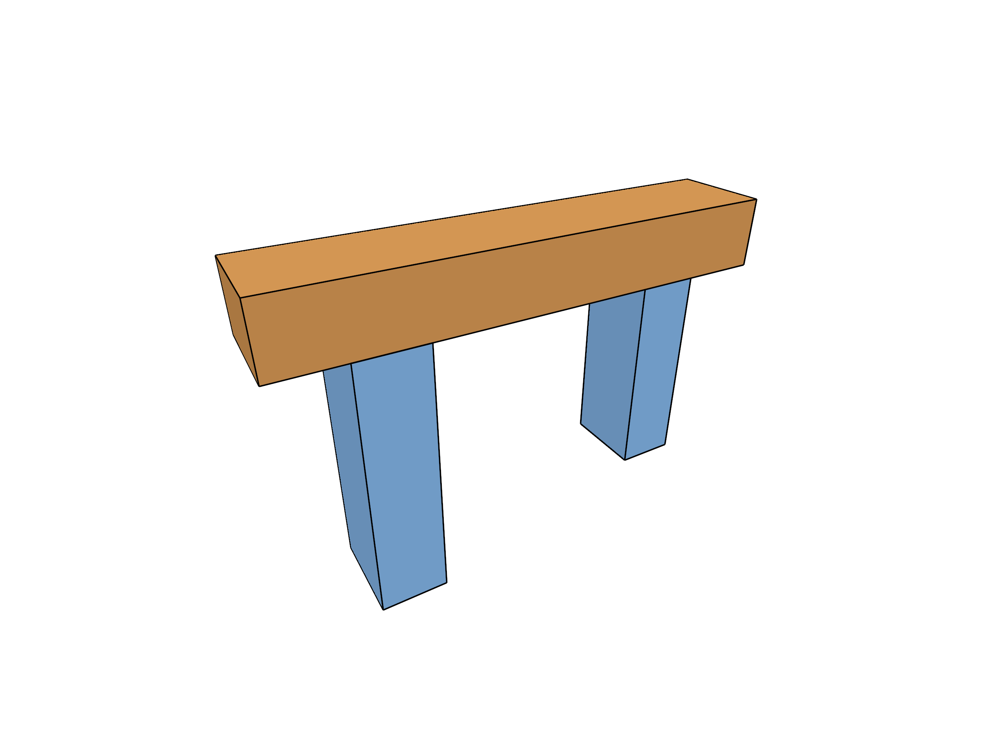

# 8.2.23 · Exercise layers shortcuts colours and exact source ownership

**Chapter 8 · Hierarchy, layers and direct editing · Section 8.2 · Layers and presentation** · [Contents](contents.md)

**Typing: 3–6 minutes.** [Estimate](typing-load.md).

The new layer-name field and the command dock share egui keyboard focus.

## Type

Continue from [Route layer controls before handles and canvas input](53t-input.md). [Save or recover your work](recovery.md).

### 1. `src/shortcuts.rs`

Route keyboard shortcuts through the actual egui focus owner before exercising layer editing. Append this helper after `key`; popup controls and nonempty focused fields retain their keyboard input.

```rust
pub fn context_key(context:&egui::Context,command_text:&str,text:&str,command:bool,shift:bool,alt:bool,composing:bool)->Option<Shortcut> {
    if egui::Popup::is_any_open(context) {return None;}
    let empty_command=context.memory(|memory|memory.focused())==Some(egui::Id::new("command-input"))&&command_text.is_empty();
    key(text,command,shift,alt,composing,context.egui_wants_keyboard_input(),empty_command)
}
```

<details>
<summary>Optional patch references</summary>

```text
--8<-- "journey/code/54a-selection-03.rs"
```

</details>

The [command dock](03d-input.md) already owns its focus behavior. Keep that implementation unchanged while adding layer controls.

### 3. `src/view_flags_tests.rs`

Copy the full source ownership, history and actual control regressions.

Copy this supplied file:

```text
--8<-- "journey/code/53u-layers-01.rs"
```

</details>

### 4. `src/lib.rs`

Register the new source component.

<details>
<summary>Locate the existing block</summary>

```rust

pub mod layer_palette;
```

</details>

After that block, type:

```rust
--8<-- "journey/code/53u-layers-02.rs" skip=24
```

<details>
<summary>Supplied validation fixture</summary>

Copy this supplied authoring fixture once. Continue with the browser build below; the course does not require running native tests.

### 5. `src/layer_edit_tests.rs`

Copy the full source ownership, history and actual control regressions.

Copy this supplied file:

```text
--8<-- "journey/code/53u-layers-03.rs"
```

</details>

### 6. `src/lib.rs`

Register the new source component.

<details>
<summary>Locate the existing block</summary>

```rust
#[cfg(test)]
mod view_flags_tests;
```

</details>

After that block, type:

```rust
--8<-- "journey/code/53u-layers-04.rs" skip=35
```

<details>
<summary>Supplied validation fixture</summary>

Copy this supplied authoring fixture once. Continue with the browser build below; the course does not require running native tests.

### 7. `src/layer_ui_tests.rs`

Copy the full source ownership, history and actual control regressions.

Copy this supplied file:

```text
--8<-- "journey/code/53u-layers-05.rs"
```

</details>

### 8. `src/lib.rs`

Register the new source component.

<details>
<summary>Locate the existing block</summary>

```rust
#[cfg(test)]
mod layer_edit_tests;
```

</details>

After that block, type:

```rust
--8<-- "journey/code/53u-layers-06.rs" skip=35
```

<details>
<summary>Supplied validation fixture</summary>

Copy this supplied authoring fixture once. Continue with the browser build below; the course does not require running native tests.

### 9. `src/pick_gpu_tests.rs`

Copy the actual GPU colour, independent channel and geometry-reuse regression.

<details>
<summary>Locate the existing block</summary>

```text
    renderer.set_preview(Some(&draft)).unwrap(); scene.clear(); renderer.set_scene(&scene, None); assert_eq!(renderer.preview_bytes(), 0);
}
```

</details>

After that block, append this supplied code:

```text
--8<-- "journey/code/53u-layers-07.rs" skip=141
```

</details>

## Run and check

In your project:

```sh
cd workspace/journey
REGEN_PROTO=0 cargo build --lib --locked --target wasm32-unknown-unknown -j1
REGEN_PROTO=0 CARGO_BUILD_JOBS=1 trunk serve --port 8780
```

Open `http://127.0.0.1:8780/`. Keep an existing Trunk server running; saving rebuilds it.

Type Close, Example Nested, Fit, View Isometric, then Layers All. Right-click Frame to create a sublayer, set it current, and add Example Box. Rename the layer, edit Faces and Edges separately, duplicate it and delete the copy with confirmation. Undo each document edit. Select Posts, press H then S outside text fields, and verify that Delete plus Undo restores its parent and attribute together. Hide one child, switch its parent off and on, and verify the child stays hidden while visible siblings return. Selecting a panel row fits its current selection.

### Recorded visual result

**Source31 native image reviewed.**

The Posts group draws with a blue face override and original black boundaries; the unrelated top beam retains its original brown source colour.



*Fresh Rust/NVIDIA raw-DPR4 presentation, personally reviewed at 2560 × 1920. The actual53u constructor presents blue Posts faces with original black boundaries while the unrelated top beam retains its original brown source colour. Layer control GUI interactions require separate checks. Fixed-resolution pixel checks and browser controls require separate acceptance.*

<details>
<summary>Code explanation and diagram</summary>

Adapt the existing dock at this boundary: request focus once when focus_command is set, and gate completion and Escape on the field response. command_open describes display state, so it must not reclaim the keyboard every frame. Then exercise the full layer workflow using supplied source, history, GPU and combined egui fixtures. Preserve precise original geometry while presentation and layer membership change independently.

real layer controls → source-preserving properties → group edit → exact undo and save → canvas shortcuts.


Which layer operations belong in document Undo?

New, rename, move, copy, duplicate and delete. Hiding, showing, locking, recolouring, expansion and choosing current change presentation without consuming document Undo.

Study estimate, including typing and experiments: 0.5–1 hours.

</details>

<details>
<summary>Optional experiment</summary>

Create a sublayer, set it current, add geometry, rename, colour Faces and Edges, duplicate and delete with confirmation. Undo each document edit; use H/S/Delete only outside focused fields.

</details>

<details>
<summary>Check and save your work</summary>

Restore experimental edits, then run from `session_viewer`:

```sh
npm --prefix ../session_tests run course -- check 8.2.23
npm --prefix ../session_tests run course -- save 8.2.23
```

Source comparison leaves your project untouched. [Save and recovery instructions](recovery.md).

</details>

<details>
<summary>Viewer coverage and verification</summary>

This cumulative subject implements layer editing and independent presentation for the mesh tree and generated geometry lanes already taught. General group placements, display-only streamed documents and later geometry types connect in their own subjects.

[October 9 behavior](current-viewer.md): independent layer lamps, panel selection Fit, Element Attributes Off and Element Interactions On. The dated comparison preserves the earlier baseline; browser and handwritten-runtime coverage remain separate.

Additional native checks cover presentation/source separation, current-layer protection, stable keys, generated routing, cross-document world placements, source-sharing copies, complete deletion undo, repeated save identities, actual egui name and colour controls, deletion confirmation and actual GPU face/edge independence. All earlier checks remain.

The complete layer menu, shortcut, name-focus, source-sharing and deletion workflow is authored for browser acceptance. It has not been run in Chrome.

[Full validation scope](release.md).

To reproduce the scripted acceptance of the reference checkpoint, run from `session_viewer` with the [course bundle server](release.md#reproduce) running on port 8781:

```sh
npm --prefix ../session_tests run course -- capture 8.2.23
```

This uses the verified reference bundle; it does not check or change your typed project.

</details>
