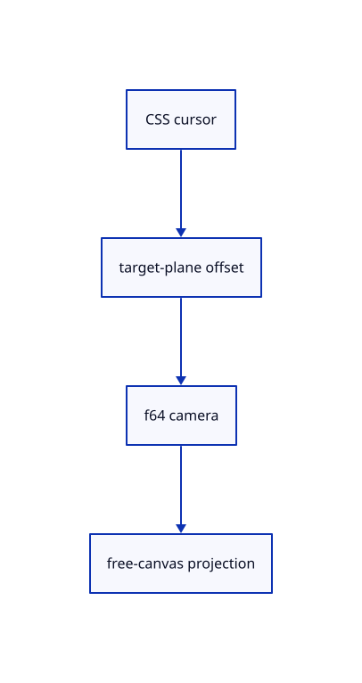

# 8.3.1 · Navigate and fit inside the free canvas

**Chapter 8 · Hierarchy, layers and direct editing · Section 8.3 · Free-canvas navigation and direct editing** · [Contents](contents.md)

**Typing: 20–40 minutes.** [Estimate](typing-load.md).

Use CSS pixel camera rates, zoom around a cursor point and frame the selected geometry in the space left by panels.

## Type

Continue from [Exercise layers shortcuts colours and exact source ownership](53u-layers.md). [Save or recover your work](recovery.md).

### 1. `src/camera.rs`

Keep cursor zoom, CSS pan, unbounded captured rays and panel-free fit in the camera.

Edit these blocks from bottom to top. Keep the surrounding lines unchanged.

<details>
<summary>Locate this block</summary>

```rust
        if screen.iter().any(|value| !value.is_finite() || value.abs() > 1.0) {
            return None;
        }
        let inverse = self.view_projection().inverse()?;
        let origin = inverse.transform_point(&Point::new(screen[0] as f64, screen[1] as f64, 0.0));
        let end = inverse.transform_point(&Point::new(screen[0] as f64, screen[1] as f64, 1.0));
```

</details>

Replace it with:

```rust
        if screen.iter().any(|value| !value.is_finite() || value.abs() > 1.0) {
            return None;
        }
        self.ray_unbounded(screen)
    }

    pub fn ray_unbounded(&self,screen:[f32;2])->Option<Ray> {
        if screen.iter().any(|v|!v.is_finite()) {return None;}
        let inverse = self.view_projection().inverse()?;
        let origin = inverse.transform_point(&Point::new(screen[0] as f64, screen[1] as f64, 0.0));
        let end = inverse.transform_point(&Point::new(screen[0] as f64, screen[1] as f64, 1.0));
```

<details>
<summary>Locate this block</summary>

```rust
                Xform::orthographic(-w, w, -h, h, -depth_range, depth_range)
            }
        };
        projection * view
    }

    pub fn uniform(&self) -> [f32; 16] {
```

</details>

Replace it with:

```rust
                Xform::orthographic(-w, w, -h, h, -depth_range, depth_range)
            }
        };
        let shift=self.shift();
        Xform::translation(shift[0],shift[1],0.) * projection * view
    }

    pub fn shift(&self)->[f64;2] { [self.frame[0]+self.frame[2]-1.,1.-self.frame[1]-self.frame[3]] }

    pub fn frame(&mut self,frame:[f64;4])->bool {
        if frame.iter().any(|v|!v.is_finite()||*v<0.||*v>1.)||frame[0]>=frame[2]||frame[1]>=frame[3] {return false;}
        if self.frame==frame {return false;}self.frame=frame;true
    }

    pub fn pan_screen(&mut self,delta:[f64;2],size:[f64;2]) {
        if delta.iter().any(|v|!v.is_finite())||size.iter().any(|v|!v.is_finite()||*v<=0.) {return;}
        let scale=self.distance*0.0015;
        let right=self.orientation.rotate_vector(Vector::x_axis());let up=self.orientation.rotate_vector(Vector::z_axis());
        for i in 0..3 {self.target[i]+=scale*(-delta[0]*right[i]+delta[1]*up[i]);}
    }

    pub fn zoom_at(&mut self,factor:f32,screen:[f32;2]) {
        if screen.iter().any(|v|!v.is_finite()||v.abs()>1.) {return;}
        let old=self.distance;self.zoom(factor);let k=self.distance/old;let shift=self.shift();
        let h=old*HALF_FOV.tan();let right=self.orientation.rotate_vector(Vector::x_axis());let up=self.orientation.rotate_vector(Vector::z_axis());
        for i in 0..3 {self.target[i]+=(1.-k)*h*(right[i]*(screen[0] as f64-shift[0])*self.aspect+up[i]*(screen[1] as f64-shift[1]));}
    }

    pub fn uniform(&self) -> [f32; 16] {
```

<details>
<summary>Locate this block</summary>

```rust
            aspect: 640.0 / 480.0,
            projection: Projection::Perspective,
            grid: None,
        }
    }
}

impl Camera {
    pub fn fit(&mut self, bounds: &crate::bounds::Bounds) {
        let half_y = HALF_FOV;
        let half_x = (self.aspect * half_y.tan()).atan();
        let radius = bounds.radius();
        self.radius = if radius > 0.0 { radius } else { 1.0 };
        self.target = bounds.centre();
        let opening = match self.projection {
            Projection::Perspective => half_x.min(half_y).sin(),
            Projection::Orthographic => half_y.tan() * self.aspect.min(1.0),
        };
        self.distance = self.radius * 1.1 / opening;
    }
```

</details>

Replace it with:

```rust
            aspect: 640.0 / 480.0,
            projection: Projection::Perspective,
            grid: None,
            frame:[0.,0.,1.,1.],
        }
    }
}

impl Camera {
    pub fn fit(&mut self, bounds: &crate::bounds::Bounds) {
        let half_y = (HALF_FOV.tan()*(self.frame[3]-self.frame[1])).atan();
        let half_x = (self.aspect * HALF_FOV.tan()*(self.frame[2]-self.frame[0])).atan();
        let radius = bounds.radius();
        self.radius = if radius > 0.0 { radius } else { 1.0 };
        self.target = bounds.centre();
        let opening = match self.projection {
            Projection::Perspective => half_x.min(half_y).sin(),
            Projection::Orthographic => half_y.tan().min(half_x.tan()),
        };
        self.distance = self.radius * 1.1 / opening;
    }
```

<details>
<summary>Locate this block</summary>

```rust
    pub aspect: f64,
    pub projection: Projection,
    pub grid: Option<crate::grid::Settings>,
}

impl Default for Camera {
```

</details>

Replace it with:

```rust
    pub aspect: f64,
    pub projection: Projection,
    pub grid: Option<crate::grid::Settings>,
    pub frame:[f64;4],
}

impl Default for Camera {
```

<details>
<summary>Complete updated block reference</summary>

```rust
use session_rust::{Point, Quaternion, Vector, Xform};

pub const NEAR_FRACTION:f64=1.0e-4;

const HALF_FOV: f64 = std::f64::consts::FRAC_PI_6;

#[derive(Clone, Copy, Debug, PartialEq, Eq)]
pub enum Projection {
    Perspective,
    Orthographic,
}

pub struct Ray {
    pub origin: Point,
    pub direction: Vector,
    pub max_distance: f64,
}

pub struct Camera {
    pub target: [f64; 3],
    pub distance: f64,
    pub radius: f64,
    pub orientation: Quaternion,
    pub aspect: f64,
    pub projection: Projection,
    pub grid: Option<crate::grid::Settings>,
    pub frame:[f64;4],
}

impl Default for Camera {
    fn default() -> Self {
        Self {
            target: [0.0; 3],
            distance: 3.0,
            radius: 1.0,
            orientation: Quaternion::from_axis_angle(Vector::x_axis(), -std::f64::consts::FRAC_PI_2),
            aspect: 640.0 / 480.0,
            projection: Projection::Perspective,
            grid: None,
            frame:[0.,0.,1.,1.],
        }
    }
}

impl Camera {
    pub fn fit(&mut self, bounds: &crate::bounds::Bounds) {
        let half_y = (HALF_FOV.tan()*(self.frame[3]-self.frame[1])).atan();
        let half_x = (self.aspect * HALF_FOV.tan()*(self.frame[2]-self.frame[0])).atan();
        let radius = bounds.radius();
        self.radius = if radius > 0.0 { radius } else { 1.0 };
        self.target = bounds.centre();
        let opening = match self.projection {
            Projection::Perspective => half_x.min(half_y).sin(),
            Projection::Orthographic => half_y.tan().min(half_x.tan()),
        };
        self.distance = self.radius * 1.1 / opening;
    }

    pub fn pan(&mut self, dx: f32, dy: f32) {
        let right = self.orientation.rotate_vector(Vector::x_axis());
        let up = self.orientation.rotate_vector(Vector::z_axis());
        for i in 0..3 {
            self.target[i] += dx as f64 * right[i] + dy as f64 * up[i];
        }
    }

    pub fn zoom(&mut self, factor: f32) {
        if factor.is_finite() && factor > 0.0 {
            self.distance = (self.distance / factor as f64).clamp(self.radius * 0.2, self.radius * 50.0);
        }
    }

    pub fn rotate(&mut self, radians: f32) {
        self.orbit(radians as f64, 0.0);
    }

    pub fn orbit(&mut self, yaw: f64, pitch: f64) {
        let right = self.orientation.rotate_vector(Vector::x_axis());
        let turn = Quaternion::from_axis_angle(Vector::z_axis(), yaw);
        let tilt = Quaternion::from_axis_angle(right, pitch);
        self.orientation = (turn * (tilt * self.orientation.duplicate())).normalized();
    }

    pub fn isometric(&mut self) {
        let turn = Quaternion::from_axis_angle(Vector::z_axis(), -std::f64::consts::FRAC_PI_6);
        let right = turn.rotate_vector(Vector::x_axis());
        let tilt = Quaternion::from_axis_angle(right, -std::f64::consts::FRAC_PI_6);
        self.orientation = (tilt * turn).normalized();
    }

    pub fn view_projection(&self) -> Xform {
        let forward = self.orientation.rotate_vector(Vector::y_axis());
        let up = self.orientation.rotate_vector(Vector::z_axis());
        let target = Point::new(self.target[0], self.target[1], self.target[2]);
        let eye = Point::new(
            self.target[0] - forward[0] * self.distance,
            self.target[1] - forward[1] * self.distance,
            self.target[2] - forward[2] * self.distance,
        );
        let view = Xform::look_at_right_handed(&eye, &target, &up);
        let near = self.distance * NEAR_FRACTION;
        let reach = self.grid.and_then(|grid| grid.reach(self.target).ok()).map_or(self.radius, |reach| self.radius.max(reach));
        let far = (self.distance * 10.0).max(self.distance + 2.0 * reach);
        let projection = match self.projection {
            Projection::Perspective => Xform::perspective(2.0 * HALF_FOV, self.aspect, near, far),
            Projection::Orthographic => {
                let h = self.distance * HALF_FOV.tan();
                let w = h * self.aspect;
                let depth_range = (self.distance + 2.0 * reach).max(1.0e-6);
                Xform::orthographic(-w, w, -h, h, -depth_range, depth_range)
            }
        };
        let shift=self.shift();
        Xform::translation(shift[0],shift[1],0.) * projection * view
    }

    pub fn shift(&self)->[f64;2] { [self.frame[0]+self.frame[2]-1.,1.-self.frame[1]-self.frame[3]] }

    pub fn frame(&mut self,frame:[f64;4])->bool {
        if frame.iter().any(|v|!v.is_finite()||*v<0.||*v>1.)||frame[0]>=frame[2]||frame[1]>=frame[3] {return false;}
        if self.frame==frame {return false;}self.frame=frame;true
    }

    pub fn pan_screen(&mut self,delta:[f64;2],size:[f64;2]) {
        if delta.iter().any(|v|!v.is_finite())||size.iter().any(|v|!v.is_finite()||*v<=0.) {return;}
        let scale=self.distance*0.0015;
        let right=self.orientation.rotate_vector(Vector::x_axis());let up=self.orientation.rotate_vector(Vector::z_axis());
        for i in 0..3 {self.target[i]+=scale*(-delta[0]*right[i]+delta[1]*up[i]);}
    }

    pub fn zoom_at(&mut self,factor:f32,screen:[f32;2]) {
        if screen.iter().any(|v|!v.is_finite()||v.abs()>1.) {return;}
        let old=self.distance;self.zoom(factor);let k=self.distance/old;let shift=self.shift();
        let h=old*HALF_FOV.tan();let right=self.orientation.rotate_vector(Vector::x_axis());let up=self.orientation.rotate_vector(Vector::z_axis());
        for i in 0..3 {self.target[i]+=(1.-k)*h*(right[i]*(screen[0] as f64-shift[0])*self.aspect+up[i]*(screen[1] as f64-shift[1]));}
    }

    pub fn uniform(&self) -> [f32; 16] {
        self.view_projection().to_f32()
    }

    pub fn ray(&self, screen: [f32; 2]) -> Option<Ray> {
        if screen.iter().any(|value| !value.is_finite() || value.abs() > 1.0) {
            return None;
        }
        self.ray_unbounded(screen)
    }

    pub fn ray_unbounded(&self,screen:[f32;2])->Option<Ray> {
        if screen.iter().any(|v|!v.is_finite()) {return None;}
        let inverse = self.view_projection().inverse()?;
        let origin = inverse.transform_point(&Point::new(screen[0] as f64, screen[1] as f64, 0.0));
        let end = inverse.transform_point(&Point::new(screen[0] as f64, screen[1] as f64, 1.0));
        let delta = &end - &origin;
        let max_distance = delta.magnitude();
        if !max_distance.is_finite() || max_distance <= 0.0 {
            return None;
        }
        Some(Ray { origin, direction: delta.normalized(), max_distance })
    }
}

#[cfg(test)]
mod tests {
    use super::*;

    #[test]
    fn the_target_stays_centred_after_pan_zoom_and_turn() {
        let mut camera = Camera::default();
        camera.pan(0.25, -0.5);
        camera.zoom(2.0);
        camera.rotate(0.7);
        camera.orbit(0.3, 0.2);
        let target = Point::new(camera.target[0], camera.target[1], camera.target[2]);
        let screen = camera.view_projection().transform_point(&target);
        assert!(screen[0].abs() < 1.0e-9 && screen[1].abs() < 1.0e-9);
        assert!((0.0..1.0).contains(&screen[2]));
    }

    #[test]
    fn repeated_orbit_keeps_the_camera_axes_orthonormal() {
        let mut camera = Camera::default();
        for _ in 0..1_000 {
            camera.orbit(0.01, 0.02);
        }
        let right = camera.orientation.rotate_vector(Vector::x_axis());
        let forward = camera.orientation.rotate_vector(Vector::y_axis());
        let up = camera.orientation.rotate_vector(Vector::z_axis());
        for axis in [&right, &forward, &up] {
            assert!((axis.magnitude() - 1.0).abs() < 1.0e-10);
        }
        assert!(right.dot(&forward).abs() < 1.0e-10);
        assert!(right.dot(&up).abs() < 1.0e-10);
        assert!(forward.dot(&up).abs() < 1.0e-10);
    }

    #[test]
    fn a_projected_point_lies_on_its_unprojected_ray() {
        let camera = Camera::default();
        let world = Point::new(0.4, 0.2, 0.75);
        let screen = camera.view_projection().transform_point(&world);
        let ray = camera.ray([screen[0] as f32, screen[1] as f32]).unwrap();
        let offset = &world - &ray.origin;
        assert!(offset.cross(&ray.direction).magnitude() < 1.0e-6);
        assert!(offset.dot(&ray.direction) > 0.0);
        assert!(offset.magnitude() < ray.max_distance);
        assert!(camera.ray([f32::NAN, 0.0]).is_none());
    }
}

#[cfg(test)]
mod near_range_tests{
 use super::*;
 #[test]
 fn large_scene_radius_does_not_cut_geometry_just_ahead_of_the_eye(){
  for distance in [0.001,1.,1000.]{let mut camera=Camera::default();camera.distance=distance;camera.radius=distance*100000.;
   let forward=camera.orientation.rotate_vector(Vector::y_axis());let point=|gap:f64|Point::new(camera.target[0]+forward[0]*(gap-distance),camera.target[1]+forward[1]*(gap-distance),camera.target[2]+forward[2]*(gap-distance));
   let matrix=camera.view_projection();let inside=matrix.transform_point(&point(distance*NEAR_FRACTION*2.));let cut=matrix.transform_point(&point(distance*NEAR_FRACTION*0.5));
   assert!((0.0..1.0).contains(&inside[2]),"near geometry remains in view: {inside:?}");assert!(cut[2]<0.,"the near plane still cuts ahead of the eye");
  }
 }
}

#[cfg(test)]
mod orthographic_range_tests{
 use super::*;
 #[test]
 fn orthographic_depth_retains_four_millimetres_at_a_distant_camera(){
  let mut camera=Camera::default();camera.projection=Projection::Orthographic;camera.distance=1_000_000.;camera.radius=1000.;
  let forward=camera.orientation.rotate_vector(Vector::y_axis());let center=Point::new(camera.target[0],camera.target[1],camera.target[2]);let behind=&center+&(forward*4.);
  let matrix=camera.view_projection();let a=matrix.transform_point(&center);let b=matrix.transform_point(&behind);
  assert!((0.0..1.0).contains(&a[2])&&(0.0..1.0).contains(&b[2]));let front=a[2]as f32;let rear=b[2]as f32;
  assert!((front-rear).abs()>rear.abs()*1.9073486e-6,"four millimetres exceed the ink visibility tolerance");
 }
}
```

</details>

<details>
<summary>Optional patch references</summary>

Use these original edit fragments when comparing a saved checkpoint. Apply the complete blocks above.

```text
--8<-- "journey/code/54-camera-01.rs"
```

```text
--8<-- "journey/code/54-camera-02.rs"
```

```text
--8<-- "journey/code/54-camera-03.rs"
```

```text
--8<-- "journey/code/54-camera-04.rs"
```

```text
--8<-- "journey/code/54-camera-05.rs"
```

```text
--8<-- "journey/code/54-camera-06.rs"
```

</details>

### 2. `src/navigation.rs`

Normalise wheel units and use the current bounded 0.9 zoom steps.

<details>
<summary>Locate the existing block</summary>

```rust
        _ => return None,
    };
    let pixels = (delta * unit).clamp(-600.0, 600.0);
    Some(Action::Zoom((-0.002 * pixels).exp() as f32))
}
```

</details>

Edit the existing block to match this code; keep unchanged lines:

```rust
--8<-- "journey/code/54-camera-07.rs"
```

<details>
<summary>Supplied validation fixture</summary>

Copy this supplied authoring fixture once. Continue with the browser build below; the course does not require running native tests.

### 3. `src/navigation_tests.rs`

Copy the preserved wheel, invalid-input and history checks with the current ten-step limit.

<details>
<summary>Locate the existing block</summary>

```text
    }
    assert!(wheel(10.0, 99, 480.0).is_none());
    assert_eq!(distance(f64::MAX, 2), distance(600.0, 0));
    assert_eq!(distance(-f64::MAX, 2), distance(-600.0, 0));
}
```

</details>

Update the existing block with this supplied code; keep unchanged lines:

```text
--8<-- "journey/code/54-camera-08.rs"
```

</details>

## Run and check

In your project:

```sh
cd workspace/journey
REGEN_PROTO=0 cargo build --lib --locked --target wasm32-unknown-unknown -j1
REGEN_PROTO=0 CARGO_BUILD_JOBS=1 trunk serve --port 8780
```

Open `http://127.0.0.1:8780/`. Keep an existing Trunk server running; saving rebuilds it.

Continue the blue Posts layer exercise. This preparation connects one navigation component; the complete canvas and touch exercise comes at the end of54.

### Recorded visual result

**Previous native render — current verification pending.**

Blue Posts retain original black boundaries and the independent brown source beam.


*This recorded image predates a source or checker change. Rebuild this checkpoint before using it as current evidence; browser controls require separate acceptance.*

<details>
<summary>Code explanation and diagram</summary>


CSS cursor → target-plane offset → f64 camera → free-canvas projection.



Why subtract the free-canvas shift while zooming?

The camera target is centred in the space left by panels. The cursor offset must use that same shifted projection to keep its target-plane point under the cursor.

Study estimate, including typing and experiments: 0.5–1 hours.

</details>

<details>
<summary>Optional experiment</summary>

Project a target-plane point, zoom at its cursor and compare its screen position in both projections.

</details>

<details>
<summary>Check and save your work</summary>

Restore experimental edits, then run from `session_viewer`:

```sh
npm --prefix ../session_tests run course -- check 8.3.1
npm --prefix ../session_tests run course -- save 8.3.1
```

Source comparison leaves your project untouched. [Save and recovery instructions](recovery.md).

</details>

<details>
<summary>Viewer coverage and verification</summary>

This subject implements current canvas navigation and eligible window/crossing selection for the geometry lanes already taught. Surface, BRep, cloud and instance sampling connect in their own subjects. Actual Chrome and Lenovo performance acceptance remains outstanding.

The earlier Layers exercise remains; full navigation acceptance connects at the end of this subject.

[Full validation scope](release.md).

To reproduce the scripted acceptance of the reference checkpoint, run from `session_viewer` with the [course bundle server](release.md#reproduce) running on port 8781:

```sh
npm --prefix ../session_tests run course -- capture 8.3.1
```

This uses the verified reference bundle; it does not check or change your typed project.

</details>
