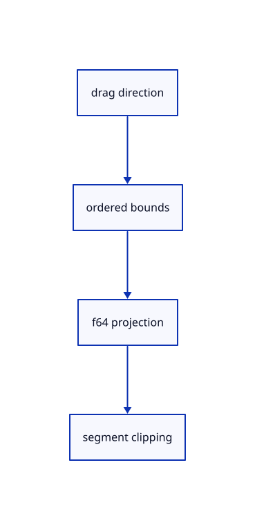

# 8.3.5 · Distinguish window and crossing rectangles

**Chapter 8 · Hierarchy, layers and direct editing · Section 8.3 · Free-canvas navigation and direct editing** · [Contents](contents.md)

**Typing: 17–34 minutes.** [Estimate](typing-load.md).

Track drag direction independently of ordered bounds, project original world points in CSS pixels and clip segments against the rectangle.

## Type

Continue from [Keep touch handles reachable without enlarging them](54b-finger.md). [Save or recover your work](recovery.md).

### 1. `src/rect_select.rs`

Define finite rectangles, direction, point containment, segment clipping and CSS projection.

Create the file and type:

```rust
--8<-- "journey/code/54c-rectangle-01.rs"
```

### 2. `src/lib.rs`

Register the source component.

<details>
<summary>Locate the existing block</summary>

```rust
#[cfg(test)]
mod layer_ui_tests;
```

</details>

After that block, type:

```rust
--8<-- "journey/code/54c-rectangle-02.rs" skip=33
```

## Run and check

In your project:

```sh
cd workspace/journey
REGEN_PROTO=0 cargo build --lib --locked --target wasm32-unknown-unknown -j1
REGEN_PROTO=0 CARGO_BUILD_JOBS=1 trunk serve --port 8780
```

Open `http://127.0.0.1:8780/`. Keep an existing Trunk server running; saving rebuilds it.


### Recorded visual result

**Previous native render — current verification pending.**

Blue Posts retain original black boundaries and the independent brown source beam.


*This recorded image predates a source or checker change. Rebuild this checkpoint before using it as current evidence; browser controls require separate acceptance.*

This reference image is shared with [8.3.1 · Navigate and fit inside the free canvas](54-camera.md). It does not demonstrate a new feature by itself.

<details>
<summary>Code explanation and diagram</summary>


drag direction → ordered bounds → f64 projection → segment clipping.



Can a crossing find a line when both endpoints are outside?

Yes. Segment clipping finds an intersection with the rectangle even when neither endpoint lies inside. A window still requires every projected sample inside.

Study estimate, including typing and experiments: 0.5–1 hours.

</details>

<details>
<summary>Optional experiment</summary>

Drag the same rectangle in opposite directions around the middle of a long line. Compare its window and crossing results.

</details>

<details>
<summary>Check and save your work</summary>

Restore experimental edits, then run from `session_viewer`:

```sh
npm --prefix ../session_tests run course -- check 8.3.5
npm --prefix ../session_tests run course -- save 8.3.5
```

Source comparison leaves your project untouched. [Save and recovery instructions](recovery.md).

</details>

<details>
<summary>Viewer coverage and verification</summary>

This subject implements current canvas navigation and eligible window/crossing selection for the geometry lanes already taught. Surface, BRep, cloud and instance sampling connect in their own subjects. Actual Chrome and Lenovo performance acceptance remains outstanding.

The earlier Layers exercise remains; full navigation acceptance connects at the end of this subject.

[Full validation scope](release.md).

To reproduce the scripted acceptance of the reference checkpoint, run from `session_viewer` with the [course bundle server](release.md#reproduce) running on port 8781:

```sh
npm --prefix ../session_tests run course -- capture 8.3.5
```

This uses the verified reference bundle; it does not check or change your typed project.

</details>
