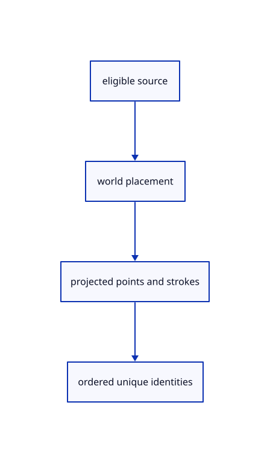

# 8.3.6 · Select original projected geometry in one source pass

**Chapter 8 · Hierarchy, layers and direct editing · Section 8.3 · Free-canvas navigation and direct editing** · [Contents](contents.md)

**Typing: 22–43 minutes.** [Estimate](typing-load.md).

Test the precise original geometry already taught and exclude hidden, locked and read-only owners before collecting samples.

## Type

Continue from [Distinguish window and crossing rectangles](54c-rectangle.md). [Save or recover your work](recovery.md).

### 1. `src/rect_select.rs`

Collect original mesh vertices and boundary strokes plus precise line, path and point samples.

<details>
<summary>Locate the existing block</summary>

```rust
    let point=[(clip(0)/w+1.)*size[0]/2.,(1.-clip(1)/w)*size[1]/2.];point.iter().all(|value|value.is_finite()).then_some(point)
}
```

</details>

After that block, type:

```rust
--8<-- "journey/code/54d-samples-01.rs" skip=131
```

<details>
<summary>Supplied validation fixture</summary>

Copy this supplied authoring fixture once. Continue with the browser build below; the course does not require running native tests.

### 2. `src/rect_select_tests.rs`

Copy direction, segment, projection, mixed-geometry and current-eligibility checks.

Copy this supplied file:

```text
--8<-- "journey/code/54d-samples-02.rs"
```

</details>

<details>
<summary>Supplied validation fixture</summary>

Copy this supplied authoring fixture once. Continue with the browser build below; the course does not require running native tests.

### 3. `src/lib.rs`

Register the source component.

<details>
<summary>Locate the existing block</summary>

```text

pub mod rect_select;
```

</details>

After that block, append this supplied code:

```text
--8<-- "journey/code/54d-samples-03.rs" skip=22
```

</details>

## Run and check

In your project:

```sh
cd workspace/journey
REGEN_PROTO=0 cargo build --lib --locked --target wasm32-unknown-unknown -j1
REGEN_PROTO=0 CARGO_BUILD_JOBS=1 trunk serve --port 8780
```

Open `http://127.0.0.1:8780/`. Keep an existing Trunk server running; saving rebuilds it.


### Recorded visual result

**Previous native render — current verification pending.**

Blue Posts retain original black boundaries and the independent brown source beam.


*This recorded image predates a source or checker change. Rebuild this checkpoint before using it as current evidence; browser controls require separate acceptance.*

This reference image is shared with [8.3.1 · Navigate and fit inside the free canvas](54-camera.md). It does not demonstrate a new feature by itself.

<details>
<summary>Code explanation and diagram</summary>


eligible source → world placement → projected points and strokes → ordered unique identities.



Why avoid searching all rows again for each candidate identity?

It makes rectangle selection quadratic in the number of objects. One pass per geometry lane preserves original precision and checks each eligible owner directly.

Study estimate, including typing and experiments: 0.5–1 hours.

</details>

<details>
<summary>Optional experiment</summary>

Select a line and point in a small rectangle, lock the point, hide the line, and compare all three results.

</details>

<details>
<summary>Check and save your work</summary>

Restore experimental edits, then run from `session_viewer`:

```sh
npm --prefix ../session_tests run course -- check 8.3.6
npm --prefix ../session_tests run course -- save 8.3.6
```

Source comparison leaves your project untouched. [Save and recovery instructions](recovery.md).

</details>

<details>
<summary>Viewer coverage and verification</summary>

This subject implements current canvas navigation and eligible window/crossing selection for the geometry lanes already taught. Surface, BRep, cloud and instance sampling connect in their own subjects. Actual Chrome and Lenovo performance acceptance remains outstanding.

The earlier Layers exercise remains; full navigation acceptance connects at the end of this subject.

[Full validation scope](release.md).

To reproduce the scripted acceptance of the reference checkpoint, run from `session_viewer` with the [course bundle server](release.md#reproduce) running on port 8781:

```sh
npm --prefix ../session_tests run course -- capture 8.3.6
```

This uses the verified reference bundle; it does not check or change your typed project.

</details>
