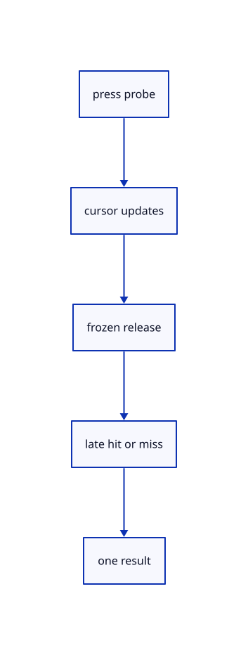

# 8.3.7 · Freeze a released drag until its pick answers

**Chapter 8 · Hierarchy, layers and direct editing · Section 8.3 · Free-canvas navigation and direct editing** · [Contents](contents.md)

**Typing: 28–55 minutes.** [Estimate](typing-load.md).

Keep the press, current cursor, release modifiers and source-preserving preview. A late hit moves by the entire drag; a late miss finishes rectangle selection.

## Type

Continue from [Select original projected geometry in one source pass](54d-samples.md). [Save or recover your work](recovery.md).

### 1. `src/canvas_drag.rs`

Store the captured drag and a fixed world plane without changing original geometry.

Create the file and type:

```rust
--8<-- "journey/code/54e-drag-01.rs"
```

### 2. `src/lib.rs`

Register the source component.

<details>
<summary>Locate the existing block</summary>

```rust
#[cfg(test)]
mod rect_select_tests;
```

</details>

After that block, type:

```rust
--8<-- "journey/code/54e-drag-02.rs" skip=36
```

## Run and check

In your project:

```sh
cd workspace/journey
REGEN_PROTO=0 cargo build --lib --locked --target wasm32-unknown-unknown -j1
REGEN_PROTO=0 CARGO_BUILD_JOBS=1 trunk serve --port 8780
```

Open `http://127.0.0.1:8780/`. Keep an existing Trunk server running; saving rebuilds it.


### Recorded visual result

**Previous native render — current verification pending.**

Blue Posts retain original black boundaries and the independent brown source beam.


*This recorded image predates a source or checker change. Rebuild this checkpoint before using it as current evidence; browser controls require separate acceptance.*

This reference image is shared with [8.3.1 · Navigate and fit inside the free canvas](54-camera.md). It does not demonstrate a new feature by itself.

<details>
<summary>Code explanation and diagram</summary>


press probe → cursor updates → frozen release → late hit or miss → one result.



What survives when release comes before the pick answer?

The release cursor and its modifiers. A hit commits the full movement once; a miss applies the rectangle using those release modifiers. A new press discards the old request.

Study estimate, including typing and experiments: 0.5–1 hours.

</details>

<details>
<summary>Optional experiment</summary>

Compare hit and miss answers while held and after release; then cancel before either answer arrives.

</details>

<details>
<summary>Check and save your work</summary>

Restore experimental edits, then run from `session_viewer`:

```sh
npm --prefix ../session_tests run course -- check 8.3.7
npm --prefix ../session_tests run course -- save 8.3.7
```

Source comparison leaves your project untouched. [Save and recovery instructions](recovery.md).

</details>

<details>
<summary>Viewer coverage and verification</summary>

This subject implements current canvas navigation and eligible window/crossing selection for the geometry lanes already taught. Surface, BRep, cloud and instance sampling connect in their own subjects. Actual Chrome and Lenovo performance acceptance remains outstanding.

The earlier Layers exercise remains; full navigation acceptance connects at the end of this subject.

[Full validation scope](release.md).

To reproduce the scripted acceptance of the reference checkpoint, run from `session_viewer` with the [course bundle server](release.md#reproduce) running on port 8781:

```sh
npm --prefix ../session_tests run course -- capture 8.3.7
```

This uses the verified reference bundle; it does not check or change your typed project.

</details>
