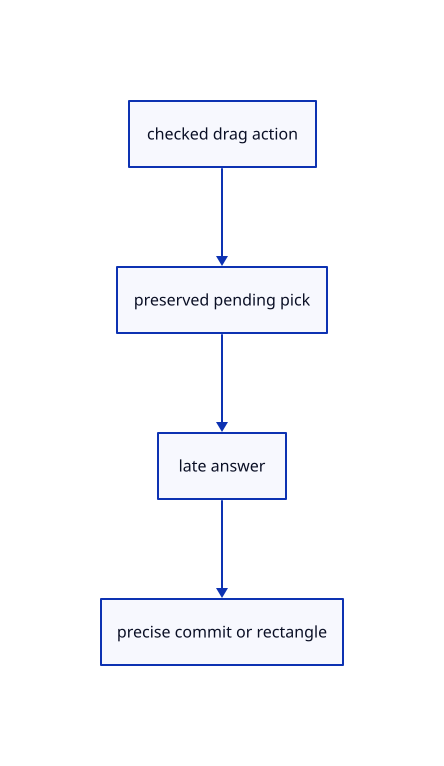

# 8.3.9 · Apply held released and cancelled drag outcomes

**Chapter 8 · Hierarchy, layers and direct editing · Section 8.3 · Free-canvas navigation and direct editing** · [Contents](contents.md)

**Typing: 22–43 minutes.** [Estimate](typing-load.md).

Update only the captured preview. Keep unanswered picks alive through movement and release, and discard previews on ordinary command or view changes.

## Type

Continue from [Own drag previews outside document history](54f-drag-state.md). [Save or recover your work](recovery.md).

### 1. `src/editor.rs`

Route captured drag actions, commit whole movement and invalidate snap caches after a document change.

<details>
<summary>Locate the existing block</summary>

```rust

    pub fn apply(&mut self, action: Action) -> Result<Change, &'static str> {
        match action {Action::SelectRows {ids,add,remove}=>{self.select_rows(ids,add,remove);return Ok(Change::View);},_=>{}}
        let keep_gizmo=matches!(&action,Action::GizmoPress {..}|Action::GizmoTouch {..}|Action::GizmoMove {..}|Action::GizmoRelease {..}|Action::GizmoCancel|Action::GizmoNumber(_)|Action::Zoom(_)|Action::ZoomAt {..}|Action::PanScreen {..}|Action::Pan(_,_)|Action::Orbit(_,_)|Action::Fit|Action::FitSelected|Action::Projection(_)|Action::ResetView|Action::Background|Action::NormalView(_)|Action::Grid(_)|Action::Snap(_));
        let keep_edit=matches!(&action, Action::GizmoPress {..} | Action::GizmoTouch {..} | Action::GizmoMove {..} | Action::GizmoRelease {..} | Action::GizmoCancel | Action::GizmoNumber(_) | Action::BeginTool(_) | Action::ToolPoint(_) | Action::ToolScreen {..} | Action::ToolHover(_) | Action::CancelTool | Action::Snap(_) | Action::Zoom(_) | Action::ZoomAt {..} | Action::PanScreen {..} | Action::Pan(_,_) | Action::Orbit(_,_) | Action::Fit | Action::FitSelected | Action::Projection(_) | Action::ResetView | Action::Background | Action::NormalView(_) | Action::Grid(_));
```

</details>

Edit the existing block to match this code; keep unchanged lines:

```rust
--8<-- "journey/code/54g-drag-actions-01.rs"
```

## Run and check

In your project:

```sh
cd workspace/journey
REGEN_PROTO=0 cargo build --lib --locked --target wasm32-unknown-unknown -j1
REGEN_PROTO=0 CARGO_BUILD_JOBS=1 trunk serve --port 8780
```

Open `http://127.0.0.1:8780/`. Keep an existing Trunk server running; saving rebuilds it.


### Recorded visual result

**Previous native render — current verification pending.**

Blue Posts retain original black boundaries and the independent brown source beam.


*This recorded image predates a source or checker change. Rebuild this checkpoint before using it as current evidence; browser controls require separate acceptance.*

This reference image is shared with [8.3.1 · Navigate and fit inside the free canvas](54-camera.md). It does not demonstrate a new feature by itself.

<details>
<summary>Code explanation and diagram</summary>


checked drag action → preserved pending pick → late answer → precise commit or rectangle.



Why must pending movement return a view change rather than upload a scene?

Uploading the unchanged scene invalidates its pending pick. A pending drag only updates cursor state. A real placement preview can update display after its answer arrives.

Study estimate, including typing and experiments: 0.5–1 hours.

</details>

<details>
<summary>Optional experiment</summary>

Release before answering, move the cursor again, then deliver the answer. Verify it uses the frozen release and one Undo restores the source placement.

</details>

<details>
<summary>Check and save your work</summary>

Restore experimental edits, then run from `session_viewer`:

```sh
npm --prefix ../session_tests run course -- check 8.3.9
npm --prefix ../session_tests run course -- save 8.3.9
```

Source comparison leaves your project untouched. [Save and recovery instructions](recovery.md).

</details>

<details>
<summary>Viewer coverage and verification</summary>

This subject implements current canvas navigation and eligible window/crossing selection for the geometry lanes already taught. Surface, BRep, cloud and instance sampling connect in their own subjects. Actual Chrome and Lenovo performance acceptance remains outstanding.

The earlier Layers exercise remains; full navigation acceptance connects at the end of this subject.

[Full validation scope](release.md).

To reproduce the scripted acceptance of the reference checkpoint, run from `session_viewer` with the [course bundle server](release.md#reproduce) running on port 8781:

```sh
npm --prefix ../session_tests run course -- capture 8.3.9
```

This uses the verified reference bundle; it does not check or change your typed project.

</details>
