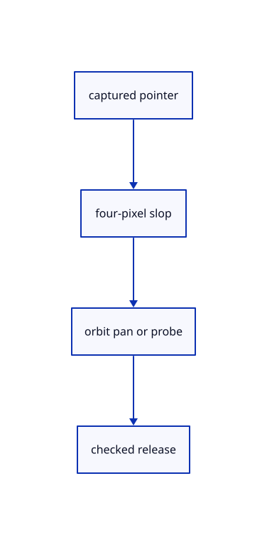

# 8.3.10 · Capture mouse gestures in CSS pixels

**Chapter 8 · Hierarchy, layers and direct editing · Section 8.3 · Free-canvas navigation and direct editing** · [Contents](contents.md)

**Typing: 30–59 minutes.** [Estimate](typing-load.md).

Use four-pixel slop before orbit or selection probes. Middle drag and Ctrl/Cmd-right drag pan; an unmoved right click requests command repetition.

## Type

Continue from [Apply held released and cancelled drag outcomes](54g-drag-actions.md). [Save or recover your work](recovery.md).

### 1. `src/gesture.rs`

Keep captured pointer ownership, full first delta, mouse navigation and released probes.

<details>
<summary>Locate the existing block</summary>

```rust
#[derive(Debug, PartialEq)]
pub enum Motion {
    Pick([f64; 2]),
    Orbit([f64; 2]),
}

impl Motion {
    pub fn action(self, rect: [f64; 4]) -> Option<Action> {
        let [left, top, width, height] = rect;
        if rect.iter().any(|n| !n.is_finite()) || width <= 0.0 || height <= 0.0 {
            return None;
        }
        Some(match self {
            Self::Pick([x, y]) => Action::Pick([
                (2.0 * (x - left) / width - 1.0) as f32,
                (1.0 - 2.0 * (y - top) / height) as f32,
            ]),
            Self::Orbit([dx, dy]) => Action::Orbit(
                -std::f64::consts::PI * dx / width,
                -std::f64::consts::PI * dy / height,
            ),
        })
    }
}

struct Drag {
    id: i32,
    button: i16,
    start: [f64; 2],
    last: [f64; 2],
    moved: bool,
}

#[derive(Default)]
pub struct Gesture {
    active: Option<Drag>,
}

impl Gesture {
    pub fn press(&mut self, id: i32, button: i16, position: [f64; 2]) -> bool {
        if self.active.is_some() || !matches!(button, 0 | 2)
            || position.iter().any(|n| !n.is_finite()) {
            return false;
        }
        self.active = Some(Drag { id, button, start: position, last: position, moved: false });
        true
    }

    pub fn move_to(&mut self, id: i32, position: [f64; 2]) -> Option<Motion> {
        let drag = self.active.as_mut().filter(|drag| drag.id == id)?;
        if position.iter().any(|n| !n.is_finite()) {
            return None;
        }
        let delta = [position[0] - drag.last[0], position[1] - drag.last[1]];
        drag.last = position;
        let distance = (position[0] - drag.start[0]).hypot(position[1] - drag.start[1]);
        // Once a press becomes a drag, returning to its start must not turn it into a click.
        drag.moved |= distance > 4.0;
        (drag.button == 2 && delta != [0.0, 0.0]).then_some(Motion::Orbit(delta))
    }

    pub fn release(&mut self, id: i32, position: [f64; 2]) -> Option<Motion> {
        if self.active.as_ref()?.id != id {
            return None;
        }
        let last_motion = self.move_to(id, position);
        let drag = self.active.take()?;
        if drag.button == 2 {
            return last_motion;
        }
        (!drag.moved && position.iter().all(|n| n.is_finite()))
            .then_some(Motion::Pick(position))
    }

    pub fn cancel(&mut self) {
        self.active = None;
    }

    pub fn cancel_pointer(&mut self, id: i32) {
        if self.active.as_ref().is_some_and(|drag| drag.id == id) {
            self.cancel();
        }
    }
}
```

</details>

Edit the existing block to match this code; keep unchanged lines:

```rust
--8<-- "journey/code/54h-mouse-01.rs"
```

<details>
<summary>Supplied validation fixture</summary>

Copy this supplied authoring fixture once. Continue with the browser build below; the course does not require running native tests.

### 2. `src/gesture_tests.rs`

Copy all preserved captured-pointer, CSS, cancellation and view-history checks for the new probe and middle pan.

<details>
<summary>Locate the existing block</summary>

```text

#[test]
fn a_click_selects_but_a_left_drag_does_not() {
    let mut input = Gesture::default();
    assert!(input.press(1, 0, [10.0, 20.0]));
    assert_eq!(input.release(1, [12.0, 20.0]), Some(Motion::Pick([12.0, 20.0])));
    input.press(1, 0, [10.0, 20.0]);
    assert_eq!(input.move_to(1, [20.0, 20.0]), None);
    assert_eq!(input.release(1, [10.0, 20.0]), None);
    input.press(1, 0, [10.0, 20.0]);
    assert_eq!(input.release(1, [30.0, 20.0]), None);
}
```

</details>

Update the existing block with this supplied code; keep unchanged lines:

```text
--8<-- "journey/code/54h-mouse-02.rs"
```

</details>

<details>
<summary>Supplied validation fixture</summary>

Copy this supplied authoring fixture once. Continue with the browser build below; the course does not require running native tests.

### 3. `src/gesture_tests.rs`

Copy all preserved captured-pointer, CSS, cancellation and view-history checks for the new probe and middle pan.

<details>
<summary>Locate the existing block</summary>

```text
    input.cancel();
    assert_eq!(input.move_to(2, [20.0, 0.0]), None);
    assert!(!input.press(1, 1, [0.0, 0.0]));
    assert!(!input.press(1, 0, [f64::NAN, 0.0]));
}
```

</details>

Update the existing block with this supplied code; keep unchanged lines:

```text
--8<-- "journey/code/54h-mouse-03.rs"
```

</details>

## Run and check

In your project:

```sh
cd workspace/journey
REGEN_PROTO=0 cargo build --lib --locked --target wasm32-unknown-unknown -j1
REGEN_PROTO=0 CARGO_BUILD_JOBS=1 trunk serve --port 8780
```

Open `http://127.0.0.1:8780/`. Keep an existing Trunk server running; saving rebuilds it.


### Recorded visual result

**Previous native render — current verification pending.**

Blue Posts retain original black boundaries and the independent brown source beam.


*This recorded image predates a source or checker change. Rebuild this checkpoint before using it as current evidence; browser controls require separate acceptance.*

This reference image is shared with [8.3.1 · Navigate and fit inside the free canvas](54-camera.md). It does not demonstrate a new feature by itself.

<details>
<summary>Code explanation and diagram</summary>


captured pointer → four-pixel slop → orbit pan or probe → checked release.



Can returning to the press turn a drag back into a click?

No. Once movement crosses the slop it remains a drag. Only the captured pointer may update or release it.

Study estimate, including typing and experiments: 0.5–1 hours.

</details>

<details>
<summary>Optional experiment</summary>

Move right past the slop then back to the start. Confirm no command repeats; test middle pan and Ctrl-right pan separately.

</details>

<details>
<summary>Check and save your work</summary>

Restore experimental edits, then run from `session_viewer`:

```sh
npm --prefix ../session_tests run course -- check 8.3.10
npm --prefix ../session_tests run course -- save 8.3.10
```

Source comparison leaves your project untouched. [Save and recovery instructions](recovery.md).

</details>

<details>
<summary>Viewer coverage and verification</summary>

This subject implements current canvas navigation and eligible window/crossing selection for the geometry lanes already taught. Surface, BRep, cloud and instance sampling connect in their own subjects. Actual Chrome and Lenovo performance acceptance remains outstanding.

The earlier Layers exercise remains; full navigation acceptance connects at the end of this subject.

[Full validation scope](release.md).

To reproduce the scripted acceptance of the reference checkpoint, run from `session_viewer` with the [course bundle server](release.md#reproduce) running on port 8781:

```sh
npm --prefix ../session_tests run course -- capture 8.3.10
```

This uses the verified reference bundle; it does not check or change your typed project.

</details>
