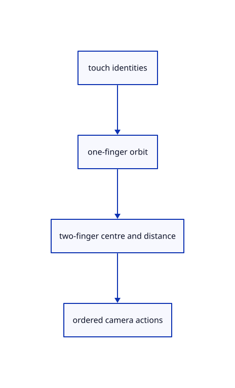

# 8.3.11 · Orbit with one finger and pan pinch with two

**Chapter 8 · Hierarchy, layers and direct editing · Section 8.3 · Free-canvas navigation and direct editing** · [Contents](contents.md)

**Typing: 23–45 minutes.** [Estimate](typing-load.md).

Keep touch identities, cancel first-finger editing when another finger arrives and apply pan before cursor-centred pinch zoom.

## Type

Continue from [Capture mouse gestures in CSS pixels](54h-mouse.md). [Save or recover your work](recovery.md).

### 1. `src/touch.rs`

Track active fingers, CSS orbit and ordered two-finger camera changes.

Create the file and type:

```rust
--8<-- "journey/code/54i-touch-01.rs"
```

### 2. `src/lib.rs`

Register the source component.

<details>
<summary>Locate the existing block</summary>

```rust

pub mod canvas_drag;
```

</details>

After that block, type:

```rust
--8<-- "journey/code/54i-touch-02.rs" skip=22
```

## Run and check

In your project:

```sh
cd workspace/journey
REGEN_PROTO=0 cargo build --lib --locked --target wasm32-unknown-unknown -j1
REGEN_PROTO=0 CARGO_BUILD_JOBS=1 trunk serve --port 8780
```

Open `http://127.0.0.1:8780/`. Keep an existing Trunk server running; saving rebuilds it.


### Recorded visual result

**Previous native render — current verification pending.**

Blue Posts retain original black boundaries and the independent brown source beam.


*This recorded image predates a source or checker change. Rebuild this checkpoint before using it as current evidence; browser controls require separate acceptance.*

This reference image is shared with [8.3.1 · Navigate and fit inside the free canvas](54-camera.md). It does not demonstrate a new feature by itself.

<details>
<summary>Code explanation and diagram</summary>


touch identities → one-finger orbit → two-finger centre and distance → ordered camera actions.



What happens when one finger lifts after a pinch?

The remaining finger does not start a new orbit or select. The gesture waits until all fingers have lifted before accepting a new one-finger action.

Study estimate, including typing and experiments: 0.5–1 hours.

</details>

<details>
<summary>Optional experiment</summary>

Move one finger, add another, pan and pinch, then lift one. Verify the remaining finger cannot begin an unintended orbit.

</details>

<details>
<summary>Check and save your work</summary>

Restore experimental edits, then run from `session_viewer`:

```sh
npm --prefix ../session_tests run course -- check 8.3.11
npm --prefix ../session_tests run course -- save 8.3.11
```

Source comparison leaves your project untouched. [Save and recovery instructions](recovery.md).

</details>

<details>
<summary>Viewer coverage and verification</summary>

This subject implements current canvas navigation and eligible window/crossing selection for the geometry lanes already taught. Surface, BRep, cloud and instance sampling connect in their own subjects. Actual Chrome and Lenovo performance acceptance remains outstanding.

The earlier Layers exercise remains; full navigation acceptance connects at the end of this subject.

[Full validation scope](release.md).

To reproduce the scripted acceptance of the reference checkpoint, run from `session_viewer` with the [course bundle server](release.md#reproduce) running on port 8781:

```sh
npm --prefix ../session_tests run course -- capture 8.3.11
```

This uses the verified reference bundle; it does not check or change your typed project.

</details>
