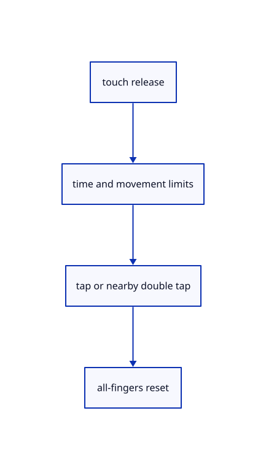

# 8.3.12 · Finish taps double taps and touch cancellation

**Chapter 8 · Hierarchy, layers and direct editing · Section 8.3 · Free-canvas navigation and direct editing** · [Contents](contents.md)

**Typing: 8–16 minutes.** [Estimate](typing-load.md).

Use bounded tap time and distance, fit on a nearby double tap and clear all touch ownership when cancelled.

## Type

Continue from [Orbit with one finger and pan pinch with two](54i-touch.md). [Save or recover your work](recovery.md).

### 1. `src/touch.rs`

Finish taps, nearby double-tap Fit and all-finger cancellation without changing document history.

<details>
<summary>Locate the existing block</summary>

```rust
        if first>1.&&last>1. {if let Some(Action::Pick(screen))=Motion::Pick(after).action(rect) {actions.push(Action::ZoomAt {factor:(last/first).clamp(0.1,10.) as f32,screen});}}actions
    }
    pub fn contains(&self,id:i32)->bool {self.fingers.iter().any(|f|f.id==id)}
    pub fn count(&self)->usize {self.fingers.len()}
```

</details>

Edit the existing block to match this code; keep unchanged lines:

```rust
--8<-- "journey/code/54j-taps-01.rs"
```

## Run and check

In your project:

```sh
cd workspace/journey
REGEN_PROTO=0 cargo build --lib --locked --target wasm32-unknown-unknown -j1
REGEN_PROTO=0 CARGO_BUILD_JOBS=1 trunk serve --port 8780
```

Open `http://127.0.0.1:8780/`. Keep an existing Trunk server running; saving rebuilds it.


### Recorded visual result

**Previous native render — current verification pending.**

Blue Posts retain original black boundaries and the independent brown source beam.


*This recorded image predates a source or checker change. Rebuild this checkpoint before using it as current evidence; browser controls require separate acceptance.*

This reference image is shared with [8.3.1 · Navigate and fit inside the free canvas](54-camera.md). It does not demonstrate a new feature by itself.

<details>
<summary>Code explanation and diagram</summary>


touch release → time and movement limits → tap or nearby double tap → all-fingers reset.



Can a cancelled touch select when its release arrives later?

No. Cancellation removes every captured finger and the remembered tap. A later release has no gesture to finish.

Study estimate, including typing and experiments: 0.5–1 hours.

</details>

<details>
<summary>Optional experiment</summary>

Tap to select, double tap nearby to fit, then cancel a touch before release and verify selection remains unchanged.

</details>

<details>
<summary>Check and save your work</summary>

Restore experimental edits, then run from `session_viewer`:

```sh
npm --prefix ../session_tests run course -- check 8.3.12
npm --prefix ../session_tests run course -- save 8.3.12
```

Source comparison leaves your project untouched. [Save and recovery instructions](recovery.md).

</details>

<details>
<summary>Viewer coverage and verification</summary>

This subject implements current canvas navigation and eligible window/crossing selection for the geometry lanes already taught. Surface, BRep, cloud and instance sampling connect in their own subjects. Actual Chrome and Lenovo performance acceptance remains outstanding.

The earlier Layers exercise remains; full navigation acceptance connects at the end of this subject.

[Full validation scope](release.md).

To reproduce the scripted acceptance of the reference checkpoint, run from `session_viewer` with the [course bundle server](release.md#reproduce) running on port 8781:

```sh
npm --prefix ../session_tests run course -- capture 8.3.12
```

This uses the verified reference bundle; it does not check or change your typed project.

</details>
