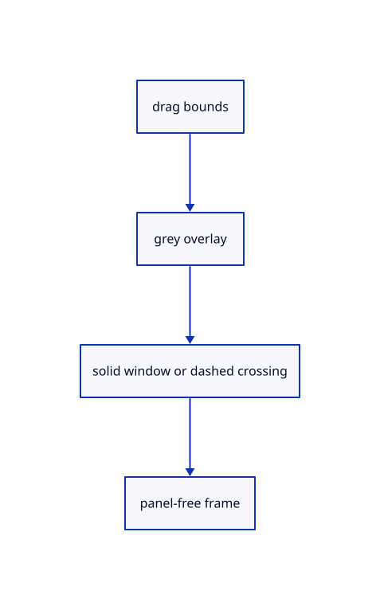

# 8.3.13 · Draw a thin selection rectangle above the canvas

**Chapter 8 · Hierarchy, layers and direct editing · Section 8.3 · Free-canvas navigation and direct editing** · [Contents](contents.md)

**Typing: 22–44 minutes.** [Estimate](typing-load.md).

Draw one-CSS-pixel grey outlines with a light fill. Crossing uses dashes. Keep the overlay presentation-only and measure the panel-free canvas.

## Type

Continue from [Finish taps double taps and touch cancellation](54j-taps.md). [Save or recover your work](recovery.md).

### 1. `src/panel.rs`

Draw the non-pickable overlay, measure free canvas and obtain a repeated command from dock history.

Edit these blocks from bottom to top. Keep the surrounding lines unchanged.

<details>
<summary>Locate this block</summary>

```rust
        self.controls = Some(Vec::new());
        let mut line = None;
        let output = self.context.run_ui(input, |root| {
            crate::tree_panel::draw(root,&mut self.tree,&mut self.controls);
            crate::number_box::draw(root,&mut self.number,&mut self.controls);
            command_dock::draw(root, &mut self.model, &mut self.controls, &mut line, &self.commands, true);
```

</details>

Replace it with:

```rust
        self.controls = Some(Vec::new());
        let mut line = None;
        let output = self.context.run_ui(input, |root| {
            if let Some(rectangle)=self.rectangle {
                let painter=root.ctx().layer_painter(egui::LayerId::new(egui::Order::Middle,egui::Id::new("selection-rectangle")));
                let [x0,y0,x1,y1]=rectangle.bounds.map(|v|v as f32);let rect=egui::Rect::from_min_max(egui::pos2(x0,y0),egui::pos2(x1,y1));
                painter.rect_filled(rect,0.,egui::Color32::from_rgba_unmultiplied(160,160,160,40));
                let stroke=egui::Stroke::new(1.,egui::Color32::from_gray(110));
                let corners=[rect.left_top(),rect.right_top(),rect.right_bottom(),rect.left_bottom(),rect.left_top()];
                for pair in corners.windows(2) {if rectangle.crossing {
                    let length=pair[0].distance(pair[1]);let direction=(pair[1]-pair[0])/length;
                    for n in 0..((length/8.).ceil() as usize).min(16384) {let at=n as f32*8.;painter.line_segment([pair[0]+direction*at,pair[0]+direction*(at+4.).min(length)],stroke);}
                } else {painter.line_segment([pair[0],pair[1]],stroke);}}
            }
            crate::tree_panel::draw(root,&mut self.tree,&mut self.controls);
            crate::number_box::draw(root,&mut self.number,&mut self.controls);
            command_dock::draw(root, &mut self.model, &mut self.controls, &mut line, &self.commands, true);
```

<details>
<summary>Locate this block</summary>

```rust
        over
    }

    pub fn inspect(&self) -> String {
        serde_json::json!({"tree_rect":self.tree.rect.map(|r|[r.min.x,r.min.y,r.max.x,r.max.y]),"tree_open":self.tree.open,"number":self.number.number,"number_error":self.number.number_error,"number_rect":self.number.number_rect.map(|r|[r.min.x,r.min.y,r.max.x,r.max.y]),"controls": self.controls, "command": self.model.command, "history": self.model.history, "status": self.model.status,
            "pointer_owned": self.pointer_owned,
```

</details>

Replace it with:

```rust
        over
    }

    pub fn free_frame(&self,size:[f64;2])->Option<[f64;4]> {
        if size.iter().any(|v|!v.is_finite()||*v<=0.) {return None;}
        let right=self.tree.rect.map_or(size[0],|r|r.left() as f64).clamp(size[0]*0.1,size[0]);
        let bottom=(self.top as f64).min(size[1]).max(size[1]*0.1);
        Some([0.,0.,right/size[0],bottom/size[1]])
    }

    pub fn inspect(&self) -> String {
        serde_json::json!({"tree_rect":self.tree.rect.map(|r|[r.min.x,r.min.y,r.max.x,r.max.y]),"tree_open":self.tree.open,"number":self.number.number,"number_error":self.number.number_error,"number_rect":self.number.number_rect.map(|r|[r.min.x,r.min.y,r.max.x,r.max.y]),"controls": self.controls, "command": self.model.command, "history": self.model.history, "status": self.model.status,
            "pointer_owned": self.pointer_owned,
```

<details>
<summary>Locate this block</summary>

```rust
        self.context.memory_mut(|memory| memory.surrender_focus(egui::Id::new("command-input")));
    }

    pub fn command(&self) -> &str { &self.model.command }

    pub fn history(&self) -> &std::collections::VecDeque<String> { &self.model.history }

    pub fn shortcut(&self, event: &web_sys::KeyboardEvent) -> Option<crate::shortcuts::Shortcut> {
        if self.number.number_prompt.is_some() || event.type_() != "keydown" || event.repeat() { return None; }
        crate::shortcuts::key(&event.key(), event.ctrl_key() || event.meta_key(), event.shift_key(),
            event.alt_key(), event.is_composing(), self.context.egui_wants_keyboard_input(), self.model.command.is_empty())
    }

    pub fn key(&mut self, event: &web_sys::KeyboardEvent) -> bool {
```

</details>

Replace it with:

```rust
        self.context.memory_mut(|memory| memory.surrender_focus(egui::Id::new("command-input")));
    }

    pub fn repeat_line(&self)->Option<String> {
        if !self.model.command.trim().is_empty() {return Some(self.model.command.clone());}
        self.model.history.iter().rev().find_map(|line|line.strip_prefix("> ").and_then(|line|line.lines().next()).map(str::to_owned))
    }

    pub fn command(&self) -> &str { &self.model.command }

    pub fn history(&self) -> &std::collections::VecDeque<String> { &self.model.history }

    pub fn shortcut(&self, event: &web_sys::KeyboardEvent) -> Option<crate::shortcuts::Shortcut> {
        if self.number.number_prompt.is_some() || event.type_() != "keydown" || event.repeat() { return None; }
        crate::shortcuts::context_key(&self.context,&self.model.command,&event.key(),event.ctrl_key()||event.meta_key(),event.shift_key(),event.alt_key(),event.is_composing())
    }

    pub fn key(&mut self, event: &web_sys::KeyboardEvent) -> bool {
```

<details>
<summary>Locate this block</summary>

```rust
        // One layout pass prevents a future text event from being replayed.
        context.options_mut(|options| options.max_passes = 1.try_into().unwrap());
        let painter = egui_wgpu::Renderer::new(&renderer.device, format, Default::default());
        Self { tree:Default::default(), number:Default::default(), commands: Commands(commands), consumed: false, pointer_owned: false, top: f32::INFINITY, controls: None, context, painter, events: Vec::new(), output: None,
            screen: egui_wgpu::ScreenDescriptor { size_in_pixels: [640, 480], pixels_per_point: 1.0 }, model: CommandLine {
            focus_command: true,
            ..Default::default()
```

</details>

Replace it with:

```rust
        // One layout pass prevents a future text event from being replayed.
        context.options_mut(|options| options.max_passes = 1.try_into().unwrap());
        let painter = egui_wgpu::Renderer::new(&renderer.device, format, Default::default());
        Self { rectangle:None,tree:Default::default(), number:Default::default(), commands: Commands(commands), consumed: false, pointer_owned: false, top: f32::INFINITY, controls: None, context, painter, events: Vec::new(), output: None,
            screen: egui_wgpu::ScreenDescriptor { size_in_pixels: [640, 480], pixels_per_point: 1.0 }, model: CommandLine {
            focus_command: true,
            ..Default::default()
```

<details>
<summary>Locate this block</summary>

```rust
}

pub struct Panel {
    pub tree:crate::tree_panel::TreePanel,
    number:crate::number_box::NumberBox,
    commands: Commands,
```

</details>

Replace it with:

```rust
}

pub struct Panel {
    pub rectangle:Option<crate::rect_select::Rectangle>,
    pub tree:crate::tree_panel::TreePanel,
    number:crate::number_box::NumberBox,
    commands: Commands,
```

<details>
<summary>Complete updated block reference</summary>

```rust
use crate::command_dock::{self, CommandLine, Commands as _, theme};
use crate::renderer::Renderer;

struct Commands(Vec<&'static str>);

impl command_dock::Commands for Commands {
    fn canonical(&self, line: &str) -> String {
        crate::commands::canonical(line)
    }
    fn choosing_option(&self, _: &str) -> bool {
        false
    }
    fn accept(&self, line: &str) -> (String, bool) {
        (self.canonical(line), true)
    }
    fn completions(&self, line: &str) -> Vec<&'static str> {
        crate::command_vocabulary::ranked(self.0.as_ref(), line)
    }
    fn browse(&self, line: &str) -> Vec<&'static str> {
        self.completions(line)
    }
}

pub struct Panel {
    pub rectangle:Option<crate::rect_select::Rectangle>,
    pub tree:crate::tree_panel::TreePanel,
    number:crate::number_box::NumberBox,
    commands: Commands,
    pub consumed: bool,
    pointer_owned: bool,
    top: f32,
    controls: Option<Vec<command_dock::Control>>,
    context: egui::Context,
    painter: egui_wgpu::Renderer,
    model: CommandLine,
    events: Vec<egui::Event>,
    output: Option<egui::FullOutput>,
    screen: egui_wgpu::ScreenDescriptor,
}

impl Panel {
    pub fn new(renderer: &Renderer, format: wgpu::TextureFormat, commands: Vec<&'static str>) -> Self {
        let context = egui::Context::default();
        context.set_fonts(theme::fonts([
            include_bytes!("../assets/text/NotoSans-Regular.subset.ttf"),
            include_bytes!("../assets/text/NotoSansSymbols2-Regular.subset.ttf"),
            include_bytes!("../assets/text/NotoSansSymbols-Regular.subset.ttf"),
        ]));
        context.set_theme(egui::Theme::Light);
        context.set_visuals(theme::visuals());
        // One layout pass prevents a future text event from being replayed.
        context.options_mut(|options| options.max_passes = 1.try_into().unwrap());
        let painter = egui_wgpu::Renderer::new(&renderer.device, format, Default::default());
        Self { rectangle:None,tree:Default::default(), number:Default::default(), commands: Commands(commands), consumed: false, pointer_owned: false, top: f32::INFINITY, controls: None, context, painter, events: Vec::new(), output: None,
            screen: egui_wgpu::ScreenDescriptor { size_in_pixels: [640, 480], pixels_per_point: 1.0 }, model: CommandLine {
            focus_command: true,
            ..Default::default()
        } }
    }

    pub fn number(&mut self,prompt:Option<crate::number_box::NumberPrompt>) {
        if prompt.is_some() {self.model.focus_command=false;}
        else if self.number.number_prompt.is_some() {self.context.memory_mut(|m|m.surrender_focus(egui::Id::new("number-input")));}
        self.number.set(prompt);
    }

    pub fn tool(&mut self, prompt: String, options: Vec<(String, String)>) {
        self.model.drawing_prompt = prompt; self.model.options = options;
        if self.model.options.is_empty() { self.model.options_rect = None; }
        if !self.model.options.is_empty() { self.model.completion_visible = false; self.model.inline_suffix = false; }
    }

    pub fn cancel_input(&mut self) {
        self.model.command.clear(); self.model.completion_visible = false; self.model.inline_suffix = false;
        self.model.command_open = false; self.model.focus_command = false;
        self.context.memory_mut(|memory| memory.surrender_focus(egui::Id::new("command-input")));
    }

    pub fn repeat_line(&self)->Option<String> {
        if !self.model.command.trim().is_empty() {return Some(self.model.command.clone());}
        self.model.history.iter().rev().find_map(|line|line.strip_prefix("> ").and_then(|line|line.lines().next()).map(str::to_owned))
    }

    pub fn command(&self) -> &str { &self.model.command }

    pub fn history(&self) -> &std::collections::VecDeque<String> { &self.model.history }

    pub fn shortcut(&self, event: &web_sys::KeyboardEvent) -> Option<crate::shortcuts::Shortcut> {
        if self.number.number_prompt.is_some() || event.type_() != "keydown" || event.repeat() { return None; }
        crate::shortcuts::context_key(&self.context,&self.model.command,&event.key(),event.ctrl_key()||event.meta_key(),event.shift_key(),event.alt_key(),event.is_composing())
    }

    pub fn key(&mut self, event: &web_sys::KeyboardEvent) -> bool {

        if event.is_composing() { return false; }
        let modifiers = egui::Modifiers {
            alt: event.alt_key(), ctrl: event.ctrl_key(), shift: event.shift_key(),
            mac_cmd: event.meta_key(), command: event.ctrl_key() || event.meta_key(),
        };
        let text = event.type_() == "keydown" && event.key().chars().count() == 1
            && !modifiers.command && !modifiers.alt;
        if text && (!self.context.egui_wants_keyboard_input() || self.number.number_prompt.is_some()) {
            let number=self.number.number_prompt.is_some();
            if !self.context.egui_wants_keyboard_input() && !number { self.model.focus_command=true; }
            self.context.memory_mut(|memory|memory.request_focus(egui::Id::new(if number {"number-input"} else {"command-input"})));
            if !number {self.model.command_open=true;}
        }
        if !self.context.egui_wants_keyboard_input() { return false; }
        if let Some(key) = egui::Key::from_name(&event.key()) {
            self.events.push(egui::Event::Key {
                key, physical_key: None, pressed: event.type_() == "keydown",
                repeat: event.repeat(), modifiers,
            });
        }
        if text { self.events.push(egui::Event::Text(event.key())); }
        event.prevent_default();
        true
    }

    pub fn pointer(&mut self, event: &web_sys::PointerEvent, canvas: &web_sys::HtmlCanvasElement) -> bool {
        let rect = canvas.get_bounding_client_rect();
        let pos = egui::pos2((event.client_x() as f64 - rect.left()) as f32, (event.client_y() as f64 - rect.top()) as f32);
        let over = (self.tree.rect.is_some_and(|r|r.contains(pos)) || self.tree.menu_rects.iter().any(|r|r.contains(pos))) || self.number.number_rect.is_some_and(|r|r.contains(pos)) || pos.y >= self.top || (self.model.completion_rect.is_some_and(|r| r.contains(pos)) || self.model.options_rect.is_some_and(|r| r.contains(pos)));
        let owned = over || self.pointer_owned;
        if event.type_() == "pointerdown" {
            self.pointer_owned = over;
            if !over {
                self.model.command_open = false;
                self.model.focus_command = false;
                self.context.memory_mut(|memory| memory.surrender_focus(egui::Id::new("command-input")));
            }
        }
        self.events.push(egui::Event::PointerMoved(pos));
        if matches!(event.type_().as_str(), "pointercancel" | "lostpointercapture") {
            for button in [egui::PointerButton::Primary, egui::PointerButton::Middle, egui::PointerButton::Secondary] {
                self.events.push(egui::Event::PointerButton { pos, button, pressed: false, modifiers: Default::default() });
            }
            self.events.push(egui::Event::PointerGone);
        } else if matches!(event.type_().as_str(), "pointerdown" | "pointerup") {
            let button = match event.button() { 0 => egui::PointerButton::Primary, 1 => egui::PointerButton::Middle, _ => egui::PointerButton::Secondary };
            self.events.push(egui::Event::PointerButton { pos, button, pressed: event.type_() == "pointerdown", modifiers: Default::default() });
        }
        if matches!(event.type_().as_str(), "pointerup" | "pointercancel" | "lostpointercapture") { self.pointer_owned = false; }
        if owned { event.prevent_default(); }
        owned
    }

    pub fn wheel(&mut self, event: &web_sys::WheelEvent, canvas: &web_sys::HtmlCanvasElement) -> bool {
        let rect = canvas.get_bounding_client_rect();
        let pos = egui::pos2((event.client_x() as f64 - rect.left()) as f32, (event.client_y() as f64 - rect.top()) as f32);
        self.events.push(egui::Event::PointerMoved(pos));
        self.events.push(egui::Event::MouseWheel {
            unit: match event.delta_mode() { 1 => egui::MouseWheelUnit::Line, 2 => egui::MouseWheelUnit::Page, _ => egui::MouseWheelUnit::Point },
            phase: egui::TouchPhase::Move, delta: egui::vec2(-event.delta_x() as f32, -event.delta_y() as f32), modifiers: Default::default(),
        });
        let over = (self.tree.rect.is_some_and(|r|r.contains(pos)) || self.tree.menu_rects.iter().any(|r|r.contains(pos))) || self.number.number_rect.is_some_and(|r|r.contains(pos)) || pos.y >= self.top || (self.model.completion_rect.is_some_and(|r| r.contains(pos)) || self.model.options_rect.is_some_and(|r| r.contains(pos)));
        if over { event.prevent_default(); }
        over
    }

    pub fn free_frame(&self,size:[f64;2])->Option<[f64;4]> {
        if size.iter().any(|v|!v.is_finite()||*v<=0.) {return None;}
        let right=self.tree.rect.map_or(size[0],|r|r.left() as f64).clamp(size[0]*0.1,size[0]);
        let bottom=(self.top as f64).min(size[1]).max(size[1]*0.1);
        Some([0.,0.,right/size[0],bottom/size[1]])
    }

    pub fn inspect(&self) -> String {
        serde_json::json!({"tree_rect":self.tree.rect.map(|r|[r.min.x,r.min.y,r.max.x,r.max.y]),"tree_open":self.tree.open,"number":self.number.number,"number_error":self.number.number_error,"number_rect":self.number.number_rect.map(|r|[r.min.x,r.min.y,r.max.x,r.max.y]),"controls": self.controls, "command": self.model.command, "history": self.model.history, "status": self.model.status,
            "pointer_owned": self.pointer_owned,
            "top": self.top, "focused": self.context.egui_wants_keyboard_input(),
            "completion_rect": self.model.completion_rect.map(|r| [r.min.x, r.min.y, r.max.x, r.max.y]),
            "options": self.model.options, "options_rect": self.model.options_rect.map(|r| [r.min.x, r.min.y, r.max.x, r.max.y])}).to_string()
    }

    pub fn answer(&mut self, line: &str, message: &str) {
        self.model.remember(format!("> {line}\n{message}"));
        self.model.status = message.into();
    }

    pub fn result(&mut self, message: &str) {
        self.model.status = message.into();
        if self.number.number_prompt.is_some() {self.number.number_error=message.into();}
        if let Some(last) = self.model.history.back_mut()
            && let Some(at) = last.find('\n')
        {
            last.truncate(at + 1);
            last.push_str(message);
        }
    }

    pub fn update(
        &mut self,
        event: Option<&web_sys::Event>,
        canvas: &web_sys::HtmlCanvasElement,
    ) -> Result<Option<String>, wasm_bindgen::JsValue> {
        use wasm_bindgen::JsCast;
        let rect = canvas.get_bounding_client_rect();
        self.screen.size_in_pixels = [canvas.width(), canvas.height()];
        self.screen.pixels_per_point = canvas.width() as f32 / rect.width() as f32;
        self.consumed = false;
        if let Some(event) = event {
            if let Some(key) = event.dyn_ref::<web_sys::KeyboardEvent>() { self.consumed = self.key(key); }
            if let Some(pointer) = event.dyn_ref::<web_sys::PointerEvent>() {
                self.consumed = self.pointer(pointer, canvas);
                if event.type_() == "pointerdown" {
                    let options = web_sys::FocusOptions::new(); options.set_prevent_scroll(true);
                    canvas.focus_with_options(&options)?;
                    event.prevent_default();
                }
            }
            if let Some(wheel) = event.dyn_ref::<web_sys::WheelEvent>() { self.consumed = self.wheel(wheel, canvas); }
        }
        let number_open=self.number.number_prompt.is_some();
        let line = self.prepare();
        canvas.set_attribute("data-command-ui", &self.inspect())?;
        let Some(line) = line else { return Ok(None); };
        if number_open {return Ok(Some(line));}
        if !self.model.options.is_empty() { self.answer(&line, "Tool input submitted."); return Ok(Some(line)); }
        if line == "Escape" { return Ok(None); }
        if line.eq_ignore_ascii_case("Help") {
            self.answer(&line, &self.commands.0.join(" · "));
            return Ok(None);
        }
        self.answer(&line, "Command submitted.");
        Ok(Some(line))
    }

    fn prepare(&mut self) -> Option<String> {
        let size = self.screen.size_in_pixels;
        let mut input = egui::RawInput {
            focused: true,
            events: std::mem::take(&mut self.events),
            screen_rect: Some(egui::Rect::from_min_size(
                egui::Pos2::ZERO, egui::vec2(size[0] as f32, size[1] as f32) / self.screen.pixels_per_point,
            )),
            ..Default::default()
        };
        input.viewports.get_mut(&egui::ViewportId::ROOT).unwrap().native_pixels_per_point = Some(self.screen.pixels_per_point);
        self.controls = Some(Vec::new());
        let mut line = None;
        let output = self.context.run_ui(input, |root| {
            if let Some(rectangle)=self.rectangle {
                let painter=root.ctx().layer_painter(egui::LayerId::new(egui::Order::Middle,egui::Id::new("selection-rectangle")));
                let [x0,y0,x1,y1]=rectangle.bounds.map(|v|v as f32);let rect=egui::Rect::from_min_max(egui::pos2(x0,y0),egui::pos2(x1,y1));
                painter.rect_filled(rect,0.,egui::Color32::from_rgba_unmultiplied(160,160,160,40));
                let stroke=egui::Stroke::new(1.,egui::Color32::from_gray(110));
                let corners=[rect.left_top(),rect.right_top(),rect.right_bottom(),rect.left_bottom(),rect.left_top()];
                for pair in corners.windows(2) {if rectangle.crossing {
                    let length=pair[0].distance(pair[1]);let direction=(pair[1]-pair[0])/length;
                    for n in 0..((length/8.).ceil() as usize).min(16384) {let at=n as f32*8.;painter.line_segment([pair[0]+direction*at,pair[0]+direction*(at+4.).min(length)],stroke);}
                } else {painter.line_segment([pair[0],pair[1]],stroke);}}
            }
            crate::tree_panel::draw(root,&mut self.tree,&mut self.controls);
            crate::number_box::draw(root,&mut self.number,&mut self.controls);
            command_dock::draw(root, &mut self.model, &mut self.controls, &mut line, &self.commands, true);
        });
        if let Some(number)=self.number.take() {line=Some(number);}
        if let Some(control) = self.controls.as_ref().and_then(|items| items.iter().find(|item| item.key == "command/resize")) {
            self.top = control.rect[1];
        }
        if let Some(previous) = self.output.as_mut() { previous.append(output); }
        else { self.output = Some(output); }
        line
    }

    pub fn draw(&mut self, renderer: &Renderer, target: &wgpu::TextureView) {
        let Some(output) = self.output.take() else { return; };
        // The font atlas is a texture: upload its changed pixels before drawing the letters.
        for (id, delta) in &output.textures_delta.set {
            self.painter.update_texture(&renderer.device, &renderer.queue, *id, delta);
        }
        let jobs = self.context.tessellate(output.shapes, output.pixels_per_point);
        let mut encoder = renderer.device.create_command_encoder(&Default::default());
        let mut buffers = self.painter.update_buffers(
            &renderer.device, &renderer.queue, &mut encoder, &jobs, &self.screen,
        );
        let pass = encoder.begin_render_pass(&wgpu::RenderPassDescriptor {
            label: Some("command panel"),
            color_attachments: &[Some(wgpu::RenderPassColorAttachment {
                view: target, resolve_target: None, depth_slice: None,
                ops: wgpu::Operations { load: wgpu::LoadOp::Load, store: wgpu::StoreOp::Store },
            })],
            ..Default::default()
        });
        self.painter.render(&mut pass.forget_lifetime(), &jobs, &self.screen);
        buffers.push(encoder.finish());
        renderer.queue.submit(buffers);
        for id in output.textures_delta.free { self.painter.free_texture(&id); }
    }
}
```

</details>

<details>
<summary>Optional patch references</summary>

Use these original edit fragments when comparing a saved checkpoint. Apply the complete blocks above.

```text
--8<-- "journey/code/54k-overlay-01.rs"
```

```text
--8<-- "journey/code/54k-overlay-02.rs"
```

```text
--8<-- "journey/code/54k-overlay-03.rs"
```

```text
--8<-- "journey/code/54k-overlay-04.rs"
```

```text
--8<-- "journey/code/54k-overlay-05.rs"
```

```text
--8<-- "journey/code/54k-overlay-06.rs"
```

</details>

## Run and check

In your project:

```sh
cd workspace/journey
REGEN_PROTO=0 cargo build --lib --locked --target wasm32-unknown-unknown -j1
REGEN_PROTO=0 CARGO_BUILD_JOBS=1 trunk serve --port 8780
```

Open `http://127.0.0.1:8780/`. Keep an existing Trunk server running; saving rebuilds it.


### Recorded visual result

**Previous native render — current verification pending.**

Blue Posts retain original black boundaries and the independent brown source beam.


*This recorded image predates a source or checker change. Rebuild this checkpoint before using it as current evidence; browser controls require separate acceptance.*

This reference image is shared with [8.3.1 · Navigate and fit inside the free canvas](54-camera.md). It does not demonstrate a new feature by itself.

<details>
<summary>Code explanation and diagram</summary>


drag bounds → grey overlay → solid window or dashed crossing → panel-free frame.



Does the rectangle enter source geometry or document Undo?

No. It is a presentation overlay. Its bounds are CSS pixels and its direction changes only the outline style and selection rule.

Study estimate, including typing and experiments: 0.5–1 hours.

</details>

<details>
<summary>Optional experiment</summary>

Compare solid and dashed rectangles at DPR1 and DPR2. Open Layers and confirm the camera uses the remaining canvas space.

</details>

<details>
<summary>Check and save your work</summary>

Restore experimental edits, then run from `session_viewer`:

```sh
npm --prefix ../session_tests run course -- check 8.3.13
npm --prefix ../session_tests run course -- save 8.3.13
```

Source comparison leaves your project untouched. [Save and recovery instructions](recovery.md).

</details>

<details>
<summary>Viewer coverage and verification</summary>

This subject implements current canvas navigation and eligible window/crossing selection for the geometry lanes already taught. Surface, BRep, cloud and instance sampling connect in their own subjects. Actual Chrome and Lenovo performance acceptance remains outstanding.

The earlier Layers exercise remains; full navigation acceptance connects at the end of this subject.

[Full validation scope](release.md).

To reproduce the scripted acceptance of the reference checkpoint, run from `session_viewer` with the [course bundle server](release.md#reproduce) running on port 8781:

```sh
npm --prefix ../session_tests run course -- capture 8.3.13
```

This uses the verified reference bundle; it does not check or change your typed project.

</details>
