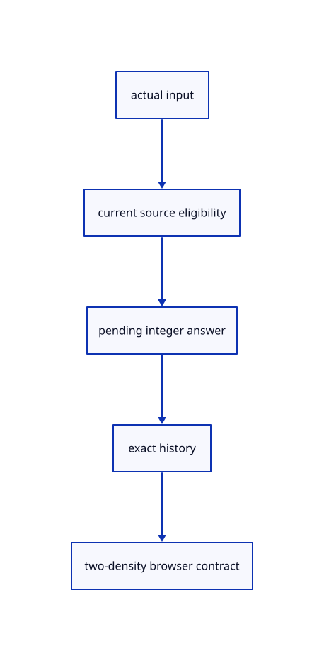

# 8.3.18 · Exercise current navigation selection and delayed answers

**Chapter 8 · Hierarchy, layers and direct editing · Section 8.3 · Free-canvas navigation and direct editing** · [Contents](contents.md)

**Typing: 0–0 minutes.** [Estimate](typing-load.md).

Copy the preserved and new camera, touch, selection and delayed GPU regressions. Exercise the full canvas contract at two device densities.

## Type

Continue from [Expose drag ownership and centre the available drawing](54o-frame.md). [Save or recover your work](recovery.md).

<details>
<summary>Supplied validation fixture</summary>

Copy this supplied authoring fixture once. Continue with the browser build below; the course does not require running native tests.

### 1. `src/navigation_complete_tests.rs`

Copy the camera, current eligibility, release, cold-source, touch and repeat regressions.

Copy this supplied file:

```text
--8<-- "journey/code/54p-navigation-01.rs"
```

</details>

<details>
<summary>Supplied validation fixture</summary>

Copy this supplied authoring fixture once. Continue with the browser build below; the course does not require running native tests.

### 2. `src/lib.rs`

Register the source component.

<details>
<summary>Locate the existing block</summary>

```text

pub mod touch;
```

</details>

After that block, append this supplied code:

```text
--8<-- "journey/code/54p-navigation-02.rs" skip=16
```

</details>

<details>
<summary>Supplied validation fixture</summary>

Copy this supplied authoring fixture once. Continue with the browser build below; the course does not require running native tests.

### 3. `src/shortcut_focus_tests.rs`

Copy actual egui command, name and popup ownership checks.

Copy this supplied file:

```text
--8<-- "journey/code/54p-navigation-03.rs"
```

</details>

<details>
<summary>Supplied validation fixture</summary>

Copy this supplied authoring fixture once. Continue with the browser build below; the course does not require running native tests.

### 4. `src/lib.rs`

Register the source component.

<details>
<summary>Locate the existing block</summary>

```text
#[cfg(test)]
mod navigation_complete_tests;
```

</details>

After that block, append this supplied code:

```text
--8<-- "journey/code/54p-navigation-04.rs" skip=44
```

</details>

<details>
<summary>Supplied validation fixture</summary>

Copy this supplied authoring fixture once. Continue with the browser build below; the course does not require running native tests.

### 5. `src/pick_gpu_tests.rs`

Copy the actual delayed integer-pick, full released movement, one-Undo and geometry-reuse regression.

<details>
<summary>Locate the existing block</summary>

```text
    Rc::make_mut(&mut scene.view).edges.remove(&id);renderer.set_scene(&scene,None);assert_eq!(colour_pixels(&mut renderer),before);assert!(Rc::ptr_eq(&source,scene.objects()[0].geometry().unwrap()));
}
```

</details>

After that block, append this supplied code:

```text
--8<-- "journey/code/54p-navigation-05.rs" skip=203
```

</details>

## Run and check

In your project:

```sh
cd workspace/journey
REGEN_PROTO=0 cargo build --lib --locked --target wasm32-unknown-unknown -j1
REGEN_PROTO=0 CARGO_BUILD_JOBS=1 trunk serve --port 8780
```

Open `http://127.0.0.1:8780/`. Keep an existing Trunk server running; saving rebuilds it.

Navigation and delayed selection share the same original drawing and document history. The supplied regressions record the two-density input contract.

### Recorded visual result

**Previous native render — current verification pending.**

Blue Posts retain original black boundaries and the independent brown source beam.


*This recorded image predates a source or checker change. Rebuild this checkpoint before using it as current evidence; browser controls require separate acceptance.*

This reference image is shared with [8.3.1 · Navigate and fit inside the free canvas](54-camera.md). It does not demonstrate a new feature by itself.

<details>
<summary>Code explanation and diagram</summary>


actual input → current source eligibility → pending integer answer → exact history → two-density browser contract.



What is still needed after native and WebAssembly checks pass?

Real browser acceptance, including pointer capture and touch event delivery. Native software-GPU checks do not establish Lenovo rotation or zoom performance.

Study estimate, including typing and experiments: 0.5–1 hours.

</details>

<details>
<summary>Optional experiment</summary>

Load Example Nested, Fit and show Layers All. Compare a left-to-right window with a right-to-left crossing selection, then use Shift to add. Orbit, pan and zoom at the cursor. Release an object drag promptly and Undo its completed move once; touch gestures are an additional device exercise.

</details>

<details>
<summary>Check and save your work</summary>

Restore experimental edits, then run from `session_viewer`:

```sh
npm --prefix ../session_tests run course -- check 8.3.18
npm --prefix ../session_tests run course -- save 8.3.18
```

Source comparison leaves your project untouched. [Save and recovery instructions](recovery.md).

</details>

<details>
<summary>Viewer coverage and verification</summary>

This subject implements current canvas navigation and eligible window/crossing selection for the geometry lanes already taught. Surface, BRep, cloud and instance sampling connect in their own subjects. Actual Chrome and Lenovo performance acceptance remains outstanding.

All earlier checks remain. New native checks cover finite rectangle clipping, CSS projection, current source eligibility, field-aware Select All, panel-free fit, both-projection cursor zoom, full released movement, release modifiers, cold-source failure without losing redo, captured touch lifetime, right-click repeat and an actual delayed GPU pick with shared geometry and exact Undo.

The full DPR1/DPR2 navigation and selection browser exercise is authored for real acceptance and remains unrun.

[Full validation scope](release.md).

To reproduce the scripted acceptance of the reference checkpoint, run from `session_viewer` with the [course bundle server](release.md#reproduce) running on port 8781:

```sh
npm --prefix ../session_tests run course -- capture 8.3.18
```

This uses the verified reference bundle; it does not check or change your typed project.

</details>
