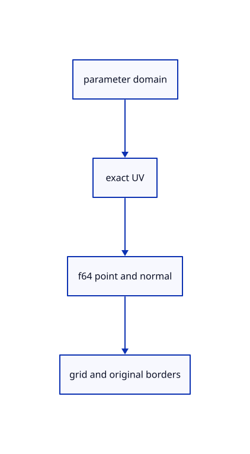

# 9.1.2 · Keep UV coordinates beside original world samples

**Chapter 9 · CAD surfaces and topology · Section 9.1 · Surface controls and trimming** · [Contents](contents.md)

**Typing: 18–36 minutes.** [Estimate](typing-load.md).

Sample the original source in f64, retain each UV address, use the current bounded grid sizes and record four original domain boundaries.

## Type

Continue from [Validate original surface control storage](55-validation.md). [Save or recover your work](recovery.md).

### 1. `src/surface.rs`

Build the current 16–96-step UV grid and open domain border segment ranges.

<details>
<summary>Locate the existing block</summary>

```rust
}
```

</details>

After that block, type:

```rust
--8<-- "journey/code/55a-grid-01.rs" skip=3
```

## Run and check

In your project:

```sh
cd workspace/journey
REGEN_PROTO=0 cargo build --lib --locked --target wasm32-unknown-unknown -j1
REGEN_PROTO=0 CARGO_BUILD_JOBS=1 trunk serve --port 8780
```

Open `http://127.0.0.1:8780/`. Keep an existing Trunk server running; saving rebuilds it.


### Recorded visual result

**Previous native render — current verification pending.**

Blue Posts, the brown source beam and black original boundaries remain visible.


*This recorded image predates a source or checker change. Rebuild this checkpoint before using it as current evidence; browser controls require separate acceptance.*

This reference image is shared with [8.3.1 · Navigate and fit inside the free canvas](54-camera.md). It does not demonstrate a new feature by itself.

<details>
<summary>Code explanation and diagram</summary>


parameter domain → exact UV → f64 point and normal → grid and original borders.



Are grid triangles new CAD faces?

No. They are derived display triangles for one original surface. UV addresses retain the connection to the source; its four domain borders keep their own identities.

Study estimate, including typing and experiments: 0.5–1 hours.

</details>

<details>
<summary>Optional experiment</summary>

Evaluate a nonunit domain and compare every cached sample with the original surface at its UV. Count boundary segments separately from interior grid edges.

</details>

<details>
<summary>Check and save your work</summary>

Restore experimental edits, then run from `session_viewer`:

```sh
npm --prefix ../session_tests run course -- check 9.1.2
npm --prefix ../session_tests run course -- save 9.1.2
```

Source comparison leaves your project untouched. [Save and recovery instructions](recovery.md).

</details>

<details>
<summary>Viewer coverage and verification</summary>


The earlier navigation acceptance exercise remains. Surface acceptance connects at the end of this subject and has not been run in Chrome.

[Full validation scope](release.md).

To reproduce the scripted acceptance of the reference checkpoint, run from `session_viewer` with the [course bundle server](release.md#reproduce) running on port 8781:

```sh
npm --prefix ../session_tests run course -- capture 9.1.2
```

This uses the verified reference bundle; it does not check or change your typed project.

</details>
