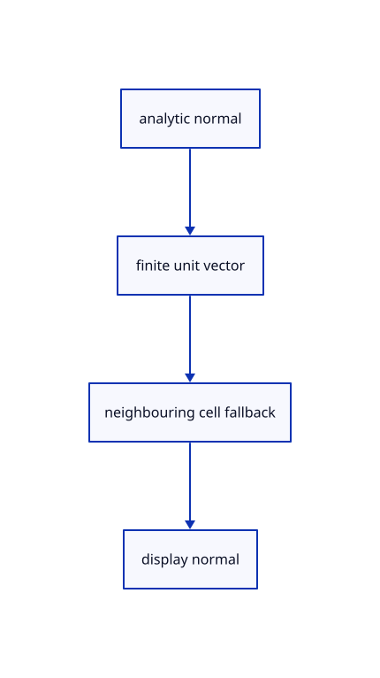

# 9.1.3 · Use analytic normals and finite singular-point fallbacks

**Chapter 9 · CAD surfaces and topology · Section 9.1 · Surface controls and trimming** · [Contents](contents.md)

**Typing: 9–18 minutes.** [Estimate](typing-load.md).

Keep the kernel normal when valid and recover a missing singular-point normal from a neighbouring grid cell without changing the source.

## Type

Continue from [Keep UV coordinates beside original world samples](55a-grid.md). [Save or recover your work](recovery.md).

### 1. `src/surface.rs`

Normalise analytic normals and safely handle singular sample positions.

<details>
<summary>Locate the existing block</summary>

```rust
    }

}
```

</details>

Edit the existing block to match this code; keep unchanged lines:

```rust
--8<-- "journey/code/55b-normals-01.rs"
```

## Run and check

In your project:

```sh
cd workspace/journey
REGEN_PROTO=0 cargo build --lib --locked --target wasm32-unknown-unknown -j1
REGEN_PROTO=0 CARGO_BUILD_JOBS=1 trunk serve --port 8780
```

Open `http://127.0.0.1:8780/`. Keep an existing Trunk server running; saving rebuilds it.


### Recorded visual result

**Previous native render — current verification pending.**

Blue Posts, the brown source beam and black original boundaries remain visible.


*This recorded image predates a source or checker change. Rebuild this checkpoint before using it as current evidence; browser controls require separate acceptance.*

This reference image is shared with [8.3.1 · Navigate and fit inside the free canvas](54-camera.md). It does not demonstrate a new feature by itself.

<details>
<summary>Code explanation and diagram</summary>


analytic normal → finite unit vector → neighbouring cell fallback → display normal.



Should a degenerate normal become a NaN vertex attribute?

No. A neighbouring nondegenerate cell can provide the direction. If the entire local patch collapses, its zero-area triangles receive a finite fallback normal.

Study estimate, including typing and experiments: 0.5–1 hours.

</details>

<details>
<summary>Optional experiment</summary>

Compare a planar patch and a curved roof. Transpose its control layout and verify that sampling follows the transposed source rather than rewriting it.

</details>

<details>
<summary>Check and save your work</summary>

Restore experimental edits, then run from `session_viewer`:

```sh
npm --prefix ../session_tests run course -- check 9.1.3
npm --prefix ../session_tests run course -- save 9.1.3
```

Source comparison leaves your project untouched. [Save and recovery instructions](recovery.md).

</details>

<details>
<summary>Viewer coverage and verification</summary>


The earlier navigation acceptance exercise remains. Surface acceptance connects at the end of this subject and has not been run in Chrome.

[Full validation scope](release.md).

To reproduce the scripted acceptance of the reference checkpoint, run from `session_viewer` with the [course bundle server](release.md#reproduce) running on port 8781:

```sh
npm --prefix ../session_tests run course -- capture 9.1.3
```

This uses the verified reference bundle; it does not check or change your typed project.

</details>
