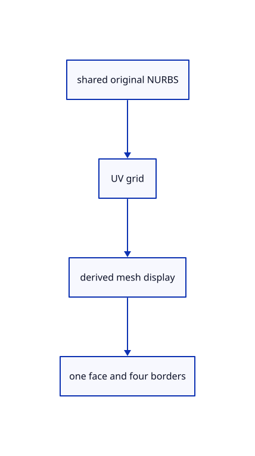

# 9.1.4 · Prepare derived surface display without losing its source

**Chapter 9 · CAD surfaces and topology · Section 9.1 · Surface controls and trimming** · [Contents](contents.md)

**Typing: 24–47 minutes.** [Estimate](typing-load.md).

Keep the original NURBS in a shared owner. Build display positions, normals, triangles and only original domain boundary ink; all triangles resolve to one face.

## Type

Continue from [Use analytic normals and finite singular-point fallbacks](55b-normals.md). [Save or recover your work](recovery.md).

### 1. `src/surface.rs`

Keep the original surface and its UV cache beside the derived display; provide the parametric-roof example.

<details>
<summary>Locate the existing block</summary>

```rust
    }
}
```

</details>

After that block, type:

```rust
--8<-- "journey/code/55c-display-01.rs" skip=9
```

## Run and check

In your project:

```sh
cd workspace/journey
REGEN_PROTO=0 cargo build --lib --locked --target wasm32-unknown-unknown -j1
REGEN_PROTO=0 CARGO_BUILD_JOBS=1 trunk serve --port 8780
```

Open `http://127.0.0.1:8780/`. Keep an existing Trunk server running; saving rebuilds it.


### Recorded visual result

**Previous native render — current verification pending.**

Blue Posts, the brown source beam and black original boundaries remain visible.


*This recorded image predates a source or checker change. Rebuild this checkpoint before using it as current evidence; browser controls require separate acceptance.*

This reference image is shared with [8.3.1 · Navigate and fit inside the free canvas](54-camera.md). It does not demonstrate a new feature by itself.

<details>
<summary>Code explanation and diagram</summary>


shared original NURBS → UV grid → derived mesh display → one face and four borders.



Why keep the original NURBS after making display triangles?

The triangles approximate its display. They cannot replace original control values, rational weights or parameter domains. Presentation and placements continue sharing the source.

Study estimate, including typing and experiments: 0.5–1 hours.

</details>

<details>
<summary>Optional experiment</summary>

Inspect the original surface before and after preparation. Compare its weights, knots, GUID and colours; count one face and four boundary identities.

</details>

<details>
<summary>Check and save your work</summary>

Restore experimental edits, then run from `session_viewer`:

```sh
npm --prefix ../session_tests run course -- check 9.1.4
npm --prefix ../session_tests run course -- save 9.1.4
```

Source comparison leaves your project untouched. [Save and recovery instructions](recovery.md).

</details>

<details>
<summary>Viewer coverage and verification</summary>


The earlier navigation acceptance exercise remains. Surface acceptance connects at the end of this subject and has not been run in Chrome.

[Full validation scope](release.md).

To reproduce the scripted acceptance of the reference checkpoint, run from `session_viewer` with the [course bundle server](release.md#reproduce) running on port 8781:

```sh
npm --prefix ../session_tests run course -- capture 9.1.4
```

This uses the verified reference bundle; it does not check or change your typed project.

</details>
