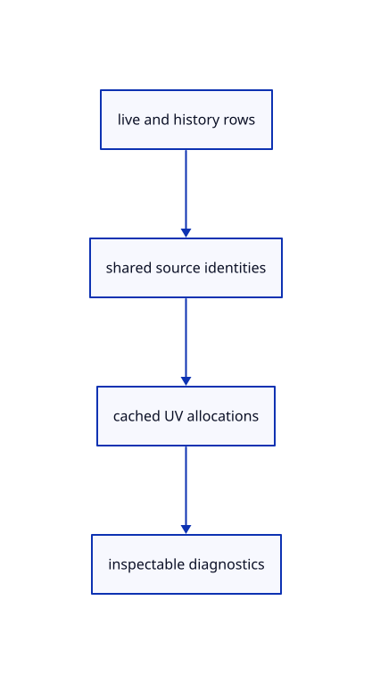

# 9.1.7 · Account for shared source and UV cache owners

**Chapter 9 · CAD surfaces and topology · Section 9.1 · Surface controls and trimming** · [Contents](contents.md)

**Typing: 17–33 minutes.** [Estimate](typing-load.md).

Count original NURBS and sampled preparation owners once across live and history scenes. Expose their source and grid identities for acceptance checks.

## Type

Continue from [Resolve original surface face and domain edges](55e-identities.md). [Save or recover your work](recovery.md).

### 1. `src/memory.rs`

Count source control/metadata bytes and cached UV/triangle/boundary allocations by unique owner.

<details>
<summary>Locate the existing block</summary>

```rust
    }
}
```

</details>

After that block, type:

```rust
--8<-- "journey/code/55f-ownership-01.rs" skip=8
```

### 2. `src/browser.rs`

Expose actual surface source, grid, face and edge identities and unique-owner accounting.

<details>
<summary>Locate the existing block</summary>

```rust
    canvas.set_attribute("data-pick-gpu", &serde_json::to_string(&renderer.pick_usage()).unwrap())?;
    canvas.set_attribute("data-point-gpu", &serde_json::to_string(&renderer.point_usage()).unwrap())?;
    canvas.set_attribute("data-curve-cpu", &serde_json::to_string(&crate::memory::curves(editor.presentation_scenes())).unwrap())?;
    canvas.set_attribute("data-control-count", &editor.scene.control_markers().len().to_string())?;
```

</details>

Edit the existing block to match this code; keep unchanged lines:

```rust
--8<-- "journey/code/55f-ownership-02.rs"
```

## Run and check

In your project:

```sh
cd workspace/journey
REGEN_PROTO=0 cargo build --lib --locked --target wasm32-unknown-unknown -j1
REGEN_PROTO=0 CARGO_BUILD_JOBS=1 trunk serve --port 8780
```

Open `http://127.0.0.1:8780/`. Keep an existing Trunk server running; saving rebuilds it.


### Recorded visual result

**Previous native render — current verification pending.**

Blue Posts, the brown source beam and black original boundaries remain visible.


*This recorded image predates a source or checker change. Rebuild this checkpoint before using it as current evidence; browser controls require separate acceptance.*

This reference image is shared with [8.3.1 · Navigate and fit inside the free canvas](54-camera.md). It does not demonstrate a new feature by itself.

<details>
<summary>Code explanation and diagram</summary>


live and history rows → shared source identities → cached UV allocations → inspectable diagnostics.



Does a history snapshot need another complete surface grid?

No. Unchanged snapshots share the original NURBS and prepared UV grid. Closing releases those source owners; a retained display mesh can survive independently.

Study estimate, including typing and experiments: 0.5–1 hours.

</details>

<details>
<summary>Optional experiment</summary>

Compare one scene with its history snapshots, then close. Verify source and preparation counts deduplicate shared owners and return to zero after Close.

</details>

<details>
<summary>Check and save your work</summary>

Restore experimental edits, then run from `session_viewer`:

```sh
npm --prefix ../session_tests run course -- check 9.1.7
npm --prefix ../session_tests run course -- save 9.1.7
```

Source comparison leaves your project untouched. [Save and recovery instructions](recovery.md).

</details>

<details>
<summary>Viewer coverage and verification</summary>


The earlier navigation acceptance exercise remains. Surface acceptance connects at the end of this subject and has not been run in Chrome.

[Full validation scope](release.md).

To reproduce the scripted acceptance of the reference checkpoint, run from `session_viewer` with the [course bundle server](release.md#reproduce) running on port 8781:

```sh
npm --prefix ../session_tests run course -- capture 9.1.7
```

This uses the verified reference bundle; it does not check or change your typed project.

</details>
