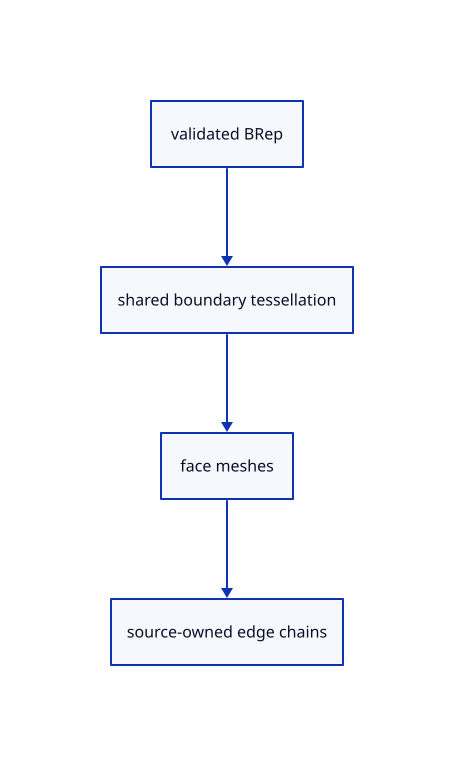

# 9.2.2 · Mesh incident faces with shared boundary constraints

**Chapter 9 · CAD surfaces and topology · Section 9.2 · Shared CAD edges** · [Contents](contents.md)

**Typing: 16–31 minutes.** [Estimate](typing-load.md).

Validate topology and surface control storage, then ask the kernel for all face meshes together at the current five-degree and 0.001 chord quality. Retain original source ownership beside their coherent chains.

## Type

Continue from [Connect original CAD edge chains](56-chains.md). [Save or recover your work](recovery.md).

### 1. `src/cad_boundary.rs`

Validate references and retain one source-owned preparation of all incident face meshes.

Create the file and type:

```rust
--8<-- "journey/code/56a-shared-01.rs"
```

### 2. `src/lib.rs`

Register the source component.

<details>
<summary>Locate the existing block</summary>

```rust

pub mod cad_edges;
```

</details>

After that block, type:

```rust
--8<-- "journey/code/56a-shared-02.rs" skip=20
```

## Run and check

In your project:

```sh
cd workspace/journey
REGEN_PROTO=0 cargo build --lib --locked --target wasm32-unknown-unknown -j1
REGEN_PROTO=0 CARGO_BUILD_JOBS=1 trunk serve --port 8780
```

Open `http://127.0.0.1:8780/`. Keep an existing Trunk server running; saving rebuilds it.


### Recorded visual result

**Previous native render — current verification pending.**

The blue parametric roof and black domain boundaries remain visible.


*This recorded image predates a source or checker change. Rebuild this checkpoint before using it as current evidence; browser controls require separate acceptance.*

This reference image is shared with [9.1.8 · Draw and pick the original parametric roof](55g-surface.md). It does not demonstrate a new feature by itself.

<details>
<summary>Code explanation and diagram</summary>


validated BRep → shared boundary tessellation → face meshes → source-owned edge chains.



Does sharing a boundary require sharing normals across its two faces?

No. Incident faces agree on boundary positions while retaining their own normals. A sharp corner keeps its shading discontinuity, and a curved cap and wall meet without a gap.

Study estimate, including typing and experiments: 0.5–1 hours.

</details>

<details>
<summary>Optional experiment</summary>

For every box edge, compare all chain positions with vertices on its neighbouring face. Repeat for both circular cylinder rims and inspect their distinct normals.

</details>

<details>
<summary>Check and save your work</summary>

Restore experimental edits, then run from `session_viewer`:

```sh
npm --prefix ../session_tests run course -- check 9.2.2
npm --prefix ../session_tests run course -- save 9.2.2
```

Source comparison leaves your project untouched. [Save and recovery instructions](recovery.md).

</details>

<details>
<summary>Viewer coverage and verification</summary>


The earlier original-surface browser acceptance exercise remains and has not been run in Chrome. The new BRep boundary checks run natively; this checkpoint does not yet draw a BRep row.

[Full validation scope](release.md).

To reproduce the scripted acceptance of the reference checkpoint, run from `session_viewer` with the [course bundle server](release.md#reproduce) running on port 8781:

```sh
npm --prefix ../session_tests run course -- capture 9.2.2
```

This uses the verified reference bundle; it does not check or change your typed project.

</details>
