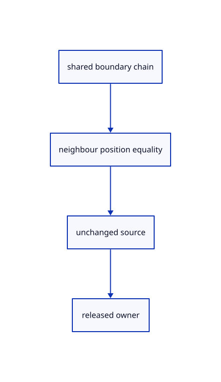

# 9.2.3 · Prove straight and circular shared boundaries

**Chapter 9 · CAD surfaces and topology · Section 9.2 · Shared CAD edges** · [Contents](contents.md)

**Typing: 0–0 minutes.** [Estimate](typing-load.md).

Copy checks that compare boundary positions against both incident faces, preserve original BRep serialization and verify that preparation releases its source owner.

## Type

Continue from [Mesh incident faces with shared boundary constraints](56a-shared.md). [Save or recover your work](recovery.md).

<details>
<summary>Supplied validation fixture</summary>

Copy this supplied authoring fixture once. Continue with the browser build below; the course does not require running native tests.

### 1. `src/cad_boundary_tests.rs`

Copy independent incident-face position, source ownership and malformed-input checks.

Copy this supplied file:

```text
--8<-- "journey/code/56b-boundaries-01.rs"
```

</details>

<details>
<summary>Supplied validation fixture</summary>

Copy this supplied authoring fixture once. Continue with the browser build below; the course does not require running native tests.

### 2. `src/lib.rs`

Register the source component.

<details>
<summary>Locate the existing block</summary>

```text

pub mod cad_boundary;
```

</details>

After that block, append this supplied code:

```text
--8<-- "journey/code/56b-boundaries-02.rs" skip=23
```

</details>

## Run and check

In your project:

```sh
cd workspace/journey
REGEN_PROTO=0 cargo build --lib --locked --target wasm32-unknown-unknown -j1
REGEN_PROTO=0 CARGO_BUILD_JOBS=1 trunk serve --port 8780
```

Open `http://127.0.0.1:8780/`. Keep an existing Trunk server running; saving rebuilds it.


### Recorded visual result

**Previous native render — current verification pending.**

The blue parametric roof and black domain boundaries remain visible.


*This recorded image predates a source or checker change. Rebuild this checkpoint before using it as current evidence; browser controls require separate acceptance.*

This reference image is shared with [9.1.8 · Draw and pick the original parametric roof](55g-surface.md). It does not demonstrate a new feature by itself.

<details>
<summary>Code explanation and diagram</summary>


shared boundary chain → neighbour position equality → unchanged source → released owner.



What must remain unchanged when display quality changes?

The original BRep, its face and edge topology, control values and source identity remain unchanged. Mesh vertex keys and display samples belong to the derived preparation.

Study estimate, including typing and experiments: 0.5–1 hours.

</details>

<details>
<summary>Optional experiment</summary>

Read the box and circular-rim fixtures beside the shared boundary collector. Trace one recorded edge into both incident face meshes, then identify the malformed source rejected before meshing. The browser display is unchanged; running the native fixtures is optional.

</details>

<details>
<summary>Check and save your work</summary>

Restore experimental edits, then run from `session_viewer`:

```sh
npm --prefix ../session_tests run course -- check 9.2.3
npm --prefix ../session_tests run course -- save 9.2.3
```

Source comparison leaves your project untouched. [Save and recovery instructions](recovery.md).

</details>

<details>
<summary>Viewer coverage and verification</summary>

Use the current production BRep quality and boundary-chain lookup. The kernel shares boundary constraints before meshing incident faces; the viewer retains original edge identities and face samples rather than independently drawing an analytic curve. BRep display, trims and face picking connect in subjects 57–59.

All earlier checks remain. Four new checks verify box, circular and unequal-grid curved boundaries against both incident meshes, unchanged original BRep data, source lifetime and rejection of invalid topology/control storage before meshing.

The earlier original-surface browser acceptance exercise remains and has not been run in Chrome. The new BRep boundary checks run natively; this checkpoint does not yet draw a BRep row.

[Full validation scope](release.md).

To reproduce the scripted acceptance of the reference checkpoint, run from `session_viewer` with the [course bundle server](release.md#reproduce) running on port 8781:

```sh
npm --prefix ../session_tests run course -- capture 9.2.3
```

This uses the verified reference bundle; it does not check or change your typed project.

</details>
