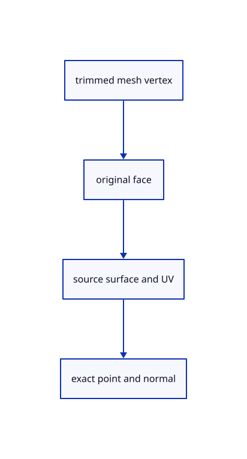

# 9.3.1 · Keep the trimmed face connected to its surface

**Chapter 9 · CAD surfaces and topology · Section 9.3 · Trimmed curved faces** · [Contents](contents.md)

**Typing: 12–24 minutes.** [Estimate](typing-load.md).

A face chooses a kept region on an underlying surface. Record source surface and UV addresses from the actual trimmed mesh vertices; preserve f64 samples and analytic normals.

## Type

Continue from [Prove straight and circular shared boundaries](56b-boundaries.md). [Save or recover your work](recovery.md).

### 1. `src/cad_samples.rs`

Retain original surface addresses and exact UV samples on a trimmed face.

Create the file and type:

```rust
--8<-- "journey/code/57-parameters-01.rs"
```

### 2. `src/lib.rs`

Register the source component.

<details>
<summary>Locate the existing block</summary>

```rust
#[cfg(test)]
mod cad_boundary_tests;
```

</details>

After that block, type:

```rust
--8<-- "journey/code/57-parameters-02.rs" skip=37
```

## Run and check

In your project:

```sh
cd workspace/journey
REGEN_PROTO=0 cargo build --lib --locked --target wasm32-unknown-unknown -j1
REGEN_PROTO=0 CARGO_BUILD_JOBS=1 trunk serve --port 8780
```

Open `http://127.0.0.1:8780/`. Keep an existing Trunk server running; saving rebuilds it.

The blue parametric roof remains visible. Inspect the supplied trim fixture; BRep drawing connects in 59.

### Recorded visual result

**Previous native render — current verification pending.**

The blue parametric roof and black domain boundaries remain visible.


*This recorded image predates a source or checker change. Rebuild this checkpoint before using it as current evidence; browser controls require separate acceptance.*

This reference image is shared with [9.1.8 · Draw and pick the original parametric roof](55g-surface.md). It does not demonstrate a new feature by itself.

<details>
<summary>Code explanation and diagram</summary>


trimmed mesh vertex → original face → source surface and UV → exact point and normal.



Does a trim replace the original surface control points?

No. The face keeps a region of the underlying surface. Its outer wire and holes choose the visible region while original control points, knots and weights remain unchanged.

Study estimate, including typing and experiments: 0.5–1 hours.

</details>

<details>
<summary>Optional experiment</summary>

Inspect the curved trimmed wave fixture. Compare each mesh vertex with the source evaluated at its stored UV and keep every sample within the retained parameter rectangle.

</details>

<details>
<summary>Check and save your work</summary>

Restore experimental edits, then run from `session_viewer`:

```sh
npm --prefix ../session_tests run course -- check 9.3.1
npm --prefix ../session_tests run course -- save 9.3.1
```

Source comparison leaves your project untouched. [Save and recovery instructions](recovery.md).

</details>

<details>
<summary>Viewer coverage and verification</summary>


The earlier original-surface browser acceptance exercise remains and has not been run in Chrome. The new BRep boundary checks run natively; this checkpoint does not yet draw a BRep row.

[Full validation scope](release.md).

To reproduce the scripted acceptance of the reference checkpoint, run from `session_viewer` with the [course bundle server](release.md#reproduce) running on port 8781:

```sh
npm --prefix ../session_tests run course -- capture 9.3.1
```

This uses the verified reference bundle; it does not check or change your typed project.

</details>
