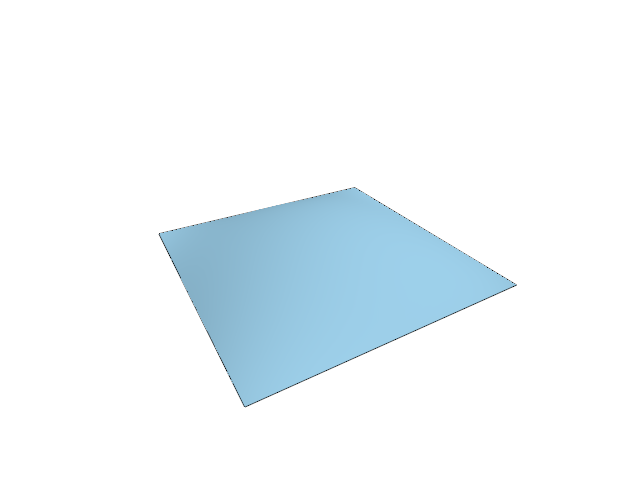
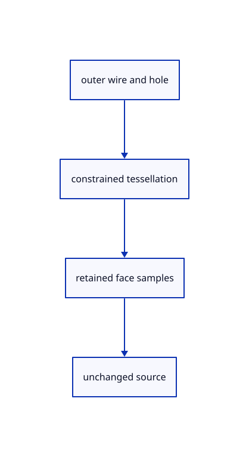

# 9.3.2 · Prove trimmed curved faces and open holes

**Chapter 9 · CAD surfaces and topology · Section 9.3 · Trimmed curved faces** · [Contents](contents.md)

**Typing: 0–0 minutes.** [Estimate](typing-load.md).

Copy the curved trim and hole fixtures. Check kept UVs, analytic normals, coherent CAD border chains and a real hole that no display triangle fills.

## Type

Continue from [Keep the trimmed face connected to its surface](57-parameters.md). [Save or recover your work](recovery.md).

<details>
<summary>Supplied validation fixture</summary>

Copy this supplied authoring fixture once. Continue with the browser build below; the course does not require running native tests.

### 1. `src/cad_trim_tests.rs`

Copy curved-trim source/UV/normal checks and the hole-region triangle regression.

Copy this supplied file:

```text
--8<-- "journey/code/57a-trims-01.rs"
```

</details>

<details>
<summary>Supplied validation fixture</summary>

Copy this supplied authoring fixture once. Continue with the browser build below; the course does not require running native tests.

### 2. `src/lib.rs`

Register the source component.

<details>
<summary>Locate the existing block</summary>

```text

pub mod cad_samples;
```

</details>

After that block, append this supplied code:

```text
--8<-- "journey/code/57a-trims-02.rs" skip=22
```

</details>

## Run and check

In your project:

```sh
cd workspace/journey
REGEN_PROTO=0 cargo build --lib --locked --target wasm32-unknown-unknown -j1
REGEN_PROTO=0 CARGO_BUILD_JOBS=1 trunk serve --port 8780
```

Open `http://127.0.0.1:8780/`. Keep an existing Trunk server running; saving rebuilds it.


### Recorded visual result

**Previous native render — current verification pending.**

The blue parametric roof and black domain boundaries remain visible.



*This recorded image predates a source or checker change. Rebuild this checkpoint before using it as current evidence; browser controls require separate acceptance.*

This reference image is shared with [9.1.8 · Draw and pick the original parametric roof](55g-surface.md). It does not demonstrate a new feature by itself.

<details>
<summary>Code explanation and diagram</summary>


outer wire and hole → constrained tessellation → retained face samples → unchanged source.



Can the viewer draw the entire surface grid and paint over a hole?

That would still leave shaded triangles and pick targets inside the hole. The kept face must be tessellated from its trim region so the omitted region has neither triangles nor face addresses.

Study estimate, including typing and experiments: 0.5–1 hours.

</details>

<details>
<summary>Optional experiment</summary>

Compare the supplied trimmed-wave and hole data in the browser editor. Locate the retained UV rectangle and the outer and inner wires, then trace why the mesh cannot fill the hole. These are optional validation examples for the mesher already written.

</details>

<details>
<summary>Check and save your work</summary>

Restore experimental edits, then run from `session_viewer`:

```sh
npm --prefix ../session_tests run course -- check 9.3.2
npm --prefix ../session_tests run course -- save 9.3.2
```

Source comparison leaves your project untouched. [Save and recovery instructions](recovery.md).

</details>

<details>
<summary>Viewer coverage and verification</summary>

Use the current kernel face mesher with original BRep trim wires and constrained borders. Retain UV/source addresses only where the mesher supplies them, as the production surface sample cache does. Actual BRep drawing and integer identity acceptance connect in 59.

All earlier checks remain. Two new native checks preserve trimmed-wave UV positions and normals and prove that the original hole wires remain while triangles do not fill the hole.

The earlier original-surface browser acceptance exercise remains and has not been run in Chrome. The new BRep boundary checks run natively; this checkpoint does not yet draw a BRep row.

[Full validation scope](release.md).

To reproduce the scripted acceptance of the reference checkpoint, run from `session_viewer` with the [course bundle server](release.md#reproduce) running on port 8781:

```sh
npm --prefix ../session_tests run course -- capture 9.3.2
```

This uses the verified reference bundle; it does not check or change your typed project.

</details>
