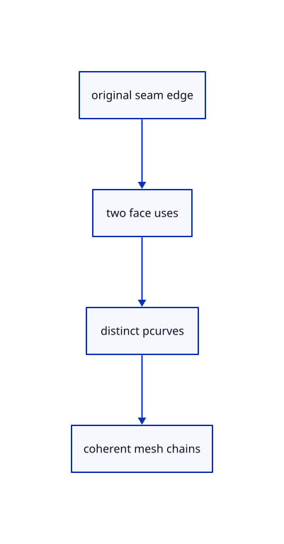

# 9.4.1 · Keep both parameter-space uses of a seam

**Chapter 9 · CAD surfaces and topology · Section 9.4 · Seams and face directions** · [Contents](contents.md)

**Typing: 10–19 minutes.** [Estimate](typing-load.md).

One seam edge can belong to the same face twice. Keep each original face use, orientation and pcurve rather than collapsing them into a single UV address.

## Type

Continue from [Prove trimmed curved faces and open holes](57a-trims.md). [Save or recover your work](recovery.md).

### 1. `src/cad_seams.rs`

Retain both original face uses and pcurve identities at a closed seam.

Create the file and type:

```rust
--8<-- "journey/code/58-uses-01.rs"
```

### 2. `src/lib.rs`

Register the source component.

<details>
<summary>Locate the existing block</summary>

```rust
#[cfg(test)]
mod cad_trim_tests;
```

</details>

After that block, type:

```rust
--8<-- "journey/code/58-uses-02.rs" skip=33
```

## Run and check

In your project:

```sh
cd workspace/journey
REGEN_PROTO=0 cargo build --lib --locked --target wasm32-unknown-unknown -j1
REGEN_PROTO=0 CARGO_BUILD_JOBS=1 trunk serve --port 8780
```

Open `http://127.0.0.1:8780/`. Keep an existing Trunk server running; saving rebuilds it.

The blue parametric roof remains visible. Inspect the supplied seam and periodic-grid fixtures; BRep drawing connects in 59.

### Recorded visual result

**Previous native render — current verification pending.**

The blue parametric roof and black domain boundaries remain visible.


*This recorded image predates a source or checker change. Rebuild this checkpoint before using it as current evidence; browser controls require separate acceptance.*

This reference image is shared with [9.1.8 · Draw and pick the original parametric roof](55g-surface.md). It does not demonstrate a new feature by itself.

<details>
<summary>Code explanation and diagram</summary>


original seam edge → two face uses → distinct pcurves → coherent mesh chains.



Does a seam that returns to the same face have only one parameter-space curve?

No. Its two face uses can follow opposite sides of the parameter domain. They share a physical 3D edge but retain different pcurves and orientations.

Study estimate, including typing and experiments: 0.5–1 hours.

</details>

<details>
<summary>Optional experiment</summary>

Inspect cylinder edge 2. Compare both face IDs, pcurve IDs and orientations; then compare their mesh positions in world coordinates.

</details>

<details>
<summary>Check and save your work</summary>

Restore experimental edits, then run from `session_viewer`:

```sh
npm --prefix ../session_tests run course -- check 9.4.1
npm --prefix ../session_tests run course -- save 9.4.1
```

Source comparison leaves your project untouched. [Save and recovery instructions](recovery.md).

</details>

<details>
<summary>Viewer coverage and verification</summary>


The earlier original-surface browser acceptance exercise remains and has not been run in Chrome. The new BRep boundary checks run natively; this checkpoint does not yet draw a BRep row.

[Full validation scope](release.md).

To reproduce the scripted acceptance of the reference checkpoint, run from `session_viewer` with the [course bundle server](release.md#reproduce) running on port 8781:

```sh
npm --prefix ../session_tests run course -- capture 9.4.1
```

This uses the verified reference bundle; it does not check or change your typed project.

</details>
