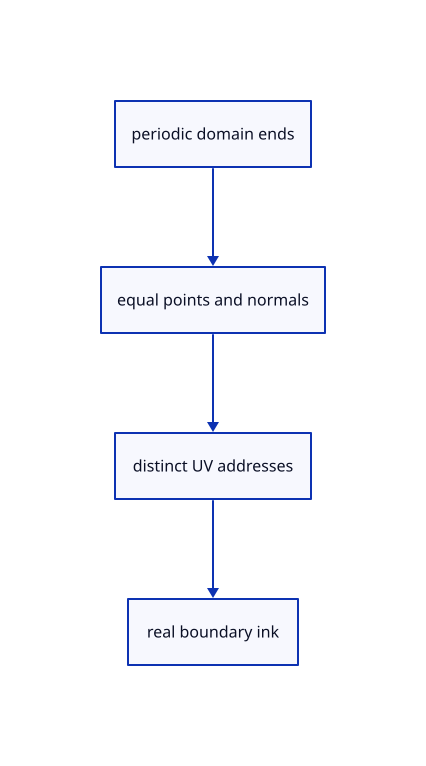

# 9.4.2 · Prove seam continuity and suppress false open borders

**Chapter 9 · CAD surfaces and topology · Section 9.4 · Seams and face directions** · [Contents](contents.md)

**Typing: 0–0 minutes.** [Estimate](typing-load.md).

Copy seam and periodic-surface checks. Equal physical points may carry distinct UV addresses at the domain ends; closed directions do not gain an artificial open boundary.

## Type

Continue from [Keep both parameter-space uses of a seam](58-uses.md). [Save or recover your work](recovery.md).

<details>
<summary>Supplied validation fixture</summary>

Copy this supplied authoring fixture once. Continue with the browser build below; the course does not require running native tests.

### 1. `src/cad_seam_tests.rs`

Copy actual same-face seam use and periodic-grid continuity checks.

Copy this supplied file:

```text
--8<-- "journey/code/58a-periodic-01.rs"
```

</details>

<details>
<summary>Supplied validation fixture</summary>

Copy this supplied authoring fixture once. Continue with the browser build below; the course does not require running native tests.

### 2. `src/lib.rs`

Register the source component.

<details>
<summary>Locate the existing block</summary>

```text

pub mod cad_seams;
```

</details>

After that block, append this supplied code:

```text
--8<-- "journey/code/58a-periodic-02.rs" skip=20
```

</details>

## Run and check

In your project:

```sh
cd workspace/journey
REGEN_PROTO=0 cargo build --lib --locked --target wasm32-unknown-unknown -j1
REGEN_PROTO=0 CARGO_BUILD_JOBS=1 trunk serve --port 8780
```

Open `http://127.0.0.1:8780/`. Keep an existing Trunk server running; saving rebuilds it.


### Recorded visual result

**Previous native render — current verification pending.**

The blue parametric roof and black domain boundaries remain visible.


*This recorded image predates a source or checker change. Rebuild this checkpoint before using it as current evidence; browser controls require separate acceptance.*

This reference image is shared with [9.1.8 · Draw and pick the original parametric roof](55g-surface.md). It does not demonstrate a new feature by itself.

<details>
<summary>Code explanation and diagram</summary>


periodic domain ends → equal points and normals → distinct UV addresses → real boundary ink.



Should equal seam positions force equal UV coordinates?

No. The original domain-end addresses must remain distinct even when their positions and normals agree. UV identity and topology describe the surface; display coincidence does not rewrite them.

Study estimate, including typing and experiments: 0.5–1 hours.

</details>

<details>
<summary>Optional experiment</summary>

Follow one cylinder seam through its two original pcurves. In the periodic example, distinguish coincident domain endpoints from a real open border. Inspect the collector's decision to omit that false border; native execution is optional.

</details>

<details>
<summary>Check and save your work</summary>

Restore experimental edits, then run from `session_viewer`:

```sh
npm --prefix ../session_tests run course -- check 9.4.2
npm --prefix ../session_tests run course -- save 9.4.2
```

Source comparison leaves your project untouched. [Save and recovery instructions](recovery.md).

</details>

<details>
<summary>Viewer coverage and verification</summary>

Use original BRep edge use orientations and pcurve_index, with the current isoparametric mesh-chain lookup. Preserve distinct source UV addresses across closed domains. The production surface grid omits closed-direction border ink; actual BRep drawing and integer identity acceptance connect in 59.

All earlier checks remain. Two new native checks retain distinct original cylinder seam pcurves and prove periodic domain-end point/normal continuity without adding false open border ink.

The earlier original-surface browser acceptance exercise remains and has not been run in Chrome. The new BRep boundary checks run natively; this checkpoint does not yet draw a BRep row.

[Full validation scope](release.md).

To reproduce the scripted acceptance of the reference checkpoint, run from `session_viewer` with the [course bundle server](release.md#reproduce) running on port 8781:

```sh
npm --prefix ../session_tests run course -- capture 9.4.2
```

This uses the verified reference bundle; it does not check or change your typed project.

</details>
