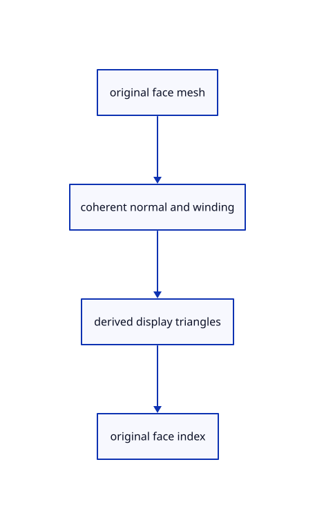

# 9.5.2 · Map each display triangle to its original CAD face

**Chapter 9 · CAD surfaces and topology · Section 9.5 · Solid orientation and bores** · [Contents](contents.md)

**Typing: 23–45 minutes.** [Estimate](typing-load.md).

Combine face display data while retaining the original f64 mesh positions, normals, face IDs and source surface UV addresses. Display triangle addresses remain derived from one original face.

## Type

Continue from [Orient connected original face groups](59-orientation.md). [Save or recover your work](recovery.md).

### 1. `src/cad_face.rs`

Prepare coherent face display arrays, original f64 positions, UV addresses and face indices.

Create the file and type:

```rust
--8<-- "journey/code/59a-face-data-01.rs"
```

### 2. `src/lib.rs`

Register the source component.

<details>
<summary>Locate the existing block</summary>

```rust

pub mod cad_orient;
```

</details>

After that block, type:

```rust
--8<-- "journey/code/59a-face-data-02.rs" skip=21
```

## Run and check

In your project:

```sh
cd workspace/journey
REGEN_PROTO=0 cargo build --lib --locked --target wasm32-unknown-unknown -j1
REGEN_PROTO=0 CARGO_BUILD_JOBS=1 trunk serve --port 8780
```

Open `http://127.0.0.1:8780/`. Keep an existing Trunk server running; saving rebuilds it.


### Recorded visual result

**Previous native render — current verification pending.**

The blue parametric roof and black domain boundaries remain visible.


*This recorded image predates a source or checker change. Rebuild this checkpoint before using it as current evidence; browser controls require separate acceptance.*

This reference image is shared with [9.1.8 · Draw and pick the original parametric roof](55g-surface.md). It does not demonstrate a new feature by itself.

<details>
<summary>Code explanation and diagram</summary>


original face mesh → coherent normal and winding → derived display triangles → original face index.



Does remeshing change the selected original face key?

No. It changes derived triangles and compact GPU addresses. Every new triangle still resolves to its original CAD face; source surface and UV addresses remain available for later edits.

Study estimate, including typing and experiments: 0.5–1 hours.

</details>

<details>
<summary>Optional experiment</summary>

Compare the seven bore face IDs with the larger number of display triangles. Evaluate each cached UV on its original source surface and inspect its display vertex address.

</details>

<details>
<summary>Check and save your work</summary>

Restore experimental edits, then run from `session_viewer`:

```sh
npm --prefix ../session_tests run course -- check 9.5.2
npm --prefix ../session_tests run course -- save 9.5.2
```

Source comparison leaves your project untouched. [Save and recovery instructions](recovery.md).

</details>

<details>
<summary>Viewer coverage and verification</summary>


The earlier original-surface browser exercise remains. CAD browser acceptance connects at the end of 59 and has not run in Chrome.

[Full validation scope](release.md).

To reproduce the scripted acceptance of the reference checkpoint, run from `session_viewer` with the [course bundle server](release.md#reproduce) running on port 8781:

```sh
npm --prefix ../session_tests run course -- capture 9.5.2
```

This uses the verified reference bundle; it does not check or change your typed project.

</details>
