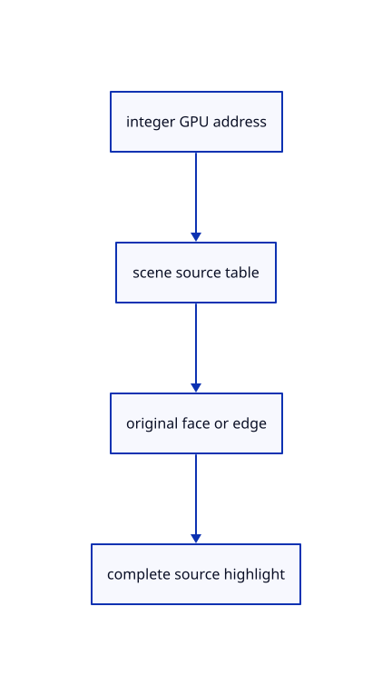

# 9.5.5 · Pick and highlight an original CAD border

**Chapter 9 · CAD surfaces and topology · Section 9.5 · Solid orientation and bores** · [Contents](contents.md)

**Typing: 12–24 minutes.** [Estimate](typing-load.md).

Resolve every display border segment to its original BRep edge. A selected edge highlights its complete chain; each shaded triangle resolves to the original face index.

## Type

Continue from [Attach original BRep ownership to existing rows](59c-source-row.md). [Save or recover your work](recovery.md).

### 1. `src/pick_sources.rs`

Resolve original BRep edge identities and highlight complete original borders.

Edit these blocks from bottom to top. Keep the surrounding lines unchanged.

<details>
<summary>Locate this block</summary>

```rust
        for row in scene.objects().iter().filter(|row| scene.visible(row.id)) {
            sources.mesh_bases.push((row.id, u32::try_from(sources.faces.len()).map_err(|_| "Too many source faces")?));
            for &key in &row.mesh.parts.faces { append(&mut sources.faces, Kind::Face, Target { owner: row.id, part: Part::Face(key) })?; }
            let mut surface_edges=row.surface.as_ref().map(|surface|surface.edge_ids());
            for (&(a, b), ends) in row.mesh.parts.edges.iter().zip(&row.mesh.parts.endpoints) {
                let part=surface_edges.as_mut().and_then(|edges|edges.next()).map_or(Part::MeshEdge(a,b),Part::SurfaceEdge);
                let ids = append(&mut sources.edges, Kind::Edge, Target { owner: row.id, part })?;
                let ends = ends.map(|p| row.model.transform_point(&session_rust::Point::new(p[0], p[1], p[2])).to_f32());
                sources.mesh_ink.push(crate::stroke::Stroke { start: ends[0], end: ends[1], colour: scene.view.edges.get(&row.id).map_or([0.,0.,0.,1.],|rgb|[rgb[0] as f32/255.,rgb[1] as f32/255.,rgb[2] as f32/255.,1.]), width: 1. });
```

</details>

Replace it with:

```rust
        for row in scene.objects().iter().filter(|row| scene.visible(row.id)) {
            sources.mesh_bases.push((row.id, u32::try_from(sources.faces.len()).map_err(|_| "Too many source faces")?));
            for &key in &row.mesh.parts.faces { append(&mut sources.faces, Kind::Face, Target { owner: row.id, part: Part::Face(key) })?; }
            let mut cad_edges=row.cad.as_ref().map(|cad|cad.edge_ids.iter());
            let mut surface_edges=row.surface.as_ref().map(|surface|surface.edge_ids());
            for (&(a, b), ends) in row.mesh.parts.edges.iter().zip(&row.mesh.parts.endpoints) {
                let part=cad_edges.as_mut().and_then(|edges|edges.next()).map(|edge|Part::BRepEdge(*edge)).unwrap_or_else(||surface_edges.as_mut().and_then(|edges|edges.next()).map_or(Part::MeshEdge(a,b),Part::SurfaceEdge));
                let ids = append(&mut sources.edges, Kind::Edge, Target { owner: row.id, part })?;
                let ends = ends.map(|p| row.model.transform_point(&session_rust::Point::new(p[0], p[1], p[2])).to_f32());
                sources.mesh_ink.push(crate::stroke::Stroke { start: ends[0], end: ends[1], colour: scene.view.edges.get(&row.id).map_or([0.,0.,0.,1.],|rgb|[rgb[0] as f32/255.,rgb[1] as f32/255.,rgb[2] as f32/255.,1.]), width: 1. });
```

<details>
<summary>Locate this block</summary>

```rust
use crate::{scene::{ObjectId, Scene}, sub_id::{self, Kind}};

#[derive(Clone, Copy, Debug, PartialEq, Eq)]
pub enum Part { Object, Face(usize), SurfaceEdge(usize), MeshEdge(usize, usize), PathEdge(usize), Curve, Control(usize) }

#[derive(Clone, Copy, Debug, PartialEq, Eq)]
pub struct Target { pub owner: ObjectId, pub part: Part }
```

</details>

Replace it with:

```rust
use crate::{scene::{ObjectId, Scene}, sub_id::{self, Kind}};

#[derive(Clone, Copy, Debug, PartialEq, Eq)]
pub enum Part { Object, Face(usize), SurfaceEdge(usize), BRepEdge(usize), MeshEdge(usize, usize), PathEdge(usize), Curve, Control(usize) }

#[derive(Clone, Copy, Debug, PartialEq, Eq)]
pub struct Target { pub owner: ObjectId, pub part: Part }
```

<details>
<summary>Complete updated block reference</summary>

```rust
use crate::{scene::{ObjectId, Scene}, sub_id::{self, Kind}};

#[derive(Clone, Copy, Debug, PartialEq, Eq)]
pub enum Part { Object, Face(usize), SurfaceEdge(usize), BRepEdge(usize), MeshEdge(usize, usize), PathEdge(usize), Curve, Control(usize) }

#[derive(Clone, Copy, Debug, PartialEq, Eq)]
pub struct Target { pub owner: ObjectId, pub part: Part }

#[derive(Clone, Copy, Debug, Default, PartialEq, Eq)]
#[repr(u32)]
pub enum Mode { #[default] Object, Face, Edge, Control }

#[derive(Default)]
pub struct Sources {
    pub faces: Vec<Target>,
    pub edges: Vec<Target>,
    pub controls: Vec<Target>,
    pub mesh_bases: Vec<(ObjectId, u32)>,
    pub mesh_ink: Vec<crate::stroke::Stroke>,
    pub mesh_ids: Vec<[u32; 2]>,
    pub line_ids: Vec<[u32; 2]>,
    pub path_ids: Vec<[u32; 2]>,
    pub marker_ids: Vec<[u32; 2]>,
}

fn append(rows: &mut Vec<Target>, kind: Kind, target: Target) -> Result<[u32; 2], &'static str> {
    let tag = sub_id::encode(kind, rows.len())?; rows.push(target); Ok([target.owner.value(), tag])
}

impl Sources {
    // A source table translates compact GPU addresses to original keys; addresses belong to this scene snapshot, not the document's saved identity.
    pub fn new(scene: &Scene) -> Result<Self, &'static str> {
        let mut sources = Self::default();
        let id = |owner: ObjectId, tag| [scene.pick_id(owner.value()).map_or(0, ObjectId::value), tag];
        for row in scene.objects().iter().filter(|row| scene.visible(row.id)) {
            sources.mesh_bases.push((row.id, u32::try_from(sources.faces.len()).map_err(|_| "Too many source faces")?));
            for &key in &row.mesh.parts.faces { append(&mut sources.faces, Kind::Face, Target { owner: row.id, part: Part::Face(key) })?; }
            let mut cad_edges=row.cad.as_ref().map(|cad|cad.edge_ids.iter());
            let mut surface_edges=row.surface.as_ref().map(|surface|surface.edge_ids());
            for (&(a, b), ends) in row.mesh.parts.edges.iter().zip(&row.mesh.parts.endpoints) {
                let part=cad_edges.as_mut().and_then(|edges|edges.next()).map(|edge|Part::BRepEdge(*edge)).unwrap_or_else(||surface_edges.as_mut().and_then(|edges|edges.next()).map_or(Part::MeshEdge(a,b),Part::SurfaceEdge));
                let ids = append(&mut sources.edges, Kind::Edge, Target { owner: row.id, part })?;
                let ends = ends.map(|p| row.model.transform_point(&session_rust::Point::new(p[0], p[1], p[2])).to_f32());
                sources.mesh_ink.push(crate::stroke::Stroke { start: ends[0], end: ends[1], colour: scene.view.edges.get(&row.id).map_or([0.,0.,0.,1.],|rgb|[rgb[0] as f32/255.,rgb[1] as f32/255.,rgb[2] as f32/255.,1.]), width: 1. });
                sources.mesh_ids.push(id(row.id, ids[1]));
            }
        }
        for row in scene.lines().iter().filter(|row| scene.visible(row.id)) {
            let ids = append(&mut sources.edges, Kind::Edge, Target { owner: row.id, part: Part::Curve })?;
            sources.line_ids.push(id(row.id, ids[1]));
        }
        for row in scene.paths().iter().filter(|row| scene.visible(row.id)) {
            let points: Vec<_> = row.points().iter().map(session_rust::Point::to_f32).collect();
            for (index, _) in points.windows(2).enumerate().filter(|(_, pair)| pair[0] != pair[1]) {
                let part = if matches!(row.prepared.source, crate::chain::Source::Polyline(_)) { Part::PathEdge(index) } else { Part::Curve };
                let ids = append(&mut sources.edges, Kind::Edge, Target { owner: row.id, part })?;
                sources.path_ids.push(id(row.id, ids[1]));
            }
        }
        for row in scene.points().iter().filter(|row| scene.visible(row.id)) { sources.marker_ids.push(id(row.id, 1)); }
        for row in scene.control_markers() {
            let ids = append(&mut sources.controls, Kind::Control, Target { owner: row.parent, part: Part::Control(row.control.index) })?;
            sources.marker_ids.push(id(row.parent, ids[1]));
        }
        Ok(sources)
    }

    pub fn bytes(&self) -> usize {
        (self.faces.capacity() + self.edges.capacity() + self.controls.capacity()) * std::mem::size_of::<Target>()
            + self.mesh_bases.capacity() * std::mem::size_of::<(ObjectId, u32)>()
            + self.mesh_ink.capacity() * std::mem::size_of::<crate::stroke::Stroke>()
            + (self.mesh_ids.capacity() + self.line_ids.capacity() + self.path_ids.capacity() + self.marker_ids.capacity()) * 8
    }

    pub fn resolve(&self, scene: &Scene, pixel: [u32; 2], mode: Mode) -> Option<Target> {
        let owner = scene.pick_id(pixel[0])?;
        if mode == Mode::Object { return Some(Target { owner, part: Part::Object }); }
        let (kind, address) = sub_id::decode(pixel[1])?;
        let target = match (mode, kind) {
            (Mode::Face, Kind::Face) => self.faces.get(address),
            (Mode::Edge, Kind::Edge) => self.edges.get(address),
            (Mode::Control, Kind::Control) => self.controls.get(address), _ => None,
        }?;
        (target.owner == owner && target.valid(scene)).then_some(*target)
    }
}
```

</details>

<details>
<summary>Optional patch references</summary>

Use these original edit fragments when comparing a saved checkpoint. Apply the complete blocks above.

```text
--8<-- "journey/code/59d-identities-01.rs"
```

```text
--8<-- "journey/code/59d-identities-02.rs"
```

</details>

### 2. `src/selection.rs`

Resolve original BRep edge identities and highlight complete original borders.

<details>
<summary>Locate the existing block</summary>

```rust
use crate::{pick_sources::{Part, Target}, scene::Scene};

impl Target {
    pub fn valid(self, scene: &Scene) -> bool {
        if scene.pick_id(self.owner.value()).is_none() { return false; }
        match self.part {
            Part::Object => true,
            Part::Face(key) => scene.objects().iter().any(|r| r.id == self.owner && r.mesh.parts.faces.contains(&key)),
            Part::SurfaceEdge(edge)=>scene.objects().iter().any(|r|r.id==self.owner&&r.surface.as_ref().is_some_and(|s|s.grid.boundaries.iter().any(|b|b.edge==edge))),
            Part::MeshEdge(a, b) => scene.objects().iter().any(|r| r.id == self.owner && r.mesh.parts.edges.contains(&(a, b))),
            Part::PathEdge(index) => scene.paths().iter().any(|r| r.id == self.owner && matches!(&r.prepared.source,
                crate::chain::Source::Polyline(line) if line.get_points().windows(2).nth(index).is_some_and(|pair| pair[0].to_f32() != pair[1].to_f32()))),
            Part::Curve => scene.lines().iter().any(|r| r.id == self.owner) || scene.paths().iter().any(|r| r.id == self.owner && !matches!(r.prepared.source, crate::chain::Source::Polyline(_))),
            Part::Control(index) => scene.paths().iter().any(|r| r.id == self.owner && r.controls_visible && matches!(&r.prepared.source,
                crate::chain::Source::Curve(curve, _) if crate::controls::Control::new(std::rc::Rc::clone(curve), index).is_ok())),
        }
    }

    pub fn describe(self) -> String {
        match self.part {
            Part::Object => format!("Object {}", self.owner.value()),
            Part::Face(key) => format!("Object {} · source face {key}", self.owner.value()),
            Part::SurfaceEdge(edge)=>format!("Object {} · surface domain edge {edge}",self.owner.value()),
            Part::MeshEdge(a, b) => format!("Object {} · source edge {a}–{b}", self.owner.value()),
            Part::PathEdge(index) => format!("Object {} · source segment {index}", self.owner.value()),
            Part::Curve => format!("Object {} · original curve", self.owner.value()),
            Part::Control(index) => format!("Object {} · original control {index}", self.owner.value()),
        }
    }
}
```

</details>

Edit the existing block to match this code; keep unchanged lines:

```rust
use crate::{pick_sources::{Part, Target}, scene::Scene};

impl Target {
    pub fn valid(self, scene: &Scene) -> bool {
        if scene.pick_id(self.owner.value()).is_none() { return false; }
        match self.part {
            Part::Object => true,
            Part::Face(key) => scene.objects().iter().any(|r| r.id == self.owner && r.mesh.parts.faces.contains(&key)),
            Part::BRepEdge(edge)=>scene.objects().iter().any(|r|r.id==self.owner&&r.cad.as_ref().is_some_and(|cad|cad.edges.iter().any(|border|border.edge==edge))),
            Part::SurfaceEdge(edge)=>scene.objects().iter().any(|r|r.id==self.owner&&r.surface.as_ref().is_some_and(|s|s.grid.boundaries.iter().any(|b|b.edge==edge))),
            Part::MeshEdge(a, b) => scene.objects().iter().any(|r| r.id == self.owner && r.mesh.parts.edges.contains(&(a, b))),
            Part::PathEdge(index) => scene.paths().iter().any(|r| r.id == self.owner && matches!(&r.prepared.source,
                crate::chain::Source::Polyline(line) if line.get_points().windows(2).nth(index).is_some_and(|pair| pair[0].to_f32() != pair[1].to_f32()))),
            Part::Curve => scene.lines().iter().any(|r| r.id == self.owner) || scene.paths().iter().any(|r| r.id == self.owner && !matches!(r.prepared.source, crate::chain::Source::Polyline(_))),
            Part::Control(index) => scene.paths().iter().any(|r| r.id == self.owner && r.controls_visible && matches!(&r.prepared.source,
                crate::chain::Source::Curve(curve, _) if crate::controls::Control::new(std::rc::Rc::clone(curve), index).is_ok())),
        }
    }

    pub fn describe(self) -> String {
        match self.part {
            Part::Object => format!("Object {}", self.owner.value()),
            Part::Face(key) => format!("Object {} · source face {key}", self.owner.value()),
            Part::BRepEdge(edge)=>format!("Object {} · original BRep edge {edge}",self.owner.value()),
            Part::SurfaceEdge(edge)=>format!("Object {} · surface domain edge {edge}",self.owner.value()),
            Part::MeshEdge(a, b) => format!("Object {} · source edge {a}–{b}", self.owner.value()),
            Part::PathEdge(index) => format!("Object {} · source segment {index}", self.owner.value()),
            Part::Curve => format!("Object {} · original curve", self.owner.value()),
            Part::Control(index) => format!("Object {} · original control {index}", self.owner.value()),
        }
    }
}
```

<details>
<summary>Optional patch references</summary>

Use these original edit fragments when comparing a saved checkpoint. Apply the complete blocks above.

```text
--8<-- "journey/code/59d-identities-03.rs"
```

```text
--8<-- "journey/code/59d-identities-04.rs"
```

</details>

### 3. `src/highlight.rs`

Resolve original BRep edge identities and highlight complete original borders.

<details>
<summary>Locate the existing block</summary>

```rust
                let mut object = row.clone(); object.mesh = Rc::new(display);
                self.mesh = Some(GpuMesh::upload(device, layout, &object, true));
            }
            Part::SurfaceEdge(edge)=>{
```

</details>

Edit the existing block to match this code; keep unchanged lines:

```rust
--8<-- "journey/code/59d-identities-05.rs"
```

## Run and check

In your project:

```sh
cd workspace/journey
REGEN_PROTO=0 cargo build --lib --locked --target wasm32-unknown-unknown -j1
REGEN_PROTO=0 CARGO_BUILD_JOBS=1 trunk serve --port 8780
```

Open `http://127.0.0.1:8780/`. Keep an existing Trunk server running; saving rebuilds it.


### Recorded visual result

**Previous native render — current verification pending.**

The blue parametric roof and black domain boundaries remain visible.


*This recorded image predates a source or checker change. Rebuild this checkpoint before using it as current evidence; browser controls require separate acceptance.*

This reference image is shared with [9.1.8 · Draw and pick the original parametric roof](55g-surface.md). It does not demonstrate a new feature by itself.

<details>
<summary>Code explanation and diagram</summary>


integer GPU address → scene source table → original face or edge → complete source highlight.



Should each segment of a circular rim become a separate CAD edge?

No. Many display segments approximate one original rim. They all resolve to one original edge identity, and highlighting follows the complete sampled border.

Study estimate, including typing and experiments: 0.5–1 hours.

</details>

<details>
<summary>Optional experiment</summary>

At the final checkpoint, pick several positions on the hole rim. Confirm they report the same original edge, while the shaded cap resolves to one original face.

</details>

<details>
<summary>Check and save your work</summary>

Restore experimental edits, then run from `session_viewer`:

```sh
npm --prefix ../session_tests run course -- check 9.5.5
npm --prefix ../session_tests run course -- save 9.5.5
```

Source comparison leaves your project untouched. [Save and recovery instructions](recovery.md).

</details>

<details>
<summary>Viewer coverage and verification</summary>


The earlier original-surface browser exercise remains. CAD browser acceptance connects at the end of 59 and has not run in Chrome.

[Full validation scope](release.md).

To reproduce the scripted acceptance of the reference checkpoint, run from `session_viewer` with the [course bundle server](release.md#reproduce) running on port 8781:

```sh
npm --prefix ../session_tests run course -- capture 9.5.5
```

This uses the verified reference bundle; it does not check or change your typed project.

</details>
