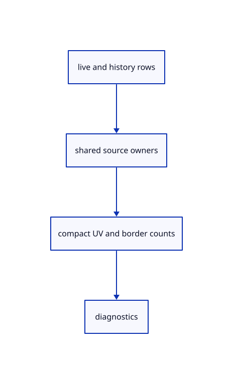

# 9.5.6 · Inspect shared CAD owners and compact cache counts

**Chapter 9 · CAD surfaces and topology · Section 9.5 · Solid orientation and bores** · [Contents](contents.md)

**Typing: 11–21 minutes.** [Estimate](typing-load.md).

Deduplicate original CAD and preparation owners across live and history scenes. Expose face, edge and UV-cache counts without mistaking sample counts for bytes or new topology.

## Type

Continue from [Pick and highlight an original CAD border](59d-identities.md). [Save or recover your work](recovery.md).

### 1. `src/memory.rs`

Expose unique CAD owners and original identity/UV-cache counts for acceptance.

<details>
<summary>Locate the existing block</summary>

```rust
    usage[1]=sources.len();usage[2]=prepared.len();usage
}
```

</details>

After that block, type:

```rust
--8<-- "journey/code/59e-cache-01.rs" skip=59
```

### 2. `src/browser.rs`

Expose unique CAD owners and original identity/UV-cache counts for acceptance.

<details>
<summary>Locate the existing block</summary>

```rust
    canvas.set_attribute("data-pick-gpu", &serde_json::to_string(&renderer.pick_usage()).unwrap())?;
    canvas.set_attribute("data-point-gpu", &serde_json::to_string(&renderer.point_usage()).unwrap())?;
    canvas.set_attribute("data-surface-cpu",&serde_json::to_string(&crate::memory::surfaces(editor.presentation_scenes())).unwrap())?;
    let surfaces=editor.scene.objects().iter().filter_map(|row|row.surface.as_ref().map(|s|serde_json::json!({"id":row.id.value(),"source":s.source.guid(),"controls":s.source.m_cv_count,"steps":s.grid.steps,"samples":s.grid.samples.len(),"faces":row.mesh.parts.faces,"edges":s.grid.boundaries.iter().map(|b|b.edge).collect::<Vec<_>>()}))).collect::<Vec<_>>();
```

</details>

Edit the existing block to match this code; keep unchanged lines:

```rust
--8<-- "journey/code/59e-cache-02.rs"
```

## Run and check

In your project:

```sh
cd workspace/journey
REGEN_PROTO=0 cargo build --lib --locked --target wasm32-unknown-unknown -j1
REGEN_PROTO=0 CARGO_BUILD_JOBS=1 trunk serve --port 8780
```

Open `http://127.0.0.1:8780/`. Keep an existing Trunk server running; saving rebuilds it.


### Recorded visual result

**Previous native render — current verification pending.**

The blue parametric roof and black domain boundaries remain visible.


*This recorded image predates a source or checker change. Rebuild this checkpoint before using it as current evidence; browser controls require separate acceptance.*

This reference image is shared with [9.1.8 · Draw and pick the original parametric roof](55g-surface.md). It does not demonstrate a new feature by itself.

<details>
<summary>Code explanation and diagram</summary>


live and history rows → shared source owners → compact UV and border counts → diagnostics.



Does Undo require another complete original BRep and UV cache?

No. Unchanged history scenes share both owners. Row counts can increase across snapshots while unique source and preparation counts stay at one.

Study estimate, including typing and experiments: 0.5–1 hours.

</details>

<details>
<summary>Optional experiment</summary>

Compare diagnostic cache counts before Move, after Move and after Undo. Close and confirm source/preparation counts return to zero while separately retained display data remains valid.

</details>

<details>
<summary>Check and save your work</summary>

Restore experimental edits, then run from `session_viewer`:

```sh
npm --prefix ../session_tests run course -- check 9.5.6
npm --prefix ../session_tests run course -- save 9.5.6
```

Source comparison leaves your project untouched. [Save and recovery instructions](recovery.md).

</details>

<details>
<summary>Viewer coverage and verification</summary>


The earlier original-surface browser exercise remains. CAD browser acceptance connects at the end of 59 and has not run in Chrome.

[Full validation scope](release.md).

To reproduce the scripted acceptance of the reference checkpoint, run from `session_viewer` with the [course bundle server](release.md#reproduce) running on port 8781:

```sh
npm --prefix ../session_tests run course -- capture 9.5.6
```

This uses the verified reference bundle; it does not check or change your typed project.

</details>
