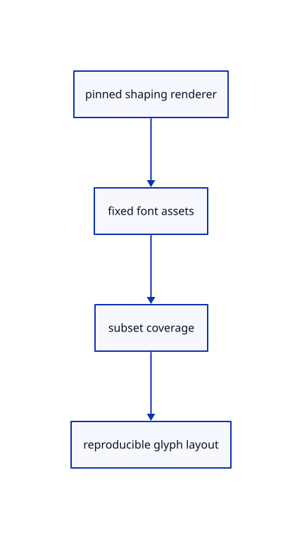

# 10.1.1 · Pin scene-text shaping and supply the viewer fonts

**Chapter 10 · Text and labels · Section 10.1 · Fonts and text shaping** · [Contents](contents.md)

**Typing: 2–4 minutes.** [Estimate](typing-load.md).

Use the current Glyphon release compatible with the viewer GPU API and the viewer’s explicit Noto main/symbol fonts. Keep the font licence with the supplied assets.

## Type

Continue from [Draw the original bore and prove its empty hole](59f-cad.md). [Save or recover your work](recovery.md).

### 1. `Cargo.toml`

Pin the production text renderer and explicit glyph coverage parser.

<details>
<summary>Locate the existing block</summary>

```toml
serde_json = "1.0"

[dev-dependencies]
pollster = "=0.4.0"
```

</details>

Edit the existing block to match this code; keep unchanged lines:

```toml
--8<-- "journey/code/60-fonts-01.rs"
```

### 2. `index.html`

Make the supplied whole fonts available at the current text asset URLs.

<details>
<summary>Locate the existing block</summary>

```html
  <title>Session Viewer</title>
  <link data-trunk rel="rust">
  <style>
    html, body { width: 100%; height: 100%; margin: 0; overflow: hidden; }
```

</details>

Edit the existing block to match this code; keep unchanged lines:

```html
--8<-- "journey/code/60-fonts-02.rs"
```

## Run and check

Run this from `session_viewer` to select the fixed dependency versions and install supplied binary assets. It updates Cargo.lock and preserves the previous lock. It does not write implementation code:

```sh
npm --prefix ../session_tests run course -- dependencies 10.1.1
```

In your project:

```sh
cd workspace/journey
REGEN_PROTO=0 cargo build --lib --locked --target wasm32-unknown-unknown -j1
REGEN_PROTO=0 CARGO_BUILD_JOBS=1 trunk serve --port 8780
```

Open `http://127.0.0.1:8780/`. Keep an existing Trunk server running; saving rebuilds it.

The blue CAD bore remains visible. Run the supplied text shaping checks; glyph coverage is drawn through the atlas in 61 and scene labels connect in 62.

### Recorded visual result

**Previous native render — current verification pending.**

The blue CAD bore and its black original borders remain visible.

This checkpoint was rendered independently and has the same native comparison frame as [Inspect shared CAD owners and compact cache counts](59e-cache.md). Use its state checks and browser exercise to assess the changed behavior.


*This recorded image predates a source or checker change. Rebuild this checkpoint before using it as current evidence; browser controls require separate acceptance.*

This reference image is shared with [9.1.8 · Draw and pick the original parametric roof](55g-surface.md). It does not demonstrate a new feature by itself.

<details>
<summary>Code explanation and diagram</summary>


pinned shaping renderer → fixed font assets → subset coverage → reproducible glyph layout.



Should a CAD label depend on whichever fonts happen to be installed?

No. Explicit bundled fonts make its glyph coverage and layout reproducible. Main and symbol fonts handle the viewer’s strings; whole fonts are available when the subsets lack a character.

Study estimate, including typing and experiments: 0.5–1 hours.

</details>

<details>
<summary>Optional experiment</summary>

Inspect the supplied main and symbol fonts and OFL.txt. Keep the licence beside them when distributing assets, and compare subset coverage with the full fonts.

</details>

<details>
<summary>Check and save your work</summary>

Restore experimental edits, then run from `session_viewer`:

```sh
npm --prefix ../session_tests run course -- check 10.1.1
npm --prefix ../session_tests run course -- save 10.1.1
```

Source comparison leaves your project untouched. [Save and recovery instructions](recovery.md).

</details>

<details>
<summary>Viewer coverage and verification</summary>


The earlier CAD browser acceptance exercise remains, authored and unrun. These text checkpoints exercise CPU shaping; actual glyph atlas and scene-label browser checks connect in 61–62.

[Full validation scope](release.md).

To reproduce the scripted acceptance of the reference checkpoint, run from `session_viewer` with the [course bundle server](release.md#reproduce) running on port 8781:

```sh
npm --prefix ../session_tests run course -- capture 10.1.1
```

This uses the verified reference bundle; it does not check or change your typed project.

</details>
