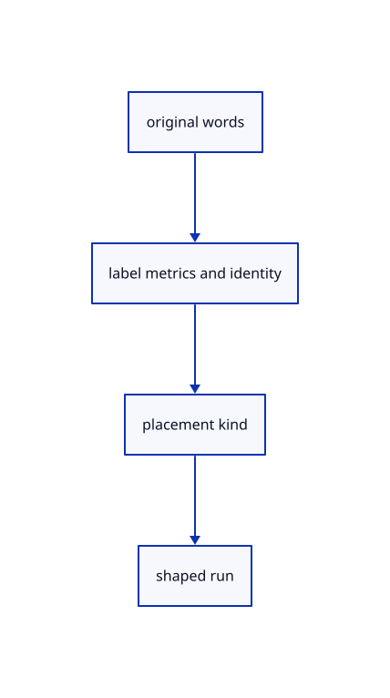

# 10.1.2 · Keep source words metrics and placement together

**Chapter 10 · Text and labels · Section 10.1 · Fonts and text shaping** · [Contents](contents.md)

**Typing: 20–39 minutes.** [Estimate](typing-load.md).

Retain original text, source identity, colour and CSS metrics beside an explicit screen, anchor, nameplate, world-plane or billboard placement. World positions and axes remain f64.

## Type

Continue from [Pin scene-text shaping and supply the viewer fonts](60-fonts.md). [Save or recover your work](recovery.md).

### 1. `src/text.rs`

Define current label/source placement types and explicit bundled font constants.

Create the file and type:

```rust
--8<-- "journey/code/60a-labels-01.rs"
```

### 2. `src/lib.rs`

Register the source component.

<details>
<summary>Locate the existing block</summary>

```rust
#[cfg(test)]
mod cad_display_tests;
```

</details>

After that block, type:

```rust
--8<-- "journey/code/60a-labels-02.rs" skip=36
```

## Run and check

Run this from `session_viewer` to select the fixed dependency versions and install supplied binary assets. It updates Cargo.lock and preserves the previous lock. It does not write implementation code:

```sh
npm --prefix ../session_tests run course -- dependencies 10.1.2
```

In your project:

```sh
cd workspace/journey
REGEN_PROTO=0 cargo build --lib --locked --target wasm32-unknown-unknown -j1
REGEN_PROTO=0 CARGO_BUILD_JOBS=1 trunk serve --port 8780
```

Open `http://127.0.0.1:8780/`. Keep an existing Trunk server running; saving rebuilds it.


### Recorded visual result

**Previous native render — current verification pending.**

The blue CAD bore and its black original borders remain visible.


*This recorded image predates a source or checker change. Rebuild this checkpoint before using it as current evidence; browser controls require separate acceptance.*

This reference image is shared with [9.1.8 · Draw and pick the original parametric roof](55g-surface.md). It does not demonstrate a new feature by itself.

<details>
<summary>Code explanation and diagram</summary>


original words → label metrics and identity → placement kind → shaped run.



Is the source text a list of positioned glyphs?

No. Words and placement are source data. Shaping derives glyphs and clusters, and rendering derives their coverage. Moving or recolouring a label should not rewrite its words.

Study estimate, including typing and experiments: 0.5–1 hours.

</details>

<details>
<summary>Optional experiment</summary>

Compare CSS font size with a world-plane world height. Keep the original world coordinates unchanged while changing the screen colour or clip rectangle.

</details>

<details>
<summary>Check and save your work</summary>

Restore experimental edits, then run from `session_viewer`:

```sh
npm --prefix ../session_tests run course -- check 10.1.2
npm --prefix ../session_tests run course -- save 10.1.2
```

Source comparison leaves your project untouched. [Save and recovery instructions](recovery.md).

</details>

<details>
<summary>Viewer coverage and verification</summary>


The earlier CAD browser acceptance exercise remains, authored and unrun. These text checkpoints exercise CPU shaping; actual glyph atlas and scene-label browser checks connect in 61–62.

[Full validation scope](release.md).

To reproduce the scripted acceptance of the reference checkpoint, run from `session_viewer` with the [course bundle server](release.md#reproduce) running on port 8781:

```sh
npm --prefix ../session_tests run course -- capture 10.1.2
```

This uses the verified reference bundle; it does not check or change your typed project.

</details>
