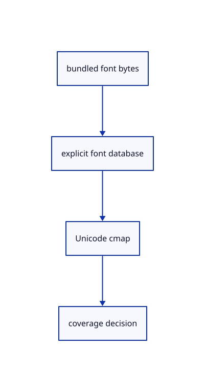

# 10.1.3 · Load explicit fonts and inspect missing coverage

**Chapter 10 · Text and labels · Section 10.1 · Fonts and text shaping** · [Contents](contents.md)

**Typing: 12–23 minutes.** [Estimate](typing-load.md).

Load the current bundled fonts into an explicit font database and read their Unicode character maps. Coverage can request whole fonts before the renderer silently loses a glyph.

## Type

Continue from [Keep source words metrics and placement together](60a-labels.md). [Save or recover your work](recovery.md).

### 1. `src/text.rs`

Load shared font bytes and inspect their actual Unicode coverage.

<details>
<summary>Locate the existing block</summary>

```rust
    }
}
```

</details>

After that block, type:

```rust
--8<-- "journey/code/60b-coverage-01.rs" skip=9
```

## Run and check

Run this from `session_viewer` to select the fixed dependency versions and install supplied binary assets. It updates Cargo.lock and preserves the previous lock. It does not write implementation code:

```sh
npm --prefix ../session_tests run course -- dependencies 10.1.3
```

In your project:

```sh
cd workspace/journey
REGEN_PROTO=0 cargo build --lib --locked --target wasm32-unknown-unknown -j1
REGEN_PROTO=0 CARGO_BUILD_JOBS=1 trunk serve --port 8780
```

Open `http://127.0.0.1:8780/`. Keep an existing Trunk server running; saving rebuilds it.


### Recorded visual result

**Previous native render — current verification pending.**

The blue CAD bore and its black original borders remain visible.


*This recorded image predates a source or checker change. Rebuild this checkpoint before using it as current evidence; browser controls require separate acceptance.*

This reference image is shared with [9.1.8 · Draw and pick the original parametric roof](55g-surface.md). It does not demonstrate a new feature by itself.

<details>
<summary>Code explanation and diagram</summary>


bundled font bytes → explicit font database → Unicode cmap → coverage decision.



Does an absent subset character mean its whole font lacks that character too?

No. The subset deliberately contains fewer glyphs. A coverage miss can require the supplied whole font; it should not be treated as evidence that the original source text is invalid.

Study estimate, including typing and experiments: 0.5–1 hours.

</details>

<details>
<summary>Optional experiment</summary>

Compare the viewer’s Lithuanian, German and CAD symbol strings with Fixed Ω cube. Verify the subset miss, then load the whole fonts and shape a nonzero glyph.

</details>

<details>
<summary>Check and save your work</summary>

Restore experimental edits, then run from `session_viewer`:

```sh
npm --prefix ../session_tests run course -- check 10.1.3
npm --prefix ../session_tests run course -- save 10.1.3
```

Source comparison leaves your project untouched. [Save and recovery instructions](recovery.md).

</details>

<details>
<summary>Viewer coverage and verification</summary>


The earlier CAD browser acceptance exercise remains, authored and unrun. These text checkpoints exercise CPU shaping; actual glyph atlas and scene-label browser checks connect in 61–62.

[Full validation scope](release.md).

To reproduce the scripted acceptance of the reference checkpoint, run from `session_viewer` with the [course bundle server](release.md#reproduce) running on port 8781:

```sh
npm --prefix ../session_tests run course -- capture 10.1.3
```

This uses the verified reference bundle; it does not check or change your typed project.

</details>
