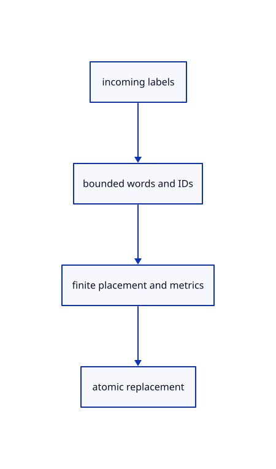

# 10.1.4 · Validate a complete label replacement before changing it

**Chapter 10 · Text and labels · Section 10.1 · Fonts and text shaping** · [Contents](contents.md)

**Typing: 23–46 minutes.** [Estimate](typing-load.md).

Check byte budget, unique identities, finite CSS metrics, world positions, orthonormal plane axes and ordered clips before replacing any current shaped runs.

## Type

Continue from [Load explicit fonts and inspect missing coverage](60b-coverage.md). [Save or recover your work](recovery.md).

### 1. `src/text.rs`

Validate metrics, positions, plane axes, padding and clip bounds.

<details>
<summary>Locate the existing block</summary>

```rust
    FontSystem::new_with_locale_and_db("en-US".into(), db)
}
```

</details>

After that block, type:

```rust
--8<-- "journey/code/60ba-validation-01.rs" skip=62
```

## Run and check

Run this from `session_viewer` to select the fixed dependency versions and install supplied binary assets. It updates Cargo.lock and preserves the previous lock. It does not write implementation code:

```sh
npm --prefix ../session_tests run course -- dependencies 10.1.4
```

In your project:

```sh
cd workspace/journey
REGEN_PROTO=0 cargo build --lib --locked --target wasm32-unknown-unknown -j1
REGEN_PROTO=0 CARGO_BUILD_JOBS=1 trunk serve --port 8780
```

Open `http://127.0.0.1:8780/`. Keep an existing Trunk server running; saving rebuilds it.


### Recorded visual result

**Previous native render — current verification pending.**

The blue CAD bore and its black original borders remain visible.


*This recorded image predates a source or checker change. Rebuild this checkpoint before using it as current evidence; browser controls require separate acceptance.*

This reference image is shared with [9.1.8 · Draw and pick the original parametric roof](55g-surface.md). It does not demonstrate a new feature by itself.

<details>
<summary>Code explanation and diagram</summary>


incoming labels → bounded words and IDs → finite placement and metrics → atomic replacement.



Should a bad label discard the currently visible text?

No. Every replacement label is checked before any current run is removed. Invalid metrics, positions or clips leave the existing label set and shaping intact.

Study estimate, including typing and experiments: 0.5–1 hours.

</details>

<details>
<summary>Optional experiment</summary>

Try a NaN font size, reversed clip box and nonunit world-plane axes. Verify each refusal preserves the current source text and revisions.

</details>

<details>
<summary>Check and save your work</summary>

Restore experimental edits, then run from `session_viewer`:

```sh
npm --prefix ../session_tests run course -- check 10.1.4
npm --prefix ../session_tests run course -- save 10.1.4
```

Source comparison leaves your project untouched. [Save and recovery instructions](recovery.md).

</details>

<details>
<summary>Viewer coverage and verification</summary>


The earlier CAD browser acceptance exercise remains, authored and unrun. These text checkpoints exercise CPU shaping; actual glyph atlas and scene-label browser checks connect in 61–62.

[Full validation scope](release.md).

To reproduce the scripted acceptance of the reference checkpoint, run from `session_viewer` with the [course bundle server](release.md#reproduce) running on port 8781:

```sh
npm --prefix ../session_tests run course -- capture 10.1.4
```

This uses the verified reference bundle; it does not check or change your typed project.

</details>
