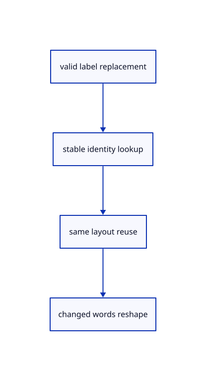

# 10.1.7 · Reshape only when the source layout changes

**Chapter 10 · Text and labels · Section 10.1 · Fonts and text shaping** · [Contents](contents.md)

**Typing: 17–34 minutes.** [Estimate](typing-load.md).

Validate the whole incoming set, reuse runs by stable label identity and preserve a shaped buffer when only position, colour, clipping or selection changes.

## Type

Continue from [Own the shaped runs with their font revisions](60c-document.md). [Save or recover your work](recovery.md).

### 1. `src/text.rs`

Reuse stable shaped buffers and measure only genuine shaping work.

<details>
<summary>Locate the existing block</summary>

```rust
            shaping_ms: 0.0,
        }
    }
```

</details>

After that block, type:

```rust
--8<-- "journey/code/60d-reuse-01.rs" skip=46
```

## Run and check

Run this from `session_viewer` to select the fixed dependency versions and install supplied binary assets. It updates Cargo.lock and preserves the previous lock. It does not write implementation code:

```sh
npm --prefix ../session_tests run course -- dependencies 10.1.7
```

In your project:

```sh
cd workspace/journey
REGEN_PROTO=0 cargo build --lib --locked --target wasm32-unknown-unknown -j1
REGEN_PROTO=0 CARGO_BUILD_JOBS=1 trunk serve --port 8780
```

Open `http://127.0.0.1:8780/`. Keep an existing Trunk server running; saving rebuilds it.


### Recorded visual result

**Previous native render — current verification pending.**

The blue CAD bore and its black original borders remain visible.


*This recorded image predates a source or checker change. Rebuild this checkpoint before using it as current evidence; browser controls require separate acceptance.*

This reference image is shared with [9.1.8 · Draw and pick the original parametric roof](55g-surface.md). It does not demonstrate a new feature by itself.

<details>
<summary>Code explanation and diagram</summary>


valid label replacement → stable identity lookup → same layout reuse → changed words reshape.



Should camera movement or label recolouring reshape the words?

No. Words, font size and line height determine shaping here. Placement, colour and selection change presentation while reusing the shaped buffer.

Study estimate, including typing and experiments: 0.5–1 hours.

</details>

<details>
<summary>Optional experiment</summary>

Move and recolour one label, then change its words or font size. Compare shape_count and revision, and confirm only the layout change increases shaping.

</details>

<details>
<summary>Check and save your work</summary>

Restore experimental edits, then run from `session_viewer`:

```sh
npm --prefix ../session_tests run course -- check 10.1.7
npm --prefix ../session_tests run course -- save 10.1.7
```

Source comparison leaves your project untouched. [Save and recovery instructions](recovery.md).

</details>

<details>
<summary>Viewer coverage and verification</summary>


The earlier CAD browser acceptance exercise remains, authored and unrun. These text checkpoints exercise CPU shaping; actual glyph atlas and scene-label browser checks connect in 61–62.

[Full validation scope](release.md).

To reproduce the scripted acceptance of the reference checkpoint, run from `session_viewer` with the [course bundle server](release.md#reproduce) running on port 8781:

```sh
npm --prefix ../session_tests run course -- capture 10.1.7
```

This uses the verified reference bundle; it does not check or change your typed project.

</details>
