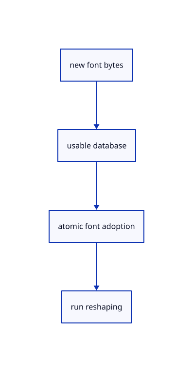

# 10.1.8 · Replace usable fonts without corrupting current text

**Chapter 10 · Text and labels · Section 10.1 · Fonts and text shaping** · [Contents](contents.md)

**Typing: 13–26 minutes.** [Estimate](typing-load.md).

Build a replacement font database before adopting it. Refuse unusable data without touching current fonts; valid replacement reshapes every run and advances both font and document revisions.

## Type

Continue from [Reshape only when the source layout changes](60d-reuse.md). [Save or recover your work](recovery.md).

### 1. `src/text.rs`

Adopt fonts only after every supplied source contains a usable face.

<details>
<summary>Locate the existing block</summary>

```rust
    }

}
```

</details>

Edit the existing block to match this code; keep unchanged lines:

```rust
--8<-- "journey/code/60e-font-reload-01.rs"
```

## Run and check

Run this from `session_viewer` to select the fixed dependency versions and install supplied binary assets. It updates Cargo.lock and preserves the previous lock. It does not write implementation code:

```sh
npm --prefix ../session_tests run course -- dependencies 10.1.8
```

In your project:

```sh
cd workspace/journey
REGEN_PROTO=0 cargo build --lib --locked --target wasm32-unknown-unknown -j1
REGEN_PROTO=0 CARGO_BUILD_JOBS=1 trunk serve --port 8780
```

Open `http://127.0.0.1:8780/`. Keep an existing Trunk server running; saving rebuilds it.


### Recorded visual result

**Previous native render — current verification pending.**

The blue CAD bore and its black original borders remain visible.


*This recorded image predates a source or checker change. Rebuild this checkpoint before using it as current evidence; browser controls require separate acceptance.*

This reference image is shared with [9.1.8 · Draw and pick the original parametric roof](55g-surface.md). It does not demonstrate a new feature by itself.

<details>
<summary>Code explanation and diagram</summary>


new font bytes → usable database → atomic font adoption → run reshaping.



Should a failed font download erase the existing labels?

No. An unusable font set never replaces the current database. The current runs remain. Only an accepted usable replacement advances font revisions and reshapes the text.

Study estimate, including typing and experiments: 0.5–1 hours.

</details>

<details>
<summary>Optional experiment</summary>

Replace fonts with eight zero bytes and verify no change. Then adopt the supplied whole fonts and compare shape count, revisions and original label words.

</details>

<details>
<summary>Check and save your work</summary>

Restore experimental edits, then run from `session_viewer`:

```sh
npm --prefix ../session_tests run course -- check 10.1.8
npm --prefix ../session_tests run course -- save 10.1.8
```

Source comparison leaves your project untouched. [Save and recovery instructions](recovery.md).

</details>

<details>
<summary>Viewer coverage and verification</summary>


The earlier CAD browser acceptance exercise remains, authored and unrun. These text checkpoints exercise CPU shaping; actual glyph atlas and scene-label browser checks connect in 61–62.

[Full validation scope](release.md).

To reproduce the scripted acceptance of the reference checkpoint, run from `session_viewer` with the [course bundle server](release.md#reproduce) running on port 8781:

```sh
npm --prefix ../session_tests run course -- capture 10.1.8
```

This uses the verified reference bundle; it does not check or change your typed project.

</details>
