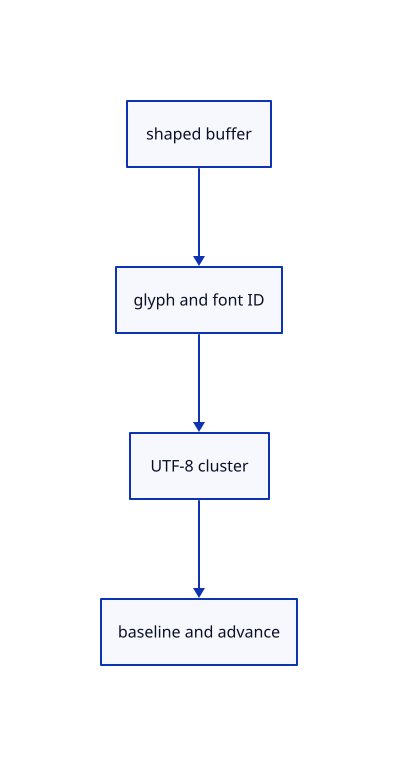

# 10.1.9 · Inspect glyph origins clusters and multiline metrics

**Chapter 10 · Text and labels · Section 10.1 · Fonts and text shaping** · [Contents](contents.md)

**Typing: 15–29 minutes.** [Estimate](typing-load.md).

Expose derived glyph identity, font identity, UTF-8 cluster range, origin, advance, offset and baseline. Clear releases shaped runs while retaining the explicit font system for future labels.

## Type

Continue from [Replace usable fonts without corrupting current text](60e-font-reload.md). [Save or recover your work](recovery.md).

### 1. `src/text.rs`

Expose actual shaped glyph metrics and release current run capacity on Clear.

Edit these blocks from bottom to top. Keep the surrounding lines unchanged.

<details>
<summary>Locate this block</summary>

```rust
    }
}

pub fn covers(text: &str) -> bool {
    text.is_ascii() || text.chars().all(|c| c.is_control() || bundled_glyph(c))
}
```

</details>

Replace it with:

```rust
    }
}

#[derive(Clone, Debug, Serialize)]
pub struct GlyphDiagnostic {
    pub label: u32,
    pub line: usize,
    pub cluster: [usize; 2],
    pub glyph: u16,
    pub font: String,
    pub origin: [f32; 2],
    pub advance: f32,
    pub offset: [f32; 2],
    pub baseline: f32,
    pub line_width: f32,
}

pub fn covers(text: &str) -> bool {
    text.is_ascii() || text.chars().all(|c| c.is_control() || bundled_glyph(c))
}
```

<details>
<summary>Locate this block</summary>

```rust
        Ok(())
    }

}

impl Default for TextDocument {
```

</details>

Replace it with:

```rust
        Ok(())
    }

    pub fn clear(&mut self) {
        self.runs.clear();
        self.runs.shrink_to_fit();
        self.revision = self.revision.wrapping_add(1);
    }

    pub fn diagnostics(&self) -> Vec<GlyphDiagnostic> {
        let mut out = Vec::new();

        for run in &self.runs {
            for line in run.buffer.layout_runs() {
                for glyph in line.glyphs {
                    out.push(GlyphDiagnostic {
                        label: run.label.id,
                        line: line.line_i,
                        cluster: [glyph.start, glyph.end],
                        glyph: glyph.glyph_id,
                        font: format!("{:?}", glyph.font_id),
                        origin: [glyph.x, glyph.y],
                        advance: glyph.w,
                        offset: [
                            glyph.x_offset * glyph.font_size,
                            glyph.y_offset * glyph.font_size,
                        ],
                        baseline: line.line_y,
                        line_width: line.line_w,
                    });
                }
            }
        }

        out
    }
}

impl Default for TextDocument {
```

<details>
<summary>Complete updated block reference</summary>

```rust
use glyphon::{Attrs, Buffer, Family, FontSystem, Metrics, Shaping, Wrap, fontdb};
use serde::Serialize;

pub const FONT_FAMILY: &str = "Noto Sans";

pub static FONT_BYTES: &[u8] = include_bytes!("../assets/text/NotoSans-Regular.subset.ttf");

pub static SYMBOL_BYTES: &[u8] =
    include_bytes!("../assets/text/NotoSansSymbols-Regular.subset.ttf");

pub static FALLBACK_BYTES: &[u8] =
    include_bytes!("../assets/text/NotoSansSymbols2-Regular.subset.ttf");

#[cfg_attr(not(target_arch = "wasm32"), allow(dead_code))]
pub const FULL_FONTS: [&str; 3] = [
    "NotoSans-Regular.ttf",
    "NotoSansSymbols2-Regular.ttf",
    "NotoSansSymbols-Regular.ttf",
];

const MAX_TEXT_BYTES: usize = 256 * 1024;

#[derive(Clone, Debug, PartialEq, serde::Serialize, serde::Deserialize)]
pub enum TextPlacement {
    Screen {
        left: f32,
        top: f32,
    },
    Anchor {
        world: [f64; 3],
        offset: [f32; 2],
    },
    Nameplate {
        world: [f64; 3],
        padding: [f32; 2],
        rounded: bool,
    },
    WorldPlane {
        world: [f64; 3],
        right: [f64; 3],
        up: [f64; 3],
        world_height: f64,
    },
    WorldBillboard {
        world: [f64; 3],
        world_height: f64,
    },
}

#[derive(Clone, Copy, Debug, PartialEq, serde::Serialize, serde::Deserialize)]
pub struct TextObject {
    pub row: u32,
    pub selected: bool,
}

#[derive(Clone, Debug, PartialEq, serde::Serialize, serde::Deserialize)]
pub struct TextLabel {
    pub id: u32,
    pub object: Option<TextObject>,
    pub text: String,
    pub font_size: f32,
    pub line_height: f32,
    pub color: [u8; 4],
    pub placement: TextPlacement,
    pub clip: Option<[f32; 4]>,
}

impl TextLabel {
    pub fn ink_color(&self) -> [u8; 4] {
        if self.object.is_some_and(|object| object.selected) {
            [0, 0, 0, 255]
        } else {
            self.color
        }
    }
}

pub struct TextRun {
    pub label: TextLabel,
    pub buffer: Buffer,
}

pub struct TextDocument {
    pub fonts: FontSystem,
    pub runs: Vec<TextRun>,
    pub revision: u64,
    pub font_revision: u64,
    pub shape_count: u64,
    pub shaping_ms: f64,
}

impl TextDocument {
    pub fn new() -> Self {
        Self {
            fonts: bundled_fonts(),
            runs: Vec::new(),
            revision: 0,
            font_revision: 1,
            shape_count: 0,
            shaping_ms: 0.0,
        }
    }

    pub fn set_labels(&mut self, labels: Vec<TextLabel>) -> anyhow::Result<()> {
        let mut bytes = 0usize;
        let mut ids = std::collections::HashSet::new();

        for label in &labels {
            bytes = bytes.saturating_add(label.text.len());
            anyhow::ensure!(bytes <= MAX_TEXT_BYTES, "text document exceeds 256 KiB");
            anyhow::ensure!(ids.insert(label.id), "duplicate text label ID {}", label.id);
            validate_label(label)?;
        }

        if self.runs.len() == labels.len() {
            let mut unchanged = true;

            for (run, label) in self.runs.iter().zip(&labels) {
                unchanged &= run.label == *label;
            }

            if unchanged {
                return Ok(());
            }
        }

        let previous = std::mem::take(&mut self.runs);
        let mut previous_by_id = std::collections::HashMap::new();

        for run in previous {
            previous_by_id.insert(run.label.id, run);
        }

        for label in labels {
            let old = previous_by_id.remove(&label.id);
            let buffer = match old {
                Some(run) if same_layout(&run.label, &label) => run.buffer,
                _ => {
                    self.shape_count += 1;
                    let started = crate::load_measure::now();
                    let buffer = shape(&mut self.fonts, &label);
                    self.shaping_ms += crate::load_measure::now() - started;
                    buffer
                }
            };
            self.runs.push(TextRun { label, buffer });
        }

        self.revision = self.revision.wrapping_add(1);
        Ok(())
    }

    pub fn replace_fonts(&mut self, sources: Vec<Vec<u8>>) -> anyhow::Result<()> {
        let sources = sources
            .into_iter()
            .map(|bytes| fontdb::Source::Binary(std::sync::Arc::new(bytes)))
            .collect();
        self.replace_sources(sources)
    }

    pub fn replace_sources(&mut self, sources: Vec<fontdb::Source>) -> anyhow::Result<()> {
        let mut db = fontdb::Database::new();

        for source in sources {
            let before = db.faces().count();
            db.load_font_source(source);
            anyhow::ensure!(
                db.faces().count() > before,
                "font data contains no usable face"
            );
        }

        anyhow::ensure!(db.faces().count() > 0, "font set is empty");
        db.set_sans_serif_family(FONT_FAMILY);
        self.fonts = FontSystem::new_with_locale_and_db("en-US".into(), db);

        for run in &mut self.runs {
            let started = crate::load_measure::now();
            run.buffer = shape(&mut self.fonts, &run.label);
            self.shaping_ms += crate::load_measure::now() - started;
            self.shape_count += 1;
        }

        self.font_revision = self.font_revision.wrapping_add(1);
        self.revision = self.revision.wrapping_add(1);
        Ok(())
    }

    pub fn clear(&mut self) {
        self.runs.clear();
        self.runs.shrink_to_fit();
        self.revision = self.revision.wrapping_add(1);
    }

    pub fn diagnostics(&self) -> Vec<GlyphDiagnostic> {
        let mut out = Vec::new();

        for run in &self.runs {
            for line in run.buffer.layout_runs() {
                for glyph in line.glyphs {
                    out.push(GlyphDiagnostic {
                        label: run.label.id,
                        line: line.line_i,
                        cluster: [glyph.start, glyph.end],
                        glyph: glyph.glyph_id,
                        font: format!("{:?}", glyph.font_id),
                        origin: [glyph.x, glyph.y],
                        advance: glyph.w,
                        offset: [
                            glyph.x_offset * glyph.font_size,
                            glyph.y_offset * glyph.font_size,
                        ],
                        baseline: line.line_y,
                        line_width: line.line_w,
                    });
                }
            }
        }

        out
    }
}

impl Default for TextDocument {
    fn default() -> Self {
        Self::new()
    }
}

#[derive(Clone, Debug, Serialize)]
pub struct GlyphDiagnostic {
    pub label: u32,
    pub line: usize,
    pub cluster: [usize; 2],
    pub glyph: u16,
    pub font: String,
    pub origin: [f32; 2],
    pub advance: f32,
    pub offset: [f32; 2],
    pub baseline: f32,
    pub line_width: f32,
}

pub fn covers(text: &str) -> bool {
    text.is_ascii() || text.chars().all(|c| c.is_control() || bundled_glyph(c))
}

fn bundled_glyph(c: char) -> bool {
    thread_local! {
        static MAPS: Vec<ttf_parser::cmap::Table<'static>> = [FONT_BYTES, FALLBACK_BYTES, SYMBOL_BYTES]
            .into_iter()
            .filter_map(|bytes| {
                let face = ttf_parser::RawFace::parse(bytes, 0).ok()?;
                ttf_parser::cmap::Table::parse(face.table(ttf_parser::Tag::from_bytes(b"cmap"))?)
            })
            .collect();
    }

    MAPS.with(|maps| {
        maps.iter().any(|map| {
            map.subtables
                .into_iter()
                .any(|table| table.is_unicode() && table.glyph_index(u32::from(c)).is_some())
        })
    })
}

fn bundled_fonts() -> FontSystem {
    let mut db = fontdb::Database::new();

    for bytes in [FONT_BYTES, FALLBACK_BYTES, SYMBOL_BYTES] {
        db.load_font_source(fontdb::Source::Binary(std::sync::Arc::new(bytes)));
    }

    db.set_sans_serif_family(FONT_FAMILY);
    FontSystem::new_with_locale_and_db("en-US".into(), db)
}

fn validate_label(label: &TextLabel) -> anyhow::Result<()> {
    anyhow::ensure!(
        label.font_size.is_finite() && (1.0..=256.0).contains(&label.font_size),
        "font size must be 1..256 CSS px"
    );
    anyhow::ensure!(
        label.line_height.is_finite()
            && label.line_height >= label.font_size
            && label.line_height <= 1024.0,
        "invalid text line height"
    );
    let valid_placement = match label.placement {
        TextPlacement::Screen { left, top } => left.is_finite() && top.is_finite(),
        TextPlacement::Anchor { world, offset } => {
            world.iter().all(finite_f64) && offset.iter().all(finite_f32)
        }
        TextPlacement::Nameplate { world, padding, .. } => {
            world.iter().all(finite_f64) && padding.iter().all(valid_padding)
        }
        TextPlacement::WorldPlane {
            world,
            right,
            up,
            world_height,
        } => {
            world.iter().all(finite_f64)
                && valid_plane_axes(right, up)
                && world_height.is_finite()
                && world_height > 0.0
        }
        TextPlacement::WorldBillboard {
            world,
            world_height,
        } => world.iter().all(finite_f64) && world_height.is_finite() && world_height > 0.0,
    };
    anyhow::ensure!(valid_placement, "invalid text placement");

    if let Some(c) = label.clip {
        anyhow::ensure!(
            c.iter().all(finite_f32) && c[2] >= c[0] && c[3] >= c[1],
            "invalid text clip rectangle"
        );
    }

    Ok(())
}

fn valid_plane_axes(right: [f64; 3], up: [f64; 3]) -> bool {
    let mut right_length = 0.0;
    let mut up_length = 0.0;
    let mut dot = 0.0;

    for axis in 0..3 {
        right_length += right[axis] * right[axis];
        up_length += up[axis] * up[axis];
        dot += right[axis] * up[axis];
    }

    (right_length.sqrt() - 1.0).abs() <= 1e-6
        && (up_length.sqrt() - 1.0).abs() <= 1e-6
        && dot.abs() <= 1e-6
}

fn finite_f32(value: &f32) -> bool {
    value.is_finite()
}

fn finite_f64(value: &f64) -> bool {
    value.is_finite()
}

fn valid_padding(value: &f32) -> bool {
    value.is_finite() && (0.0..=256.0).contains(value)
}

fn same_layout(a: &TextLabel, b: &TextLabel) -> bool {
    a.text == b.text && a.font_size == b.font_size && a.line_height == b.line_height
}

fn shape(fonts: &mut FontSystem, label: &TextLabel) -> Buffer {
    let mut buffer = Buffer::new(fonts, Metrics::new(label.font_size, label.line_height));
    buffer.set_size(fonts, None, None);
    buffer.set_wrap(fonts, Wrap::None);
    buffer.set_text(
        fonts,
        &label.text,
        &Attrs::new()
            .family(Family::Name(FONT_FAMILY))
            .metadata(label.id as usize),
        Shaping::Advanced,
        None,
    );
    buffer.shape_until_scroll(fonts, false);
    buffer
}
```

</details>

<details>
<summary>Optional patch references</summary>

Use these original edit fragments when comparing a saved checkpoint. Apply the complete blocks above.

```text
--8<-- "journey/code/60f-diagnostics-01.rs"
```

```text
--8<-- "journey/code/60f-diagnostics-02.rs"
```

</details>

## Run and check

Run this from `session_viewer` to select the fixed dependency versions and install supplied binary assets. It updates Cargo.lock and preserves the previous lock. It does not write implementation code:

```sh
npm --prefix ../session_tests run course -- dependencies 10.1.9
```

In your project:

```sh
cd workspace/journey
REGEN_PROTO=0 cargo build --lib --locked --target wasm32-unknown-unknown -j1
REGEN_PROTO=0 CARGO_BUILD_JOBS=1 trunk serve --port 8780
```

Open `http://127.0.0.1:8780/`. Keep an existing Trunk server running; saving rebuilds it.


### Recorded visual result

**Previous native render — current verification pending.**

The blue CAD bore and its black original borders remain visible.


*This recorded image predates a source or checker change. Rebuild this checkpoint before using it as current evidence; browser controls require separate acceptance.*

This reference image is shared with [9.1.8 · Draw and pick the original parametric roof](55g-surface.md). It does not demonstrate a new feature by itself.

<details>
<summary>Code explanation and diagram</summary>


shaped buffer → glyph and font ID → UTF-8 cluster → baseline and advance.



Can a glyph cluster range be used as a character count?

No. It addresses bytes in the original UTF-8 string. A multibyte character or ligature can span several bytes while producing one glyph.

Study estimate, including typing and experiments: 0.5–1 hours.

</details>

<details>
<summary>Optional experiment</summary>

Inspect office ffi and accented multiline labels. Compare line baselines one line_height apart and check that every cluster range lies in the original string.

</details>

<details>
<summary>Check and save your work</summary>

Restore experimental edits, then run from `session_viewer`:

```sh
npm --prefix ../session_tests run course -- check 10.1.9
npm --prefix ../session_tests run course -- save 10.1.9
```

Source comparison leaves your project untouched. [Save and recovery instructions](recovery.md).

</details>

<details>
<summary>Viewer coverage and verification</summary>


The earlier CAD browser acceptance exercise remains, authored and unrun. These text checkpoints exercise CPU shaping; actual glyph atlas and scene-label browser checks connect in 61–62.

[Full validation scope](release.md).

To reproduce the scripted acceptance of the reference checkpoint, run from `session_viewer` with the [course bundle server](release.md#reproduce) running on port 8781:

```sh
npm --prefix ../session_tests run course -- capture 10.1.9
```

This uses the verified reference bundle; it does not check or change your typed project.

</details>
