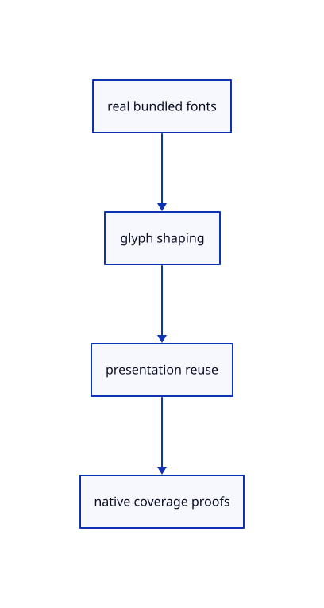

# 10.1.10 · Prove the current fonts shaping and reuse rules

**Chapter 10 · Text and labels · Section 10.1 · Fonts and text shaping** · [Contents](contents.md)

**Typing: 0–0 minutes.** [Estimate](typing-load.md).

Copy current production shaping regressions, adapted to the cumulative command vocabulary. Verify ligatures, kerning, combining accents, fallback fonts, atomic refusal and whole-font coverage.

## Type

Continue from [Inspect glyph origins clusters and multiline metrics](60f-diagnostics.md). [Save or recover your work](recovery.md).

<details>
<summary>Supplied validation fixture</summary>

Copy this supplied authoring fixture once. Continue with the browser build below; the course does not require running native tests.

### 1. `src/text.rs`

Copy current production ligature, accent, kerning, fallback, failed replacement, reuse and full-font coverage regressions.

<details>
<summary>Locate the existing block</summary>

```text
    buffer
}
```

</details>

After that block, append this supplied code:

```text
--8<-- "journey/code/60g-text-shaping-01.rs" skip=14
```

</details>

## Run and check

Run this from `session_viewer` to select the fixed dependency versions and install supplied binary assets. It updates Cargo.lock and preserves the previous lock. It does not write implementation code:

```sh
npm --prefix ../session_tests run course -- dependencies 10.1.10
```

In your project:

```sh
cd workspace/journey
REGEN_PROTO=0 cargo build --lib --locked --target wasm32-unknown-unknown -j1
REGEN_PROTO=0 CARGO_BUILD_JOBS=1 trunk serve --port 8780
```

Open `http://127.0.0.1:8780/`. Keep an existing Trunk server running; saving rebuilds it.


### Recorded visual result

**Previous native render — current verification pending.**

The blue CAD bore and its black original borders remain visible.


*This recorded image predates a source or checker change. Rebuild this checkpoint before using it as current evidence; browser controls require separate acceptance.*

This reference image is shared with [9.1.8 · Draw and pick the original parametric roof](55g-surface.md). It does not demonstrate a new feature by itself.

<details>
<summary>Code explanation and diagram</summary>


real bundled fonts → glyph shaping → presentation reuse → native coverage proofs.



What distinguishes this check from a character-to-quad mock?

It uses real font shaping, ligatures, glyph IDs and UTF-8 clusters. The checks compare actual kerning, composed/decomposed accents, fallback font identities and valid whole-font replacement.

Study estimate, including typing and experiments: 0.5–1 hours.

</details>

<details>
<summary>Optional experiment</summary>

Inspect the shaped office ffi and accented multiline examples from the previous lesson in the browser. Compare glyph clusters with the original words and baselines. Read the optional ligature, fallback and invalid-font cases to explain why a rejected replacement leaves the displayed label intact.

</details>

<details>
<summary>Check and save your work</summary>

Restore experimental edits, then run from `session_viewer`:

```sh
npm --prefix ../session_tests run course -- check 10.1.10
npm --prefix ../session_tests run course -- save 10.1.10
```

Source comparison leaves your project untouched. [Save and recovery instructions](recovery.md).

</details>

<details>
<summary>Viewer coverage and verification</summary>

Use current production TextPlacement/TextLabel and TextDocument shaping, bundled Noto font family/fallbacks, Unicode coverage, validated atomic label/font replacement and incremental layout reuse. CPU glyph diagnostics retain source UTF-8 clusters and original world coordinates; atlas drawing and scene labels connect in 61–62.

All earlier checks remain. Six current production checks use real font glyphs, ligatures, kerning, composed/decomposed accents, multiline baselines, explicit fallback, placement/colour reuse, invalid replacement preservation and whole-font coverage. Their command coverage uses the cumulative viewer vocabulary.

The earlier CAD browser acceptance exercise remains, authored and unrun. These text checkpoints exercise CPU shaping; actual glyph atlas and scene-label browser checks connect in 61–62.

[Full validation scope](release.md).

To reproduce the scripted acceptance of the reference checkpoint, run from `session_viewer` with the [course bundle server](release.md#reproduce) running on port 8781:

```sh
npm --prefix ../session_tests run course -- capture 10.1.10
```

This uses the verified reference bundle; it does not check or change your typed project.

</details>
