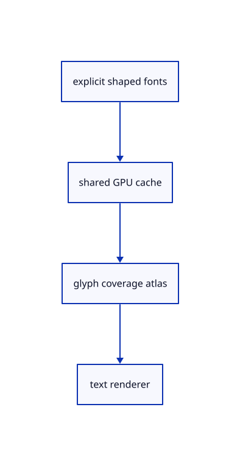

# 10.2.1 · Own glyph coverage in a shared GPU atlas

**Chapter 10 · Text and labels · Section 10.2 · Glyph atlases** · [Contents](contents.md)

**Typing: 11–21 minutes.** [Estimate](typing-load.md).

Create the current Glyphon cache, accurate-colour atlas, viewport, rasteriser and text renderer. Keep this lane lazy so scenes without labels allocate no extra text atlas.

## Type

Continue from [Prove the current fonts shaping and reuse rules](60g-text-shaping.md). [Save or recover your work](recovery.md).

### 1. `src/text_atlas.rs`

Own the current accurate-colour atlas and cache with separate frame/source revisions.

Create the file and type:

```rust
--8<-- "journey/code/61-atlas-01.rs"
```

### 2. `src/lib.rs`

Register the source component.

<details>
<summary>Locate the existing block</summary>

```rust

pub mod text;
```

</details>

After that block, type:

```rust
--8<-- "journey/code/61-atlas-02.rs" skip=15
```

## Run and check

Run this from `session_viewer` to select the fixed dependency versions and install supplied binary assets. It updates Cargo.lock and preserves the previous lock. It does not write implementation code:

```sh
npm --prefix ../session_tests run course -- dependencies 10.2.1
```

In your project:

```sh
cd workspace/journey
REGEN_PROTO=0 cargo build --lib --locked --target wasm32-unknown-unknown -j1
REGEN_PROTO=0 CARGO_BUILD_JOBS=1 trunk serve --port 8780
```

Open `http://127.0.0.1:8780/`. Keep an existing Trunk server running; saving rebuilds it.

The blue CAD bore remains visible. Connect the glyph lane and draw Example Text at the final checkpoint of 61.

### Recorded visual result

**Previous native render — current verification pending.**

The blue CAD bore and its black original borders remain visible while this preparation connects the glyph lane.


*This recorded image predates a source or checker change. Rebuild this checkpoint before using it as current evidence; browser controls require separate acceptance.*

This reference image is shared with [9.1.8 · Draw and pick the original parametric roof](55g-surface.md). It does not demonstrate a new feature by itself.

<details>
<summary>Code explanation and diagram</summary>


explicit shaped fonts → shared GPU cache → glyph coverage atlas → text renderer.



Must every repeated glyph get another texture allocation?

No. Glyph coverage belongs in a shared atlas. Positioned glyph instances can reuse that coverage while changing placement or colour. The lane is created only when labels exist.

Study estimate, including typing and experiments: 0.5–1 hours.

</details>

<details>
<summary>Optional experiment</summary>

Inspect the lane owners and compare an empty scene with the first label. Keep the colour target and sample count compatible with the surrounding renderer.

</details>

<details>
<summary>Check and save your work</summary>

Restore experimental edits, then run from `session_viewer`:

```sh
npm --prefix ../session_tests run course -- check 10.2.1
npm --prefix ../session_tests run course -- save 10.2.1
```

Source comparison leaves your project untouched. [Save and recovery instructions](recovery.md).

</details>

<details>
<summary>Viewer coverage and verification</summary>


The earlier CAD browser acceptance exercise remains, authored and unrun. The specimen’s glyph browser check connects at the end of 61.

[Full validation scope](release.md).

To reproduce the scripted acceptance of the reference checkpoint, run from `session_viewer` with the [course bundle server](release.md#reproduce) running on port 8781:

```sh
npm --prefix ../session_tests run course -- capture 10.2.1
```

This uses the verified reference bundle; it does not check or change your typed project.

</details>
