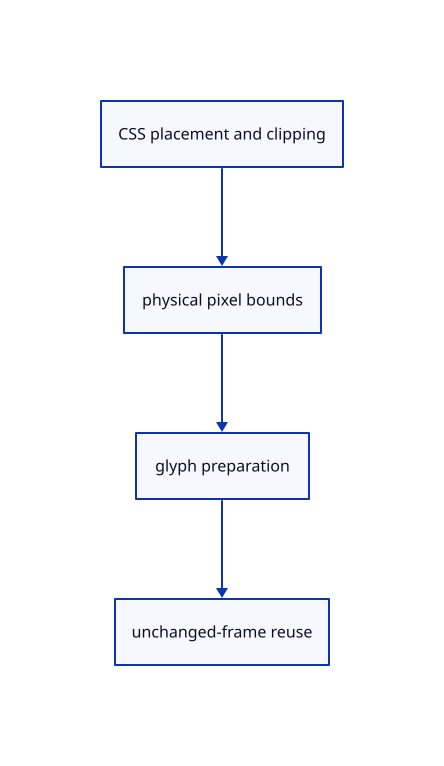

# 10.2.2 · Prepare DPI-scaled glyph bounds and cache unchanged frames

**Chapter 10 · Text and labels · Section 10.2 · Glyph atlases** · [Contents](contents.md)

**Typing: 20–39 minutes.** [Estimate](typing-load.md).

Convert CSS placement and clip bounds to physical pixels, prepare actual glyph coverage and reuse an unchanged document/font/viewport/density frame. Accepted font replacement resets stale atlas state.

## Type

Continue from [Own glyph coverage in a shared GPU atlas](61-atlas.md). [Save or recover your work](recovery.md).

### 1. `src/text_atlas.rs`

Prepare real glyph coverage, pixel clips, revision resets and truthful CPU raster-cache counts.

<details>
<summary>Locate the existing block</summary>

```rust
        Self {document:TextDocument::new(),cache,atlas,viewport,raster:SwashCache::new(),renderer,prepared:None,preparations:0,skips:0,resets:0,format}
    }
}
```

</details>

Edit the existing block to match this code; keep unchanged lines:

```rust
--8<-- "journey/code/61a-coverage-01.rs"
```

## Run and check

Run this from `session_viewer` to select the fixed dependency versions and install supplied binary assets. It updates Cargo.lock and preserves the previous lock. It does not write implementation code:

```sh
npm --prefix ../session_tests run course -- dependencies 10.2.2
```

In your project:

```sh
cd workspace/journey
REGEN_PROTO=0 cargo build --lib --locked --target wasm32-unknown-unknown -j1
REGEN_PROTO=0 CARGO_BUILD_JOBS=1 trunk serve --port 8780
```

Open `http://127.0.0.1:8780/`. Keep an existing Trunk server running; saving rebuilds it.


### Recorded visual result

**Previous native render — current verification pending.**

The blue CAD bore and its black original borders remain visible while this preparation connects the glyph lane.


*This recorded image predates a source or checker change. Rebuild this checkpoint before using it as current evidence; browser controls require separate acceptance.*

This reference image is shared with [9.1.8 · Draw and pick the original parametric roof](55g-surface.md). It does not demonstrate a new feature by itself.

<details>
<summary>Code explanation and diagram</summary>


CSS placement and clipping → physical pixel bounds → glyph preparation → unchanged-frame reuse.



Should a density change double the label’s CSS size?

No. Physical glyph pixels and bounds scale with density while the label keeps its CSS size. The changed density requires preparation and new coverage where needed, not new source words.

Study estimate, including typing and experiments: 0.5–1 hours.

</details>

<details>
<summary>Optional experiment</summary>

Compare density 1 and 2: actual ink occupies the same CSS rectangle. Clip the label, move it and verify shaping stays unchanged; replace fonts and reset the atlas only after valid adoption.

</details>

<details>
<summary>Check and save your work</summary>

Restore experimental edits, then run from `session_viewer`:

```sh
npm --prefix ../session_tests run course -- check 10.2.2
npm --prefix ../session_tests run course -- save 10.2.2
```

Source comparison leaves your project untouched. [Save and recovery instructions](recovery.md).

</details>

<details>
<summary>Viewer coverage and verification</summary>


The earlier CAD browser acceptance exercise remains, authored and unrun. The specimen’s glyph browser check connects at the end of 61.

[Full validation scope](release.md).

To reproduce the scripted acceptance of the reference checkpoint, run from `session_viewer` with the [course bundle server](release.md#reproduce) running on port 8781:

```sh
npm --prefix ../session_tests run course -- capture 10.2.2
```

This uses the verified reference bundle; it does not check or change your typed project.

</details>
