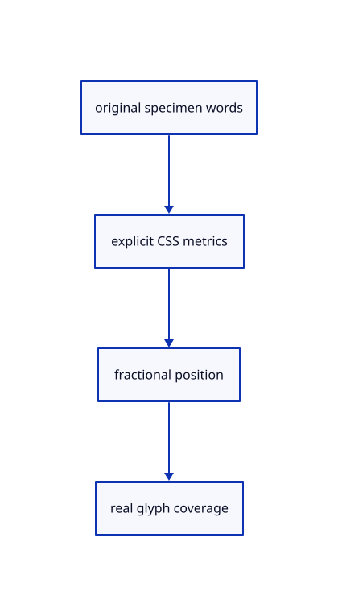

# 10.2.3 · Supply a real-font CAD text specimen

**Chapter 10 · Text and labels · Section 10.2 · Glyph atlases** · [Contents](contents.md)

**Typing: 3–6 minutes.** [Estimate](typing-load.md).

Use an explicit fractional CSS position, fixed metrics and viewer-supported ligatures, accents and symbols. This specimen is a presentation overlay and creates no scene geometry row.

## Type

Continue from [Prepare DPI-scaled glyph bounds and cache unchanged frames](61a-coverage.md). [Save or recover your work](recovery.md).

### 1. `src/text_example.rs`

Provide a current-font specimen that exercises real glyph coverage.

Create the file and type:

```rust
--8<-- "journey/code/61b-specimen-01.rs"
```

### 2. `src/lib.rs`

Register the source component.

<details>
<summary>Locate the existing block</summary>

```rust

pub mod text_atlas;
```

</details>

After that block, type:

```rust
--8<-- "journey/code/61b-specimen-02.rs" skip=21
```

## Run and check

Run this from `session_viewer` to select the fixed dependency versions and install supplied binary assets. It updates Cargo.lock and preserves the previous lock. It does not write implementation code:

```sh
npm --prefix ../session_tests run course -- dependencies 10.2.3
```

In your project:

```sh
cd workspace/journey
REGEN_PROTO=0 cargo build --lib --locked --target wasm32-unknown-unknown -j1
REGEN_PROTO=0 CARGO_BUILD_JOBS=1 trunk serve --port 8780
```

Open `http://127.0.0.1:8780/`. Keep an existing Trunk server running; saving rebuilds it.


### Recorded visual result

**Previous native render — current verification pending.**

The blue CAD bore and its black original borders remain visible while this preparation connects the glyph lane.


*This recorded image predates a source or checker change. Rebuild this checkpoint before using it as current evidence; browser controls require separate acceptance.*

This reference image is shared with [9.1.8 · Draw and pick the original parametric roof](55g-surface.md). It does not demonstrate a new feature by itself.

<details>
<summary>Code explanation and diagram</summary>


original specimen words → explicit CSS metrics → fractional position → real glyph coverage.



Does this screen specimen become a saved CAD object?

No. It demonstrates the glyph lane as a presentation overlay. Source-owned scene labels and their placements connect in 62. Its words still shape through the actual bundled fonts.

Study estimate, including typing and experiments: 0.5–1 hours.

</details>

<details>
<summary>Optional experiment</summary>

Compare office ffi, Ė, the degree sign and the keyboard symbol in the specimen. Inspect clusters and actual rendered coverage at fractional CSS coordinates.

</details>

<details>
<summary>Check and save your work</summary>

Restore experimental edits, then run from `session_viewer`:

```sh
npm --prefix ../session_tests run course -- check 10.2.3
npm --prefix ../session_tests run course -- save 10.2.3
```

Source comparison leaves your project untouched. [Save and recovery instructions](recovery.md).

</details>

<details>
<summary>Viewer coverage and verification</summary>


The earlier CAD browser acceptance exercise remains, authored and unrun. The specimen’s glyph browser check connects at the end of 61.

[Full validation scope](release.md).

To reproduce the scripted acceptance of the reference checkpoint, run from `session_viewer` with the [course bundle server](release.md#reproduce) running on port 8781:

```sh
npm --prefix ../session_tests run course -- capture 10.2.3
```

This uses the verified reference bundle; it does not check or change your typed project.

</details>
