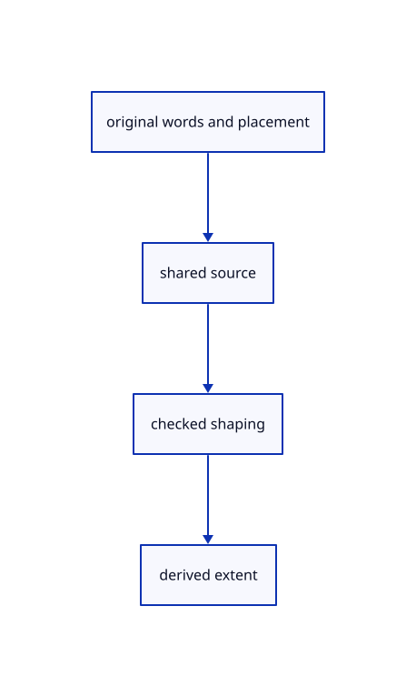

# 10.3.1 · Own original scene words and font metrics

**Chapter 10 · Text and labels · Section 10.3 · Original scene labels** · [Contents](contents.md)

**Typing: 13–25 minutes.** [Estimate](typing-load.md).

Keep original words, source GUID, name, flags and f64 placement in a shared source. Validate one label before deriving its font-unit extent.

## Type

Continue from [Draw the specimen and prove real coverage reuse](61d-glyphs.md). [Save or recover your work](recovery.md).

### 1. `src/scene_label.rs`

Own immutable original label data and derive measured bounds separately.

Create the file and type:

```rust
--8<-- "journey/code/62-source-01.rs"
```

### 2. `src/lib.rs`

Register the source component.

<details>
<summary>Locate the existing block</summary>

```rust
#[cfg(test)]
mod text_atlas_tests;
```

</details>

After that block, type:

```rust
--8<-- "journey/code/62-source-02.rs" skip=35
```

## Run and check

Run this from `session_viewer` to select the fixed dependency versions and install supplied binary assets. It updates Cargo.lock and preserves the previous lock. It does not write implementation code:

```sh
npm --prefix ../session_tests run course -- dependencies 10.3.1
```

In your project:

```sh
cd workspace/journey
REGEN_PROTO=0 cargo build --lib --locked --target wasm32-unknown-unknown -j1
REGEN_PROTO=0 CARGO_BUILD_JOBS=1 trunk serve --port 8780
```

Open `http://127.0.0.1:8780/`. Keep an existing Trunk server running; saving rebuilds it.

The earlier CAD bore and screen-font specimen remain visible while the original scene-label lane is prepared. Connect the scene examples at the end of 62.

### Recorded visual result

**Previous native render — current verification pending.**

The CAD bore and real-font screen specimen remain visible; this preparation adds no interactive scene-text example yet.


*This recorded image predates a source or checker change. Rebuild this checkpoint before using it as current evidence; browser controls require separate acceptance.*

This reference image is shared with [10.2.5 · Draw the specimen and prove real coverage reuse](61d-glyphs.md). It does not demonstrate a new feature by itself.

<details>
<summary>Code explanation and diagram</summary>


original words and placement → shared source → checked shaping → derived extent.



Does a glyph cache replace the original words?

No. The original label remains a shared source. Shaped metrics, glyph coverage and integer pick addresses are derived presentation data. Screen-only specimens stay outside scene rows.

Study estimate, including typing and experiments: 0.5–1 hours.

</details>

<details>
<summary>Optional experiment</summary>

Compare source words and placement with the derived extent. Reject a screen specimen or a source carrying an existing viewer pick address before inserting a row.

</details>

<details>
<summary>Check and save your work</summary>

Restore experimental edits, then run from `session_viewer`:

```sh
npm --prefix ../session_tests run course -- check 10.3.1
npm --prefix ../session_tests run course -- save 10.3.1
```

Source comparison leaves your project untouched. [Save and recovery instructions](recovery.md).

</details>

<details>
<summary>Viewer coverage and verification</summary>


The earlier glyph browser contract remains authored and unrun. Scene-label browser acceptance connects at the end of 62; native software rendering is not Lenovo timing.

[Full validation scope](release.md).

To reproduce the scripted acceptance of the reference checkpoint, run from `session_viewer` with the [course bundle server](release.md#reproduce) running on port 8781:

```sh
npm --prefix ../session_tests run course -- capture 10.3.1
```

This uses the verified reference bundle; it does not check or change your typed project.

</details>
