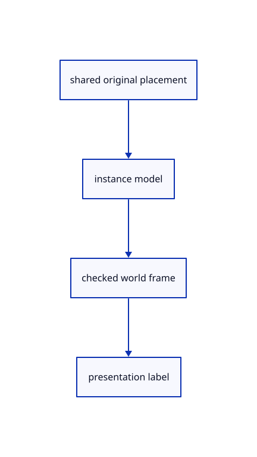

# 10.3.2 · Transform the label frame without changing its source

**Chapter 10 · Text and labels · Section 10.3 · Original scene labels** · [Contents](contents.md)

**Typing: 21–42 minutes.** [Estimate](typing-load.md).

Give each instance a stable viewer ID and independent f64 model. Preserve orthogonal equal-scale axes for plane text and uniform scale for billboards.

## Type

Continue from [Own original scene words and font metrics](62-source.md). [Save or recover your work](recovery.md).

### 1. `src/text.rs`

Reuse the checked current label validator for placed labels.

<details>
<summary>Locate the existing block</summary>

```rust
}

fn validate_label(label: &TextLabel) -> anyhow::Result<()> {
    anyhow::ensure!(
        label.font_size.is_finite() && (1.0..=256.0).contains(&label.font_size),
```

</details>

Edit the existing block to match this code; keep unchanged lines:

```rust
--8<-- "journey/code/62a-placements-01.rs"
```

### 2. `src/scene_label.rs`

Derive world labels and GPU addresses from stable source and instance identities.

<details>
<summary>Locate the existing block</summary>

```rust
 }
}
pub fn example(placement:TextPlacement)->Source {let mut label=crate::text_example::label();label.text="Original CAD · Ø25 · Ω".into();label.color=[255;4];label.placement=placement;Source {guid:uuid::Uuid::new_v4().to_string(),name:"Original CAD label".into(),visible:true,locked:false,label}}
```

</details>

Edit the existing block to match this code; keep unchanged lines:

```rust
--8<-- "journey/code/62a-placements-02.rs"
```

## Run and check

Run this from `session_viewer` to select the fixed dependency versions and install supplied binary assets. It updates Cargo.lock and preserves the previous lock. It does not write implementation code:

```sh
npm --prefix ../session_tests run course -- dependencies 10.3.2
```

In your project:

```sh
cd workspace/journey
REGEN_PROTO=0 cargo build --lib --locked --target wasm32-unknown-unknown -j1
REGEN_PROTO=0 CARGO_BUILD_JOBS=1 trunk serve --port 8780
```

Open `http://127.0.0.1:8780/`. Keep an existing Trunk server running; saving rebuilds it.


### Recorded visual result

**Previous native render — current verification pending.**

The CAD bore and real-font screen specimen remain visible; this preparation adds no interactive scene-text example yet.


*This recorded image predates a source or checker change. Rebuild this checkpoint before using it as current evidence; browser controls require separate acceptance.*

This reference image is shared with [10.2.5 · Draw the specimen and prove real coverage reuse](61d-glyphs.md). It does not demonstrate a new feature by itself.

<details>
<summary>Code explanation and diagram</summary>


shared original placement → instance model → checked world frame → presentation label.



Should Move rewrite the source label coordinates?

No. Move changes the instance model. Plane directions remain orthogonal and billboard scale stays uniform; an incompatible placement is rejected before adoption.

Study estimate, including typing and experiments: 0.5–1 hours.

</details>

<details>
<summary>Optional experiment</summary>

Translate a source at 1,000,000,000.125 by 0.25. Verify the displayed placement changes while original source coordinates and words remain exact.

</details>

<details>
<summary>Check and save your work</summary>

Restore experimental edits, then run from `session_viewer`:

```sh
npm --prefix ../session_tests run course -- check 10.3.2
npm --prefix ../session_tests run course -- save 10.3.2
```

Source comparison leaves your project untouched. [Save and recovery instructions](recovery.md).

</details>

<details>
<summary>Viewer coverage and verification</summary>


The earlier glyph browser contract remains authored and unrun. Scene-label browser acceptance connects at the end of 62; native software rendering is not Lenovo timing.

[Full validation scope](release.md).

To reproduce the scripted acceptance of the reference checkpoint, run from `session_viewer` with the [course bundle server](release.md#reproduce) running on port 8781:

```sh
npm --prefix ../session_tests run course -- capture 10.3.2
```

This uses the verified reference bundle; it does not check or change your typed project.

</details>
