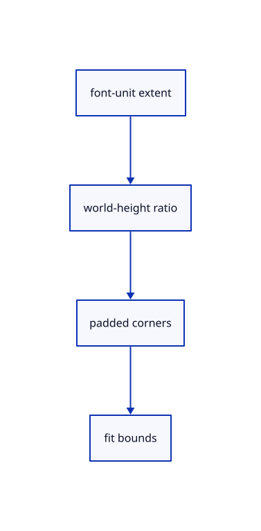

# 10.3.3 · Measure the world-sized label and its padded plate

**Chapter 10 · Text and labels · Section 10.3 · Original scene labels** · [Contents](contents.md)

**Typing: 9–18 minutes.** [Estimate](typing-load.md).

Convert shaped font-unit widths and heights to scene units. Include plane/billboard plates in Fit bounds; screen-sized anchors keep a world anchor.

## Type

Continue from [Transform the label frame without changing its source](62a-placements.md). [Save or recover your work](recovery.md).

### 1. `src/scene_label.rs`

Derive source-owned world bounds without replacing f64 coordinates by display floats.

<details>
<summary>Locate the existing block</summary>

```rust
  crate::text::validate_label(&label).map_err(|_|"Text placement is invalid")?;Ok(label)
 }
}
pub fn example(placement:TextPlacement)->Source {let mut label=crate::text_example::label();label.text="Original CAD · Ø25 · Ω".into();label.color=[255;4];label.placement=placement;Source {guid:uuid::Uuid::new_v4().to_string(),name:"Original CAD label".into(),visible:true,locked:false,label}}
```

</details>

Edit the existing block to match this code; keep unchanged lines:

```rust
--8<-- "journey/code/62b-bounds-01.rs"
```

## Run and check

Run this from `session_viewer` to select the fixed dependency versions and install supplied binary assets. It updates Cargo.lock and preserves the previous lock. It does not write implementation code:

```sh
npm --prefix ../session_tests run course -- dependencies 10.3.3
```

In your project:

```sh
cd workspace/journey
REGEN_PROTO=0 cargo build --lib --locked --target wasm32-unknown-unknown -j1
REGEN_PROTO=0 CARGO_BUILD_JOBS=1 trunk serve --port 8780
```

Open `http://127.0.0.1:8780/`. Keep an existing Trunk server running; saving rebuilds it.


### Recorded visual result

**Previous native render — current verification pending.**

The CAD bore and real-font screen specimen remain visible; this preparation adds no interactive scene-text example yet.


*This recorded image predates a source or checker change. Rebuild this checkpoint before using it as current evidence; browser controls require separate acceptance.*

This reference image is shared with [10.2.5 · Draw the specimen and prove real coverage reuse](61d-glyphs.md). It does not demonstrate a new feature by itself.

<details>
<summary>Code explanation and diagram</summary>


font-unit extent → world-height ratio → padded corners → fit bounds.



Does world_height mean the complete multiline label height?

No. It scales the font em into world units. The shaped line extents determine the complete label and its plate. Camera-facing text changes its projection while preserving that world size.

Study estimate, including typing and experiments: 0.5–1 hours.

</details>

<details>
<summary>Optional experiment</summary>

Compare font size, line height and world height. Inspect the four padded world corners and the anchor-only bounds for a CSS-sized nameplate.

</details>

<details>
<summary>Check and save your work</summary>

Restore experimental edits, then run from `session_viewer`:

```sh
npm --prefix ../session_tests run course -- check 10.3.3
npm --prefix ../session_tests run course -- save 10.3.3
```

Source comparison leaves your project untouched. [Save and recovery instructions](recovery.md).

</details>

<details>
<summary>Viewer coverage and verification</summary>


The earlier glyph browser contract remains authored and unrun. Scene-label browser acceptance connects at the end of 62; native software rendering is not Lenovo timing.

[Full validation scope](release.md).

To reproduce the scripted acceptance of the reference checkpoint, run from `session_viewer` with the [course bundle server](release.md#reproduce) running on port 8781:

```sh
npm --prefix ../session_tests run course -- capture 10.3.3
```

This uses the verified reference bundle; it does not check or change your typed project.

</details>
