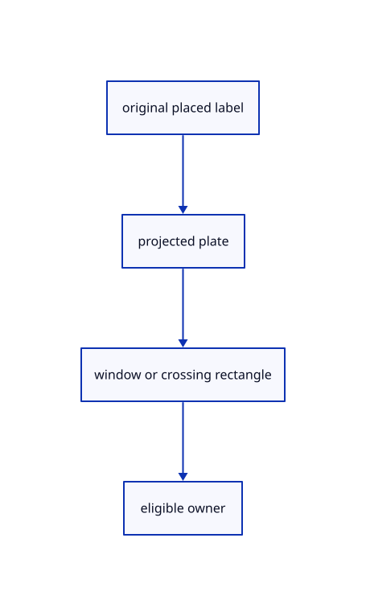

# 10.3.6 · Select a label through its projected plate

**Chapter 10 · Text and labels · Section 10.3 · Original scene labels** · [Contents](contents.md)

**Typing: 29–57 minutes.** [Estimate](typing-load.md).

Project plane corners and screen-sized/world-sized placements into CSS coordinates. A crossing rectangle fully inside a plate still intersects its owner.

## Type

Continue from [Include label owners in selection layers and history](62d-identity.md). [Save or recover your work](recovery.md).

### 1. `src/scene_label_screen.rs`

Project source-owned plate extents for rectangle selection.

Create the file and type:

```rust
--8<-- "journey/code/62e-rectangles-01.rs"
```

### 2. `src/lib.rs`

Register the source component.

<details>
<summary>Locate the existing block</summary>

```rust

pub mod scene_label;
```

</details>

After that block, type:

```rust
--8<-- "journey/code/62e-rectangles-02.rs" skip=22
```

### 3. `src/rect_select.rs`

Include only eligible original label owners in rectangle results.

<details>
<summary>Locate the existing block</summary>

```rust
    for row in scene.paths().iter().filter(|row|eligible(row.id)) {if matches(matrix,size,rectangle,vec![row.points().into_iter().map(|point|[point[0],point[1],point[2]]).collect()]) {found.push(row.id);}}
    for row in scene.points().iter().filter(|row|eligible(row.id)) {let point=row.point();if matches(matrix,size,rectangle,vec![vec![[point[0],point[1],point[2]]]]) {found.push(row.id);}}
    found.sort_unstable_by_key(|id|id.value());found.dedup();found
}
```

</details>

Edit the existing block to match this code; keep unchanged lines:

```rust
--8<-- "journey/code/62e-rectangles-03.rs"
```

## Run and check

Run this from `session_viewer` to select the fixed dependency versions and install supplied binary assets. It updates Cargo.lock and preserves the previous lock. It does not write implementation code:

```sh
npm --prefix ../session_tests run course -- dependencies 10.3.6
```

In your project:

```sh
cd workspace/journey
REGEN_PROTO=0 cargo build --lib --locked --target wasm32-unknown-unknown -j1
REGEN_PROTO=0 CARGO_BUILD_JOBS=1 trunk serve --port 8780
```

Open `http://127.0.0.1:8780/`. Keep an existing Trunk server running; saving rebuilds it.


### Recorded visual result

**Previous native render — current verification pending.**

The CAD bore and real-font screen specimen remain visible; this preparation adds no interactive scene-text example yet.


*This recorded image predates a source or checker change. Rebuild this checkpoint before using it as current evidence; browser controls require separate acceptance.*

This reference image is shared with [10.2.5 · Draw the specimen and prove real coverage reuse](61d-glyphs.md). It does not demonstrate a new feature by itself.

<details>
<summary>Code explanation and diagram</summary>


original placed label → projected plate → window or crossing rectangle → eligible owner.



Does a crossing rectangle need to cross a plate boundary?

No. It also intersects when wholly inside the plate. A window requires every projected corner to fit. Hidden and locked rows remain ineligible.

Study estimate, including typing and experiments: 0.5–1 hours.

</details>

<details>
<summary>Optional experiment</summary>

Compare a small crossing rectangle inside a plate with the same rectangle drawn left to right. The crossing selects; the small window does not contain the whole plate.

</details>

<details>
<summary>Check and save your work</summary>

Restore experimental edits, then run from `session_viewer`:

```sh
npm --prefix ../session_tests run course -- check 10.3.6
npm --prefix ../session_tests run course -- save 10.3.6
```

Source comparison leaves your project untouched. [Save and recovery instructions](recovery.md).

</details>

<details>
<summary>Viewer coverage and verification</summary>


The earlier glyph browser contract remains authored and unrun. Scene-label browser acceptance connects at the end of 62; native software rendering is not Lenovo timing.

[Full validation scope](release.md).

To reproduce the scripted acceptance of the reference checkpoint, run from `session_viewer` with the [course bundle server](release.md#reproduce) running on port 8781:

```sh
npm --prefix ../session_tests run course -- capture 10.3.6
```

This uses the verified reference bundle; it does not check or change your typed project.

</details>
