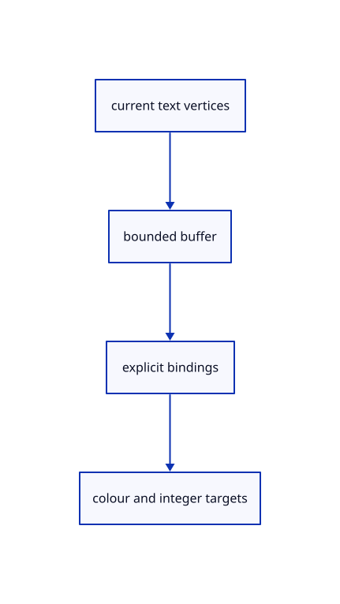

# 10.3.7 · Supply the text buffer and target adapters

**Chapter 10 · Text and labels · Section 10.3 · Original scene labels** · [Contents](contents.md)

**Typing: 25–50 minutes.** [Estimate](typing-load.md).

Keep bounded vertex uploads, explicit target formats, texture bindings and exact allocated buffer sizes compatible with current text code.

## Type

Continue from [Select a label through its projected plate](62e-rectangles.md). [Save or recover your work](recovery.md).

### 1. `src/text_gpu_support.rs`

Adapt current text buffers and bindings to this cumulative renderer.

Create the file and type:

```rust
--8<-- "journey/code/62f-gpu-support-01.rs"
```

### 2. `src/lib.rs`

Register the source component.

<details>
<summary>Locate the existing block</summary>

```rust

pub mod scene_label_screen;
```

</details>

After that block, type:

```rust
--8<-- "journey/code/62f-gpu-support-02.rs" skip=29
```

## Run and check

Run this from `session_viewer` to select the fixed dependency versions and install supplied binary assets. It updates Cargo.lock and preserves the previous lock. It does not write implementation code:

```sh
npm --prefix ../session_tests run course -- dependencies 10.3.7
```

In your project:

```sh
cd workspace/journey
REGEN_PROTO=0 cargo build --lib --locked --target wasm32-unknown-unknown -j1
REGEN_PROTO=0 CARGO_BUILD_JOBS=1 trunk serve --port 8780
```

Open `http://127.0.0.1:8780/`. Keep an existing Trunk server running; saving rebuilds it.


### Recorded visual result

**Previous native render — current verification pending.**

The CAD bore and real-font screen specimen remain visible; this preparation adds no interactive scene-text example yet.


*This recorded image predates a source or checker change. Rebuild this checkpoint before using it as current evidence; browser controls require separate acceptance.*

This reference image is shared with [10.2.5 · Draw the specimen and prove real coverage reuse](61d-glyphs.md). It does not demonstrate a new feature by itself.

<details>
<summary>Code explanation and diagram</summary>


current text vertices → bounded buffer → explicit bindings → colour and integer targets.



Are used vertex bytes the same as reserved GPU bytes?

No. Buffers reserve capacity and draw only their live vertex count. Report the actual allocation separately, and release both the count and the allocation on cleanup.

Study estimate, including typing and experiments: 0.5–1 hours.

</details>

<details>
<summary>Optional experiment</summary>

Check the 40-byte plate and 64-byte plane vertex strides against their shader layouts. Inspect the integer target and the 80-byte pick-transform binding.

</details>

<details>
<summary>Check and save your work</summary>

Restore experimental edits, then run from `session_viewer`:

```sh
npm --prefix ../session_tests run course -- check 10.3.7
npm --prefix ../session_tests run course -- save 10.3.7
```

Source comparison leaves your project untouched. [Save and recovery instructions](recovery.md).

</details>

<details>
<summary>Viewer coverage and verification</summary>


The earlier glyph browser contract remains authored and unrun. Scene-label browser acceptance connects at the end of 62; native software rendering is not Lenovo timing.

[Full validation scope](release.md).

To reproduce the scripted acceptance of the reference checkpoint, run from `session_viewer` with the [course bundle server](release.md#reproduce) running on port 8781:

```sh
npm --prefix ../session_tests run course -- capture 10.3.7
```

This uses the verified reference bundle; it does not check or change your typed project.

</details>
