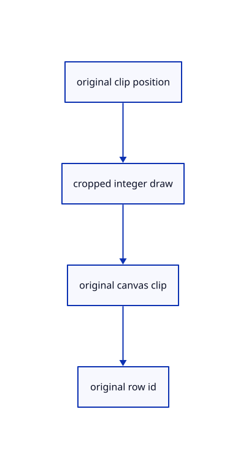

# 10.3.8 · Keep plane clipping correct in a small pick window

**Chapter 10 · Text and labels · Section 10.3 · Original scene labels** · [Contents](contents.md)

**Typing: 28–56 minutes.** [Estimate](typing-load.md).

Carry original homogeneous clip coordinates through the colour and integer shaders. Test the CSS clip in original canvas coordinates after applying a pick crop.

## Type

Continue from [Supply the text buffer and target adapters](62f-gpu-support.md). [Save or recover your work](recovery.md).

### 1. `src/text_plane.wgsl`

Keep original clip coordinates through the bounded pick crop and shade actual rounded coverage.

Create the file and type:

```wgsl
--8<-- "journey/code/62g-plane-shader-01.rs"
```

## Run and check

Run this from `session_viewer` to select the fixed dependency versions and install supplied binary assets. It updates Cargo.lock and preserves the previous lock. It does not write implementation code:

```sh
npm --prefix ../session_tests run course -- dependencies 10.3.8
```

In your project:

```sh
cd workspace/journey
REGEN_PROTO=0 cargo build --lib --locked --target wasm32-unknown-unknown -j1
REGEN_PROTO=0 CARGO_BUILD_JOBS=1 trunk serve --port 8780
```

Open `http://127.0.0.1:8780/`. Keep an existing Trunk server running; saving rebuilds it.


### Recorded visual result

**Previous native render — current verification pending.**

The CAD bore and real-font screen specimen remain visible; this preparation adds no interactive scene-text example yet.


*This recorded image predates a source or checker change. Rebuild this checkpoint before using it as current evidence; browser controls require separate acceptance.*

This reference image is shared with [10.2.5 · Draw the specimen and prove real coverage reuse](61d-glyphs.md). It does not demonstrate a new feature by itself.

<details>
<summary>Code explanation and diagram</summary>


original clip position → cropped integer draw → original canvas clip → original row id.



Can a cropped pick image use its local pixel coordinates as canvas coordinates?

No. Its origin and size differ. Retain the original clip position so colour and integer draws apply the same label clip after perspective division.

Study estimate, including typing and experiments: 0.5–1 hours.

</details>

<details>
<summary>Optional experiment</summary>

Compare the main image and a 13-pixel pick window over a clipped label. Pixels outside its CSS clip cannot draw or acquire its original row ID.

</details>

<details>
<summary>Check and save your work</summary>

Restore experimental edits, then run from `session_viewer`:

```sh
npm --prefix ../session_tests run course -- check 10.3.8
npm --prefix ../session_tests run course -- save 10.3.8
```

Source comparison leaves your project untouched. [Save and recovery instructions](recovery.md).

</details>

<details>
<summary>Viewer coverage and verification</summary>


The earlier glyph browser contract remains authored and unrun. Scene-label browser acceptance connects at the end of 62; native software rendering is not Lenovo timing.

[Full validation scope](release.md).

To reproduce the scripted acceptance of the reference checkpoint, run from `session_viewer` with the [course bundle server](release.md#reproduce) running on port 8781:

```sh
npm --prefix ../session_tests run course -- capture 10.3.8
```

This uses the verified reference bundle; it does not check or change your typed project.

</details>
