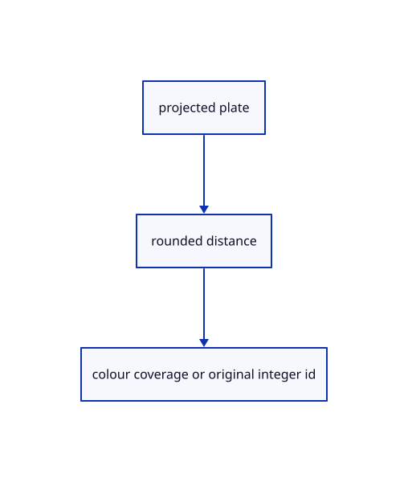

# 10.3.9 · Draw the current rounded nameplate and its original ID

**Chapter 10 · Text and labels · Section 10.3 · Original scene labels** · [Contents](contents.md)

**Typing: 21–41 minutes.** [Estimate](typing-load.md).

Use the same rounded plate distance for colour coverage and integer ownership. Black plates use white source ink; selected plates use yellow with black ink.

## Type

Continue from [Keep plane clipping correct in a small pick window](62g-plane-shader.md). [Save or recover your work](recovery.md).

### 1. `src/text_plate.wgsl`

Shade current rounded plates and preserve integer coverage ownership.

Create the file and type:

```wgsl
--8<-- "journey/code/62h-plate-shader-01.rs"
```

## Run and check

Run this from `session_viewer` to select the fixed dependency versions and install supplied binary assets. It updates Cargo.lock and preserves the previous lock. It does not write implementation code:

```sh
npm --prefix ../session_tests run course -- dependencies 10.3.9
```

In your project:

```sh
cd workspace/journey
REGEN_PROTO=0 cargo build --lib --locked --target wasm32-unknown-unknown -j1
REGEN_PROTO=0 CARGO_BUILD_JOBS=1 trunk serve --port 8780
```

Open `http://127.0.0.1:8780/`. Keep an existing Trunk server running; saving rebuilds it.


### Recorded visual result

**Previous native render — current verification pending.**

The CAD bore and real-font screen specimen remain visible; this preparation adds no interactive scene-text example yet.


*This recorded image predates a source or checker change. Rebuild this checkpoint before using it as current evidence; browser controls require separate acceptance.*

This reference image is shared with [10.2.5 · Draw the specimen and prove real coverage reuse](61d-glyphs.md). It does not demonstrate a new feature by itself.

<details>
<summary>Code explanation and diagram</summary>


projected plate → rounded distance → colour coverage or original integer id.



Should transparent rounded corners acquire the text owner?

No. The integer pass discards fragments outside the rounded plate. A locked plate writes the zero address where it occludes, while visible unlocked text keeps its original row ID.

Study estimate, including typing and experiments: 0.5–1 hours.

</details>

<details>
<summary>Optional experiment</summary>

Inspect the rounded corners in colour and the integer pass. Compare the selected plate with original source color and verify selection never rewrites source words.

</details>

<details>
<summary>Check and save your work</summary>

Restore experimental edits, then run from `session_viewer`:

```sh
npm --prefix ../session_tests run course -- check 10.3.9
npm --prefix ../session_tests run course -- save 10.3.9
```

Source comparison leaves your project untouched. [Save and recovery instructions](recovery.md).

</details>

<details>
<summary>Viewer coverage and verification</summary>


The earlier glyph browser contract remains authored and unrun. Scene-label browser acceptance connects at the end of 62; native software rendering is not Lenovo timing.

[Full validation scope](release.md).

To reproduce the scripted acceptance of the reference checkpoint, run from `session_viewer` with the [course bundle server](release.md#reproduce) running on port 8781:

```sh
npm --prefix ../session_tests run course -- capture 10.3.9
```

This uses the verified reference bundle; it does not check or change your typed project.

</details>
