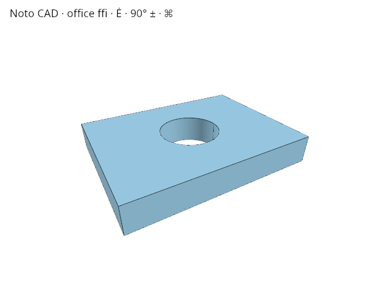

# 10.3.14 · Own and release nameplate draw resources

**Chapter 10 · Text and labels · Section 10.3 · Original scene labels** · [Contents](contents.md)

**Typing: 17–34 minutes.** [Estimate](typing-load.md).

Construct the buffers and pipelines once, draw physical and overlay plates in their declared phases, and reset logical vertex counts independently of capacity.

## Type

Continue from [Build nameplate color and object-ID pipelines](62ic-build-nameplate-color-and-object-id-pipelines.md). [Save or recover your work](recovery.md).

### 1. `src/text_plate.rs`

Add this part of own and release nameplate draw resources.

<details>
<summary>Locate the existing block</summary>

```rust
    }
}
```

</details>

After that block, type:

```rust
--8<-- "journey/code/62id-own-and-release-nameplate-draw-resources-01.rs" skip=8
```

## Run and check

Run this from `session_viewer` to select the fixed dependency versions and install supplied binary assets. It updates Cargo.lock and preserves the previous lock. It does not write implementation code:

```sh
npm --prefix ../session_tests run course -- dependencies 10.3.14
```

In your project:

```sh
cd workspace/journey
REGEN_PROTO=0 cargo build --lib --locked --target wasm32-unknown-unknown -j1
REGEN_PROTO=0 CARGO_BUILD_JOBS=1 trunk serve --port 8780
```

Open `http://127.0.0.1:8780/`. Keep an existing Trunk server running; saving rebuilds it.

Nameplate resources can reset their draw counts and release their owner separately. The browser frame connection follows in [62j](62j-frame-pass.md).

### Recorded visual result

**Previous native render — current verification pending.**

The CAD bore and real-font screen specimen remain visible; this preparation adds no interactive scene-text example yet.



*This recorded image predates a source or checker change. Rebuild this checkpoint before using it as current evidence; browser controls require separate acceptance.*

This reference image is shared with [10.3.10 · Keep CSS pixels separate from framebuffer pixels](62i-coverage.md). It does not demonstrate a new feature by itself.

<details>
<summary>Code explanation and diagram</summary>


own and release nameplate draw resources.


Does resetting a draw count release its GPU buffer?

No. A zero logical count suppresses drawing while retaining capacity. Releasing the owner drops its resources.

Study estimate, including typing and experiments: 0.5–1 hours.

</details>

<details>
<summary>Optional experiment</summary>

Follow reset and release separately. Predict which resource capacities remain after resetting only the draw count.

</details>

<details>
<summary>Check and save your work</summary>

Restore experimental edits, then run from `session_viewer`:

```sh
npm --prefix ../session_tests run course -- check 10.3.14
npm --prefix ../session_tests run course -- save 10.3.14
```

Source comparison leaves your project untouched. [Save and recovery instructions](recovery.md).

</details>

<details>
<summary>Viewer coverage and verification</summary>

Plates reset, release and retarget have different resource-lifetime effects.

Compile the added own and release nameplate draw resources code for WebAssembly; compare the declared preparation frame.

Preparation: the original browser glyph reference remains unchanged. The completed text lane connects at 62j.

[Full validation scope](release.md).

To reproduce the scripted acceptance of the reference checkpoint, run from `session_viewer` with the [course bundle server](release.md#reproduce) running on port 8781:

```sh
npm --prefix ../session_tests run course -- capture 10.3.14
```

This uses the verified reference bundle; it does not check or change your typed project.

</details>
